# 地球磁层的形成与演化：48张图逐图研究

第五版 · 新手友好版 · 全球混合模拟 ear-Reynolds-S · 2026-11-05

## 0. 本版主要发现与阅读方式

这份报告以本地两个二维切面为证据，逐张解释目录中的全部48张图。每张图分别交代读法、可测特征、物理解释和结论边界。图号F01–F48贯穿全文；后九张教材拼图单独研究，避免把示意图当作定量验证。

**本次新增的实质性结果。**

1. **日侧边界尺度稳健，但非严格稳态。** 晚期MP约11.5–11.7 Rₑ、BS约14.1–14.2 Rₑ；更换BS密度门槛后均值相差约0.13 Rₑ。
2. **压力各向异性影响动量比较。** 磁鞘标量压力代理约1.16 nPa，改用离子法向压力张量和磁张力后约1.25 nPa，更接近上游1.31 nPa；电子压力及多维收支仍未闭合。
3. **DF的密度下降不稳健。** 原14条记录中只有6条在t≥100；晚期子集的密度后/前比由全样本的约0.82变为约1.03。Bz跃升与高速流仍在，不能把低密度气泡推广到全时段。
4. **近地高速流减少对门槛较稳健。** 超过400 km/s的占比由−22 Rₑ处约37%降至−18 Rₑ处约9%、−16 Rₑ处为0；仍需分开真正减速与通道偏转。
5. **多项机制保持候选地位。** 磁镜/KHI/FTE、三维磁通绳和完整Dungey循环尚未被独立识别。报告对这些解释给出具体的下一步判别量。

**第五版新增（面向转专业新生）。**

- **新手导读**（紧接本节）：30秒磁层故事、坐标单位、读色图的五个习惯、七类图的读法、物理量速查与术语表。
- **🔰 新手读图**：每张图下方先用五步说明“回答什么问题、坐标颜色、看哪几处、说明什么、容易误读什么”，再进入原有的四段专业分析。
- **磁场重联专题（重做）**：理论示意与数据分开。先沿 Bx=0 电流片中心定位 Bz 反转，再独立按双向喷流筛选，最后检验 By。选中 28 帧中 21 帧四象限符号相符，全部 90 帧候选中为 27 帧。清晰单帧与同色标条件平均支持局地霍尔特征，但不证明所有时刻都有完整四极，也不证明电子扩散区。

**怎样读。** 初次阅读先看F03、F04建立区域概念，再看F05、F06与F24的时序；研究日侧从F07–F12进入，研究侧翼从F17–F23进入，研究磁尾从F26–F34进入。完整网页中的图片可双击放大；图内历史标题若比实际证据更强，以紧邻图的分析为准。

**仓库版本。** 本仓库保留报告文字、自绘定量图和讲稿；九张含第三方教材截图的拼图、完整 PPT、视频及大型 HTML 不入库。相关条目保留文献出处，见[组会讲稿](slides/script.md)；完整阅读入口见仓库 README。

在线动画：[赤道面MP4](http://zsyq.hxlab.tech:7654/view/magnetosphere-hybrid-v10/media/magnetosphere_eq.mp4) · [子午面MP4](http://zsyq.hxlab.tech:7654/view/magnetosphere-hybrid-v10/media/magnetosphere_mer.mp4)。视频未随 Git 分发。

## 新手导读：先学会看图，再看物理

> 这一章写给刚转入空间物理的读者。读完这一章（约20分钟），后面每一张图上方都有一个 **🔰 新手读图** 小框，按“问题 → 坐标与颜色 → 看哪里 → 说明什么 → 别误读”五步带你读图；框后面的四段是给熟悉领域的读者看的研究级分析，第一次读可以先跳过。配套讲稿见 [组会讲稿网页](slides/script.md)。

### A. 三十秒看懂“磁层”是什么

想象把一块条形磁铁（地球偶极磁场）放进一条一直吹向它的“风”里。这股风就是 **太阳风**：从太阳不断吹出的电离气体（等离子体），每立方厘米只有几个质子，却以约 400 km/s 的速度飞行，并且携带着太阳的磁场（**行星际磁场，IMF**）。

1. 太阳风比该介质里信息传播的最快速度还快，好比超音速飞机，在地球前方约 14 个地球半径（Rₑ）处形成一道**弓激波**——就像船头推开的 V 形水波。
2. 穿过激波后，太阳风被减速、压缩、加热，形成夹在中间的一层**磁鞘**。
3. 再往里约 11.6 Rₑ 处，太阳风的“推力”与地磁场的“顶力”刚好打平，这条分界面叫**磁层顶**。磁层顶以内由地球磁场主导，这个“空腔”就是**磁层**。
4. 夜侧的磁层被风拉成一条长长的“风向袋”——**磁尾**。磁尾上下两半是磁场很强、几乎没有粒子的**尾瓣**，中间夹着一层又热又相对密的**等离子体片**。
5. 当太阳风磁场朝南（本模拟 Bz≈−4 nT）时，它在日侧与朝北的地磁场方向相反，二者可以“剪断再接上”——这就是**磁场重联**。日侧重联把地磁力线“打开”、被太阳风拖到夜侧；磁尾再发生一次重联把它们“关上”、送回地球。这个循环叫 **Dungey 循环**，是整个磁层运动的发动机。

全报告就是在模拟数据里逐一找到这五件事，并检查它们是否与经典理论、观测和教材一致。建议先对照 F03（标注好的结构图）把这五个名字和位置记住。

### B. 坐标、方向与单位：先把“尺子”认清

| 你会在图上看到 | 含义 | 新手记法 |
|---|---|---|
| x 轴 | 指向太阳为正；**图中太阳总在右边**，太阳风从右往左吹 | 右=白天（日侧），左=夜里（磁尾） |
| z 轴 | 指向北 | 子午面图的上=北半球，下=南半球 |
| y 轴 | 本文约定 y>0 为昏侧（傍晚一侧），y<0 为晨侧 | 赤道面图是“从北极往下俯视” |
| 赤道面 z=0 | 横着切地球的一刀（x–y 平面） | 看侧翼涡旋、磁尾横向结构 |
| 子午面 y=0 | 竖着、包含日地连线切一刀（x–z 平面） | 看激波、极尖、尾瓣、X 线 |
| Rₑ | 地球半径 6371 km | 10 Rₑ ≈ 6.4 万公里；月球约在 60 Rₑ |
| 灰色圆盘 | 半径 3 Rₑ 的内边界，模拟不计算里面 | 灰盘里的颜色没有物理意义 |
| t 或 τ | 代码时间单位，1 个单位约 15.7 s | t=100 ≈ 26 分钟；全程 188.7 ≈ 49 分钟 |
| N（cm⁻³） | 离子数密度 | 太阳风约 4；空气约 2.5×10¹⁹，所以太阳风极其稀薄 |
| B（nT） | 磁场，1 nT = 10⁻⁹ T | 地面地磁场约 3–5 万 nT；太阳风约 5 nT |
| V（km/s） | 离子整体流速 | 太阳风约 440；磁尾高速流几百 |
| T（eV） | 温度，1 eV ≈ 1.16 万 K | 太阳风约 7 eV；等离子体片几百 eV |
| P（nPa） | 压强，1 nPa = 10⁻⁹ Pa | 太阳风动压约 1.3 nPa，只有大气压的约 10⁻¹⁴ |

**时间单位的提醒。** 旧图上写的 Ωi⁻¹（离子回旋时间）只是绘图沿用的标签；为节省计算，模拟把离子尺度放大了约 6 倍，所以“一个时间单位”不能当作真实太阳风里的一个离子回旋周期。读图时只需记住 1 单位 ≈ 15.7 s。

### C. 读彩色图的五个习惯

1. **先看色标，再看图。** 色标告诉你物理量、单位和上下限。超出上下限的地方会被“截断”成最深的颜色，所以“最红”只说明“至少这么大”。
2. **分清两种色标。**
   - *顺序色标*（如密度、温度，从暗到亮）：常用**对数**刻度，每升一档往往是“乘以 10”而不是“加 10”。颜色差一档可能意味着数值差十倍。
   - *发散色标*（红—白—蓝）：用于有正负号的量。**白=0，红=正，蓝=负**，颜色越深绝对值越大。正方向跟着坐标走：Vx 红=朝太阳（在磁尾即“向地球”），Vx 蓝=背离太阳；Bz 红=朝北，蓝=朝南。
3. **黑线不是同一种东西。**
   - *磁力线*（大多数子午面图）：线的切线方向就是该处磁场在这个平面内的方向。它是三维磁力线在平面上的“投影近似”，线的疏密由画图时选的起点决定，**不代表磁场强弱**；两条线“看起来接上了”也不等于三维上真的连通。
   - *流线*（速度图）：某一瞬间的流动方向，不是某个粒子走过的轨迹。
4. **灰盘、白边、黑色块要排除。** 灰盘是内边界；图边缘和接近黑色的区域可能只是色标下限或稀薄区，统计意义很弱。
5. **问自己：这是一瞬间，还是平均，还是统计？** 快照只代表一个时刻；时间平均会把来回摆动的结构“抹平”；统计图（直方图、散点图）展示的是“很多时刻、很多位置”的分布。三者能回答的问题不同。

### D. 报告里反复出现的七种图

| 图型 | 长什么样 | 怎么读 | 例子 |
|---|---|---|---|
| 多面板快照 | 若干张同一时刻、不同物理量的彩色图 | 同一位置上下对照：密度跳、磁场转、速度变，往往是同一个边界 | F03、F04、F26 |
| 时间序列面板 | 行=物理量，列=时刻 | 先横着看一行随时间变化，再竖着看同一时刻各量的关系 | F01、F02 |
| x–t 图（keogram） | 横轴时间、纵轴沿一条线的位置、颜色=物理量 | 一条斜着的颜色带=某结构在移动，斜率就是速度；水平带=位置不变的边界 | F05、F06、F24 |
| 剖面图 | 沿一条线画的曲线 | 找跳变（激波、磁层顶）和平台（均匀区） | F07、F09 |
| 时间曲线/探针 | “虚拟卫星”在固定点测到的值随时间变化 | 像卫星数据：看突变、周期和正负双峰 | F16、F21 |
| 统计图 | 直方图、散点、二维分布（如 Brazil 图） | 看点云集中在哪里、是否越过理论曲线 | F11、F32、F34 |
| 叠加时序 | 把很多事件按发生时刻对齐后取平均 | 零时刻前后的“共同形状”才是事件本身的特征 | F33 |

教材对照图（F37–F45）是“左边教材原图、右边本模拟”的拼图：教材图多是示意或某次卫星观测，右边是模拟的定量图，二者能比较的是**形态和机制**，不能逐个数值对比。

### E. 物理量速查：每个量“想告诉你什么”

| 符号 | 名称 | 想告诉你什么 |
|---|---|---|
| N | 密度 | 哪里是太阳风/磁鞘（密），哪里是尾瓣（极稀） |
| Bx, By, Bz | 磁场三个分量 | Bz 变号常标志磁层顶或 X 线；尾瓣里 Bx 北正南负 |
| Vx, Vy, Vz | 流速分量 | 哪里在被推动、哪里有喷流和回流 |
| T, T∥, T⊥ | 温度及平行/垂直于磁场的温度 | 哪里被加热；T⊥≠T∥ 说明粒子“偏科”，可能激发不稳定性 |
| β | 热压/磁压 | β≫1 粒子说了算（等离子体片），β≪1 磁场说了算（尾瓣） |
| Pdyn = ρV² | 动压 | 太阳风“撞”过来的力度 |
| J | 电流密度 | 电流片位置：磁层顶、磁尾中心 |
| E | 电场 | 在磁层里，E≈−V×B，可理解为“磁力线被搬运的速度” |
| MA | 阿尔芬马赫数=流速/阿尔芬速度 | 大于 1 才会有激波；本模拟约 10，是强激波 |

### F. 术语表（按出场顺序）

| 术语 | 一句话解释 | 类比 | 主要看 |
|---|---|---|---|
| 等离子体 | 电离的气体，带电粒子随磁场运动 | “导电的稀薄气体” | 全文 |
| 冻结 | 理想等离子体里，流体和磁力线一起运动 | 磁力线像粘在流体上的线 | 专题章 |
| 太阳风 / IMF | 太阳吹出的超高速等离子体及其携带的磁场 | 带着磁场的风 | F05（上游太阳风区） |
| 弓激波 | 超快太阳风被阻挡形成的突变面：密度、温度、磁场骤增 | 船头波、超音速飞机音爆 | F09、F10 |
| 准垂直/准平行激波 | 激波法向与磁场夹角大于/小于约 45° | 准平行处粒子能沿磁力线“逃”回上游，激波更“毛躁” | F10 |
| 磁鞘 | 激波与磁层顶之间被减速、加热的太阳风 | 车头前被挤压的空气 | F12 |
| 磁层顶 | 太阳风压力与地磁压力平衡的边界，带有电流 | 两股力量“掰手腕”的分界线 | F07、F08 |
| 极尖区 | 高纬磁层顶上的“漏斗”，磁鞘粒子可直接进入 | 磁场“发旋” | F02、F13 |
| 尾瓣 | 磁尾上下两半：磁场强、粒子极少 | 拉长的“风向袋”两层布 | F28 |
| 等离子体片 / 电流片 | 两尾瓣之间热而较密的薄层，中心有横跨磁尾的电流 | 两块反向磁铁中间的“夹心” | F04、F26 |
| 磁场重联 | 反向磁力线在薄电流片中断开并重新连接，磁能转为动能和热能 | 两根反向拉紧的橡皮筋被剪断、交叉接好后弹射 | 专题章、F34 |
| X 线 | 重联发生处，平面图上磁力线呈 X 形 | 剪刀的交叉点 | F26、F47 |
| 离子/电子扩散区 | X 线附近离子/电子不再随磁力线运动的区域，尺度分别约 dᵢ、dₑ | 大圈套小圈 | 专题章 |
| 霍尔效应 / 霍尔四极场 | 离子先“脱钩”、电子仍随场走，产生电流环和四瓣 By | 四叶草形的 ⊙⊗ | F46–F48 |
| 等离子团（plasmoid）/ 磁通绳 | 重联形成的闭合磁环或扭绞磁管，被喷出 | 吹出去的“磁泡泡” | F27 |
| BBF | 等离子体片中短时高速（>400 km/s）的向地流 | 磁尾里的“阵风” | F29、F32 |
| 偶极化锋面（DF） | 高速流前沿 Bz 陡增的界面 | 冲在最前面的“推土板” | F33 |
| FTE | 日侧多条 X 线之间形成的磁通绳，典型信号是法向磁场正负双峰 | 磁层顶上的“鼓包” | F14–F16 |
| KHI | 速度剪切面上起波、卷涡的不稳定性 | 风吹水面起浪 | F17–F20 |
| 温度各向异性 / Brazil 图 | T⊥/T∥ 与 β∥ 的分布及不稳定性阈值线 | 粒子“偏科”太厉害就会被波“纠正” | F11、F12 |
| 磁镜/火管/离子回旋不稳定性 | 各向异性过大时自发增长的波动 | 自动“限速器” | F11 |
| 雷诺应力 | 速度涨落相关 ρ⟨δVx δVy⟩，代表湍动带走的动量 | 搅动造成的“摩擦力” | F22、F23 |
| Dungey 循环 | 日侧开、尾部关、两侧回流的全球对流 | 磁力线的“传送带” | F35、F44 |
| 重联率 | 入流速度/阿尔芬速度，衡量重联“多快” | 剪刀每秒剪多少磁通 | F34、F45 |
| 混合模拟 | 离子当粒子、电子当无质量流体的数值方法 | 只“放大镜看离子” | 第1章 |

### G. 第一次阅读的建议路线

1. **建立地图**：F03 → F04 →（回到）F01、F02。
2. **日侧**：F05（x–t 图上边界什么时候稳定）→ F07（为什么停在 11.6 Rₑ）→ F09（激波满足守恒）→ F11/F12（各向异性）。
3. **磁尾与重联**：F24（磁尾一条线随时间）→ F26–F28（快照）→ F32–F34（统计）→ 专题章 F46–F48（中科大课题组采用的磁场重联标准图像及本模拟检验）。
4. **侧翼**：F17 → F20 → F22。
5. **最后**看 F37–F45 的教材对照与第9章综合。

每张图的研究级四段分析中，“问题与读法”和“限制与结论”两段对新手最有用：前者告诉你画了什么，后者告诉你**不能**据此说什么。

## 1. 数据、坐标、单位与证据口径

| 项目 | 定义与已核对内容 |
|---|---|
| 数据 | ear-Reynolds-S 本地缓存；本次未重新下载、未重跑模拟 |
| 切面 | 赤道面z=0与正午—子夜子午面y=0 |
| 坐标 | +x朝太阳；太阳风主要沿−x；采用y>0为昏侧、y<0为晨侧的原绘图约定 |
| 网格 | 原切面564×504；统一插值网格Δ=0.1 Rₑ，x∈[−45,22]、横向±30 Rₑ；插值不创造分辨率 |
| 上游晚期 | n≈4.01 cm⁻³、V≈440 km/s、Bz≈−4 nT、Ti≈6.96 eV、Pdyn≈1.30 nPa |
| 离子尺度参数 | VA≈43.6 km/s、MA≈10.1；仅计离子热压时快磁声马赫数约8.0 |
| 电子处理 | 混合模型按无质量电子流体解释；本地切面不含电子压力、完整电子闭合及粒子分布函数 |
| 内边界 | r=3 Rₑ，灰盘内不参与物理解释 |
| 时间窗口 | 主要平均t≥100：赤道面179帧、子午面90帧；谱用t≥60、DF筛选用t>40，另在图注说明 |
| 边界口径 | 鼻区时序MP用Bz变号，BS用N>2nsw；形状拟合的子午面MP另用密度峰30%判据 |

**时间单位重新澄清。** 本文以无量纲代码时间τ表示时间；为对应已有图，文字中的t即τ。图上旧符号Ωi⁻¹沿用历史绘图标注，不能自动当作真实太阳风的离子回旋时间。缓存核对得到

$$
u_t=\frac{u_L}{u_V}=15.685\ {\rm s},\qquad
\Omega_{ci,\rm ref}=\frac{e(4\ {\rm nT})}{m_p}\simeq0.383\ {\rm s}^{-1},\qquad
\Omega_{ci,\rm ref}u_t\simeq6.009.
$$

因此，τ=188.736对应约49.3分钟的该套宏观单位映射，而不是188.736个真实上游Ωci⁻¹。约6倍离子尺度放大与此相容，但仍需原始模型方程才能确认所有动理学缩放。赤道面Δτ≈0.5、子午面≈1，对应Nyquist频率分别为每单位τ的1周和0.5周；不能混用频率与角频率。

**图中线条和颜色。** 速度流线、固定切面内磁场积分曲线和真实三维磁力线是不同对象；瞬时流线与时变粒子轨迹也不同。对数或对称对数色标、上下限截断、稀薄区温度矩，会影响视觉判断。各向异性阈值图的β∥与空间图的标量β不相同。

**证据分级。** 数字与图像直接读出的结果称为“测量/复算”；将它们与模型联系称为“相容解释”；波模主导、物质混合、三维拓扑或全球收支若缺少关键诊断，明确保留为“待检验”。数据来源与复核范围见第10章。

## 2. 从初始条件到磁层结构

### F01 · 赤道面八时刻演化

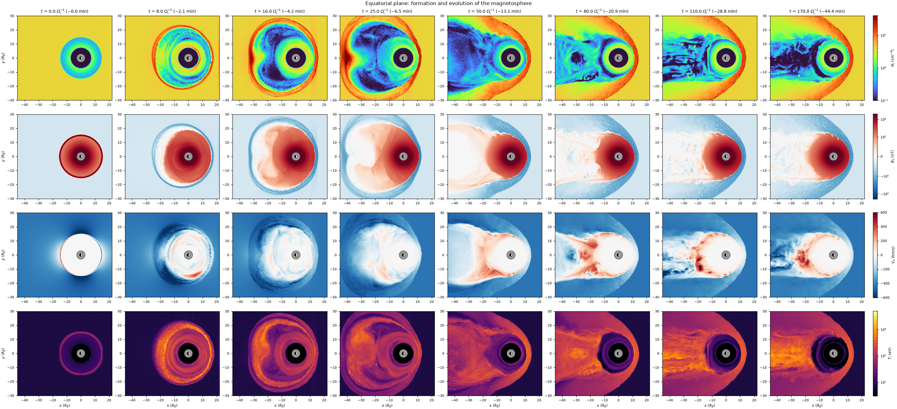

**🔰 新手读图**
1. **这张图在回答什么问题：** 太阳风吹到地球后，赤道面（从北极往下俯视的那一层）里的磁层是怎样从一个“圆球”一步步长成“蝌蚪形”的？
2. **先认坐标和颜色：** 每个小图横轴 x、纵轴 y，单位 Rₑ（地球半径）；中心灰盘是地球附近的内边界（r=3 Rₑ，不看）。太阳在右边，太阳风从右往左吹。8 列是 8 个时刻（t=0 到 170，括号里约合分钟）；4 行从上到下：密度 N、磁场 Bz、速度 Vx、离子温度 Ti。密度和温度是对数色标，每跨一大格刻度就是乘十；Vx 行红=朝太阳（朝右）流，蓝=背离太阳（朝左）流，越深越快；Bz 行红=朝北，蓝=朝南。
3. **按顺序看这几处：** ① 第一列：只有一个圆，这是人为放的初始磁层。② 第 2–4 列：一圈“壳”向外膨胀，这是启动过程。③ 第 5 列以后：右侧出现一道弧形的颜色突变（密度由黄变红）——这就是弓激波，它内侧的红色厚层是磁鞘。④ 第 6–8 列第三行左侧的红蓝斑块：磁尾里忽快忽慢、忽前忽后的流动。
4. **看到了什么，说明什么：** 太阳风像一条河冲向一块石头：石头前方水被挤高形成“船头波”（弓激波），水绕过石头后在下游拖出长长的尾迹（磁尾）。日侧鼻子形状后期变化不大，尾部却一直在“翻腾”，说明上游恒定不等于内部静止；尾部正负 Vx 与磁场重联（反向磁力线“剪断再接上”并把等离子体甩出去）相容。
5. **新手容易误读：** ① 8 个时刻不是等间隔，不能用相邻列的位移去估速度。② 单看赤道面 Bz 颜色还不能断定哪里在发生磁场重联；中心灰盘和极黑区域可能只是边界或色标下限，不是物理结构。

**问题与读法。** 四行依次是密度、Bz、Vx、离子标量温度，八列采用相同物理量的同一色标。先沿行比较时间，再在同一列联合比较不同物理量。太阳在右，太阳风向左；Vx 红色表示地向或向日，蓝色表示反日向。温度和密度为对数色标，颜色差不能线性解释。

**图中证据。** t=0 是圆形初始磁层，而非已经建立的磁尾；t=8–25 出现向外扩展的压缩壳与明显昼夜差别。t=50 的尾部主要是长条状流动；t=80 后，中心片中高速流、低密度空穴和横向细丝增多，而日侧鼻区的形状变化较小。初始壳层扩展与日侧后续压缩是两个阶段，不应合成一个单调压缩过程。

**物理联系。** 太阳风绕流使初始近球形结构变为昼侧钝头、夜侧拉长的腔体；密度跃升与加热共同支持激波形成。尾部 Vx 的正负变化与重联出流相容，但单看赤道面 Bz 颜色还不能确定 X 型磁连接。t=110 与 t=170 的尾部形态不同，也说明“上游恒定”并不意味着内部静止。

**限制与结论。** 八个时刻不是等间隔取样，不能用相邻列的视觉位移直接比较速度。灰盘内是内边界；其他近黑色区域还可能是色标下限。该图稳健展示了磁层形成和尾部间歇活动，应与 F05/F06 的 x–t 图及 F24 的时空图联合读，而不据此命名真实亚暴。

### F02 · 子午面八时刻演化

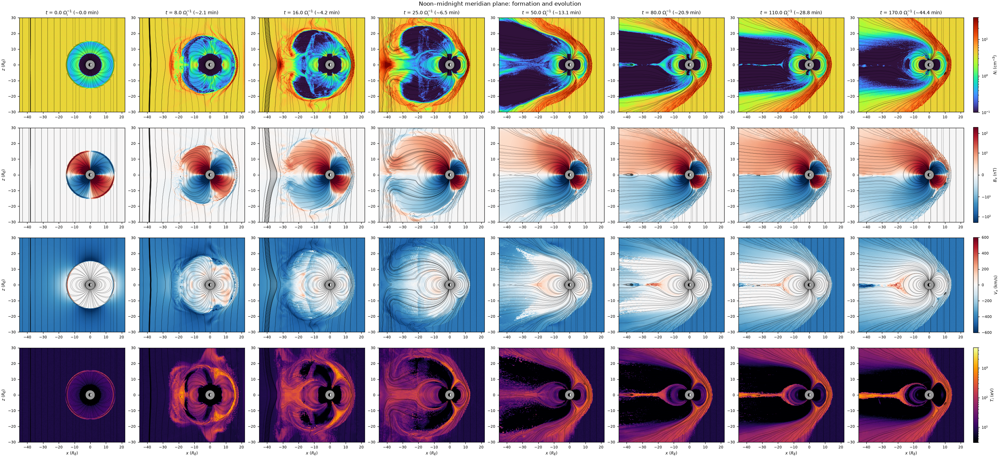

**🔰 新手读图**
1. **这张图在回答什么问题：** 从侧面（正午—子夜子午面，看得到南北）看，磁层怎样被拉出两条“尾巴”和中间一层热等离子体片？
2. **先认坐标和颜色：** 横轴 x（太阳在右），纵轴 z（上北下南），单位 Rₑ；8 列是时间，4 行是密度 N、磁场 Bx、速度 Vx、离子温度 Ti。注意第二行是 Bx（沿日地方向的磁场分量）：红=指向太阳，蓝=背离太阳，和 F01 的 Bz 含义不同。所有面板上的细黑线是“切面内磁场积分曲线”，可以粗略当磁力线的走向看。
3. **按顺序看这几处：** ① 第二行第一列：红蓝四瓣，是地球偶极磁场（像条形磁铁）的样子。② 后几列左侧：上半全红、下半全蓝——北尾瓣和南尾瓣的磁场方向正好相反。③ 第一、四行左侧中央的细亮带：夹在两个暗色尾瓣中间的薄等离子体片（密度稍高、温度很高）。④ 日侧高纬靠近地球的“凹口”：极尖区。
4. **看到了什么，说明什么：** 太阳风把地球磁场像风向袋一样向后拉长，形成上下两个尾瓣（lobe，空旷、磁场强）；两瓣磁场方向相反，中间必须夹一层电流片和热等离子体片来“隔开”它们。反向磁场贴在一起正是磁场重联最容易发生的地方。
5. **新手容易误读：** ① 黑线的疏密是画法（种子点）决定的，不代表磁场强弱。② 这些线只用了面内的 Bx、Bz，不一定是真实三维磁力线；黑线看起来“连上了”不能用来数有多少磁通被打开。

**问题与读法。** 四行是 N、Bx、Vx、Ti，所有面板还叠加固定切面内的磁场积分曲线。Bx 的红蓝表示沿 x 的场分量，不能与 F01 的 Bz 红蓝作同义解释。上下为北、南半球；黑线数量由种子点和积分方式决定，并不代表磁通密度。

**图中证据。** 初始偶极四象限 Bx 分布逐渐变为夜侧北瓣 Bx>0、南瓣 Bx<0 的反向磁场。t≈50 后，两片低密度尾瓣夹着较热、较密的薄等离子体片；t≈80、110、170 的中心线呈现不同地向和尾向流状态。日侧极尖凹陷从早期阶段就逐渐显现。

**物理联系。** 相反方向的尾瓣场需要跨尾电流片维持，其方向可用安培定律与 Jy 面板交叉检查。低密度、较强磁场的尾瓣与高温片层体现不同的压力支撑方式。南向 IMF 提供日侧磁通打开的条件，但“多少磁通已经打开”需要连接追踪，不能由黑线看似相连来计数。

**限制与结论。** 这里积分的是 y=0 面内的 Bx、Bz；只要 By 或离面梯度不可忽略，曲线一般就不是真实三维磁力线的投影。该图确认了尾瓣—片层的二维分区，并提供重联候选结构；无法单独确认三维等离子团和全球开放磁通。

### F03 · t≈150 的磁层解剖图

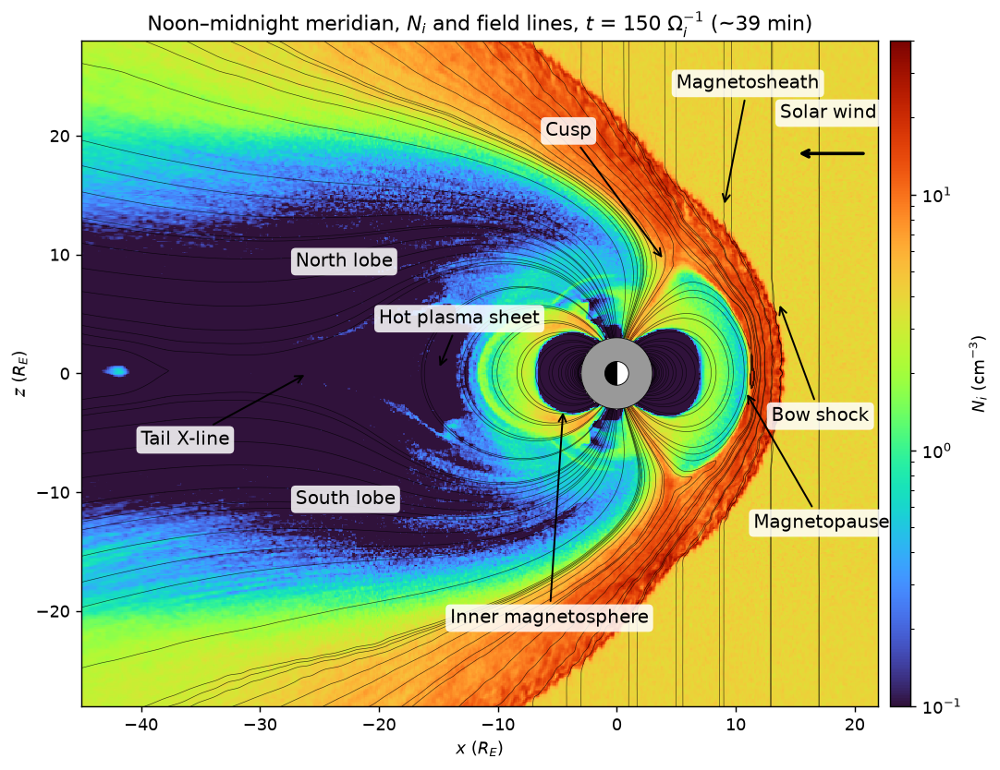

**🔰 新手读图**
1. **这张图在回答什么问题：** 磁层里各个“地名”在哪？——这是一张带标注的地图，专门给新读者建立区域概念。
2. **先认坐标和颜色：** 子午面，横轴 x（太阳在右，右上角黑箭头表示太阳风向左吹），纵轴 z（上北下南）；t=150。背景颜色是离子密度 N，对数色标：黄/红=稠密（每cm³ 十个量级），蓝紫=稀薄（0.1 左右），每深一档颜色大约差十倍。细黑线是切面内磁场曲线；白底文字和箭头是人工标注。
3. **按顺序看这几处：** ① 最右的黄色均匀区：未受扰的太阳风。② 向左第一道弧形颜色突变：Bow shock（弓激波，约 14 Rₑ）。③ 紧跟着的厚红色层：Magnetosheath（磁鞘，被激波压缩加热的太阳风）。④ 红层内侧边缘：Magnetopause（磁层顶，约 11.5 Rₑ）；再往里是地球磁场控制的区域：Cusp（极尖，高纬漏斗）、North/South lobe（尾瓣，深紫色空旷区）、Hot plasma sheet（中间热等离子体片）、Tail X-line（尾部磁场重联候选处）。
4. **看到了什么，说明什么：** 可以把磁层想成一艘逆流的船：船头前的浪是弓激波，浪与船身之间的乱流层是磁鞘，船身外壳是磁层顶（太阳风动压和地磁压力“掰手腕”打平的地方），船后拖出的两条长尾是尾瓣，中间的“龙骨”是等离子体片。
5. **新手容易误读：** ① “Tail X-line” 箭头是手工放的，大约指向 −26 Rₑ；同一时刻按 Bz 过零复算最靠地球的位置约 −30.6 Rₑ，二者不是同一次精确定位，只当示意。② 只看密度不能判断哪里“热”，“热等离子体片”要结合 F04 的温度图确认。

**问题与读法。** 这是密度背景加平面内场线的定位图。先辨认最外侧压缩边界、磁鞘和内侧腔体，再看尾瓣、极尖和中央片层。箭头是绘图时手工放置的结构指示，不是自动边界识别结果。

**图中证据。** 高密度磁鞘包围低密度腔体，两个尾瓣向左延伸，中央薄片可见局部密度增强。尾部标成“X-line”的箭头固定指向约 −26 Rₑ，然而本次在 t=150.007 的中心条带复算，最靠地球的平滑 Bz 过零代理约为 −30.6 Rₑ。这两个位置不能当作同一次精确定位。

**物理联系。** 密度结构说明太阳风等离子体被激波压缩并绕过磁层，但仅用 N 无法确定“热”等离子体片；后者需要 F04 的温度。磁层顶和弓激波同样要联合磁场、速度与压力，而不只是看颜色边界。

**限制与结论。** 图中 X-line 应理解为磁尾重联候选区的示意标注，不能用它验证 F34 的位置统计。解剖图的价值是建立坐标与区域概念；精确位置采用动态诊断。新读者应先读本图，再进入局部图，避免把磁鞘、低纬边界层和等离子体片混为一谈。

### F04 · t≈150 的六物理量子午面总览

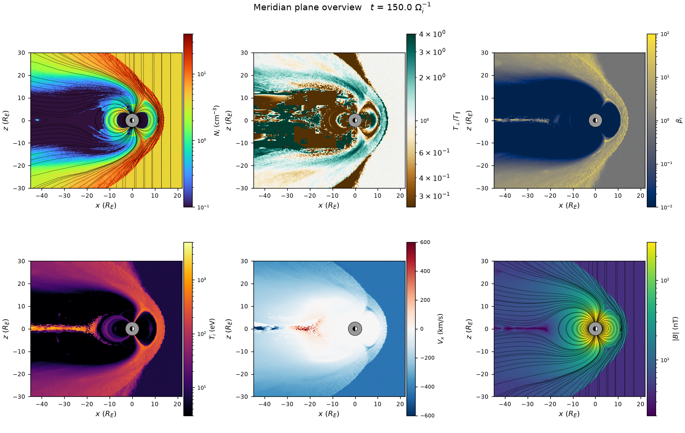

**🔰 新手读图**
1. **这张图在回答什么问题：** 同一时刻（t=150）同一子午面，六个物理量各自长什么样，合起来怎样区分磁层的不同区域？
2. **先认坐标和颜色：** 六个面板都是 x–z 子午面，太阳在右。上排：密度 N（对数）、温度各向异性 T⊥/T∥（垂直于磁场与平行于磁场方向温度之比，等于 1 为白色=各向同性，绿=垂直更热，棕=平行更热）、离子 β（热压÷磁压，深蓝=磁压占优，黄=热压占优）。下排：温度 Ti（对数）、速度 Vx（红=向太阳，蓝=背离）、磁场强度 |B|（黄=强，紫=弱，带黑色磁场曲线）。
3. **按顺序看这几处：** ① 尾瓣（左侧上下大片）：N 暗、Ti 黑、β 深蓝——稀、冷、磁场说了算。② 中间细带：Ti 亮黄、β 黄、|B| 紫——热、磁场弱、热压说了算，这就是等离子体片。③ Vx 面板约 x=−20 附近的红色小三角：流向地球的窄流。④ 日侧磁鞘：Ti 变橙、各向异性面板出现绿/棕色条带，说明过激波后被加热且加热不均匀。
4. **看到了什么，说明什么：** 磁层像一个“分工明确”的结构：尾瓣靠磁压撑着（像充满弹簧的空房间），等离子体片靠热压撑着（像一层热气垫）。β 就是判断“谁当家”的指标，β≪1 磁场当家，β≳1 热压当家。
5. **新手容易误读：** ① 各向异性面板里大片饱和棕色不代表“同一个温度比”，很多值超出色标或是稀薄区统计噪声。② 这里的 βi 只算离子，不是总 β；中心片 B 接近零时 β 会被放大，不要过度解读具体数值。

**问题与读法。** 上排是密度、温度各向异性和离子 β，下排是标量温度、Vx 和 |B|。先用 N 确定区域，再检查低 β 是否对应强磁场、高 β 是否对应热压增强。T⊥/T∥=1 才是各向同性，色标中点和白色区域需要结合刻度读取。

**图中证据。** 两个尾瓣同时低 N、低 β、低显示温度，并有较平直的尾向场；中央片层 |B| 较低、Ti 较高，存在窄地向流。日侧磁鞘在激波后加热，局部各向异性增强；极尖周围出现与低纬不同的形态。

**物理联系。** 这种组合支持尾瓣磁压主导、片层热压相对重要的分区。βi=pi/(B²/2μ₀) 只含离子，不能直接替代总等离子体 β。中心片中 B 接近零时，β 和场向温度分解会对磁场误差敏感；低密度区的温度矩也易受粒子统计影响。

**限制与结论。** 饱和棕色或深色不是“同一个温度比”的证据；有些值超出色标范围或受到数值截断。N 与 Ti 的联合证据比单独温度比更可靠。该图支撑磁层的多区物理分工，但没有给出各向异性不稳定性的波模识别。

## 3. 日侧边界、激波与磁鞘

### F05 · 赤道面日地线 x–t 图（全时段，拉长版）

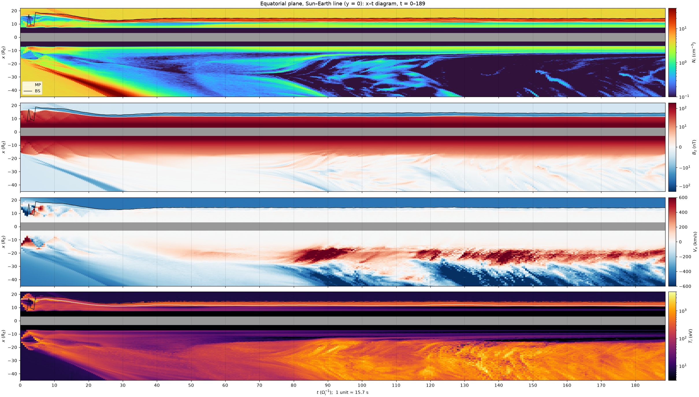

**🔰 新手读图**
1. **这张图在回答什么问题：** 整个模拟 t=0–189 期间，沿着日地连线（赤道面 y≈0 那一条线），各个位置随时间发生了什么？——把一条线上的“录像”压成一张图。
2. **先认坐标和颜色：** 这是“x–t 图”（也叫 keogram）：横轴是时间 t，纵轴是位置 x（上方 +x 朝太阳，下方是磁尾），中间灰色横带是地球内边界。四个面板从上到下：密度 N（对数）、Bz（对称对数色标，红北蓝南）、Vx（红=向太阳/向地球，蓝=背离）、温度 Ti（对数）。上部的白线=磁层顶 MP，黑线=弓激波 BS。
3. **按顺序看这几处：** ① 上半部（日侧）：t<30 白线、黑线向下（向地球）移动，说明磁层被太阳风压缩；t≳40 后几乎是水平线——边界稳定在 MP≈11.6、BS≈14.2 Rₑ。② 下半部早期（t<40）从 x≈−16 往左下延伸的斜带：启动时扫过的结构。③ Vx 面板 t≳80 后，x≈−20 附近反复出现的红色团块（向地球的快流），它下方同时有蓝色斜纹（向尾的流）。④ 温度面板同一位置变亮橙色：快流伴随加热。
4. **看到了什么，说明什么：** 读 x–t 图像看“站台时刻表”：水平带=东西停在原地，斜纹=东西在移动，斜得越陡走得越快（1 单位 dx/dt≈406 km/s）。尾部红蓝成对的流动，正像磁场重联点把等离子体一半甩向地球、一半甩向远尾。日侧安静、尾部热闹，是本模拟的核心对比。
5. **新手容易误读：** ① 斜纹斜率是“结构移动速度”，不等于颜色里读出的局地流速 Vx。② 这是在窄条带里平均的，窄通道左右扫过也会被误看成时间变化；报告中 300–500 km/s 只是估计范围，不是已测速度分布。③ 横轴被拉得很长，一个刻度是 10 个时间单位（约 2.6 分钟）；想看细节请看 F06 的放大图。

**问题与读法。** 横轴是时间 t=0–189、纵轴是 x，每个时刻先在 |y|<0.3 Rₑ 条带平均。由上到下为 N、Bz、Vx、Ti，白线和黑线是磁层顶 MP 与弓激波 BS 的代理位置。本版把横轴拉长到约为纵轴的两倍，并每 10 个时间单位加一条竖向网格，便于读出事件时刻。斜纹斜率对应结构的表观传播速度，水平方向延伸的带表示位置基本固定。

**图中证据。** t≲30 日侧 MP/BS 从初始位置向内压缩，t≳40 后近似水平：t≥100 时 MP≈11.6 Rₑ、BS≈14.2 Rₑ；把激波密度门槛从 1.5 改到 2.5 倍上游值，BS 只移动约 0.13 Rₑ。尾部初期从 x≈−16 向远尾延伸的斜带跨越 N、Bz、Vx 多个面板，属于启动过程。t≈80 之后，x≈−20 附近地向流反复增强，其尾侧同时出现尾向流条纹；这些流动与 Ti 的升高相伴。日侧压缩层的位置波动远小于尾部结构变化。

**定量推理。** 已知 uL=6371 km、ut=15.685 s，图中一单位 dx/dt 对应约 406 km/s；只有追踪同一条结构时才可将斜率换成速度。图上 Vx 是局地等离子体速度，不能自动与斜纹相速度相等。t≥100 的上游太阳风稳定（n≈4 cm⁻³、V≈440 km/s、Bz≈−4 nT），因此尾部的间歇活动不是由上游变化直接驱动。

**限制与结论。** 条带平均会削弱窄通道、把横向扫过转换为表观时间变化；Bz 的对称对数色标也会放大小幅值结构。此图说明“日侧安静、尾部间歇活跃”的整体时间结构；t=125–175 的细节见 F06。

### F06 · 赤道面日地线 x–t 图（t = 125–175 放大）

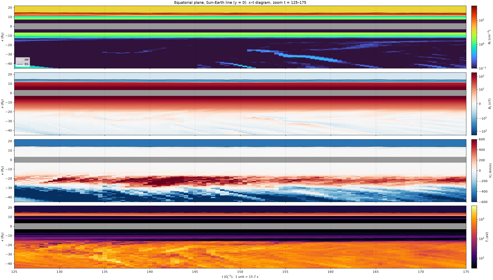

**🔰 新手读图**
1. **这张图在回答什么问题：** 把 F05 中 t=125–175 这一段“放大镜”式拉开：磁尾的快流、重联点和被甩出的等离子团，谁先谁后、各在哪里？
2. **先认坐标和颜色：** 与 F05 完全相同的四个面板和色标，只是横轴只显示 t=125–175（约 13 分钟），每条竖线间隔 5 个单位。纵轴上方 +x 朝太阳，下方是远尾；灰色带是地球内边界。Vx 面板中红=向地球流，蓝=向远尾流。
3. **按顺序看这几处：** ① Vx 面板 x≈−20 Rₑ 那条贯穿全图的红带：持续的向地快流，t≈135–145 最红（最快约 1160 km/s）。② 红带下方的红蓝交界线（约 −28 到 −32 Rₑ）：它上下缓慢起伏，这就是“重联点”在漂移。③ N 面板 t≈152–160 从 −27 斜向 −36 Rₑ 的亮蓝斜线：一团被甩向远尾的等离子体，斜率约 1.15 Rₑ/单位≈470 km/s。④ Ti 面板：t≈150 之后橙黄色逐渐变暗，说明加热在减弱。
4. **看到了什么，说明什么：** 想象一根被两头拉的橡皮筋在中间“剪断再接上”：断点（X 线）两侧的等离子体被分别弹向地球（红）和远尾（蓝）。红蓝交界就是断点的位置，它不是钉死的，而是在约 4 Rₑ 范围里来回漂。被弹向远尾的那一团，就是 N 面板里的斜线（等离子团）。快流在 t≈140 最强、之后减弱并伴随降温，说明重联活动有“起伏”，不是恒定的。
5. **新手容易误读：** ① 红蓝交界的位置取决于判据（这里用 ±100 km/s），误差约 1–2 Rₑ；它和 F47 里子午面定的 X 线（−25.5 Rₑ）用的平面和方法不同，数值不必相等。② 只看 y=0 一条线，结构从侧面扫过也会在图上像“移动”，所以斜线速度只是表观速度。③ 色块呈小方格是因为数据每 0.5 个单位一帧，并非真实的颗粒结构。

**问题与读法。** 与 F05 相同的数据、色标和条带平均，只截取 t=125–175（101 帧，帧间隔 0.5，约 13 分钟），并每 5 个单位加竖向网格。目的是把 F05 中挤在一起的尾部条纹拉开，看清地向流、尾向流和等离子团的先后关系。

**图中证据。** ① Vx 面板中，x≈−18 至 −27 Rₑ 几乎始终为红色地向流：地向流峰值位置中位数 x≈−21 Rₑ（四分位 −22.3 至 −20.3），−15 至 −25 Rₑ 区间内 43% 的格点 Vx>300 km/s。② 红蓝交界（由地向流转为尾向流的位置，取 1 Rₑ 平滑后 Vx 由 >100 变为 <−100 km/s 处）在 t=125–135 中位于 −28.5 Rₑ，t=135–155 退到约 −31.7 Rₑ，t=155–175 回到约 −29.5 Rₑ。③ 地向流最强出现在 t≈135–145（最大约 1160 km/s），t≈150 后减弱到 630–760 km/s；同期 x=−20 至 −35 Rₑ 的平均 Ti 从约 915 eV 降到约 490 eV。④ N 面板中有一条向尾倾斜的亮带：t=152 时在 x≈−26.7 Rₑ，t=160 时到 x≈−35.9 Rₑ，对应约 1.15 Rₑ/单位 ≈ 470 km/s 的向尾移动；同时在 Bz 面板出现与之平行的正负条纹。

**物理解释。** 红蓝交界相当于赤道面上的流反转点，可看作 X 线在 y=0 处的代理：其两侧等离子体分别被甩向地球和远尾，正是磁场重联出流的样子（对比专题 F47 子午面 X 线位置 −25.5±3.1 Rₑ；两者所用平面和判据不同，相差数个 Rₑ 属正常）。向尾移动的密度亮带与 Bz 正负条纹是被抛向远尾的等离子团（磁通绳/等离子体团）的赤道面截面。出流减弱与降温同时发生，说明这一窗口内重联驱动的加热先强后弱，而不是稳定不变。

**限制与结论。** 流反转点的位置依赖 ±100 km/s 阈值和平滑长度，误差约 1–2 Rₑ；亮带速度只追踪了一条结构。赤道面一条线无法区分“结构真的沿 x 运动”和“结构从 y 方向扫过”。放大图支持“近地尾 X 线在 −28 至 −32 Rₑ 之间往复漂移、并间歇抛出等离子团”的图像，但不足以确定单个重联事件的开始和结束。

### F07 · 压力剖面与 Chapman–Ferraro 尺度

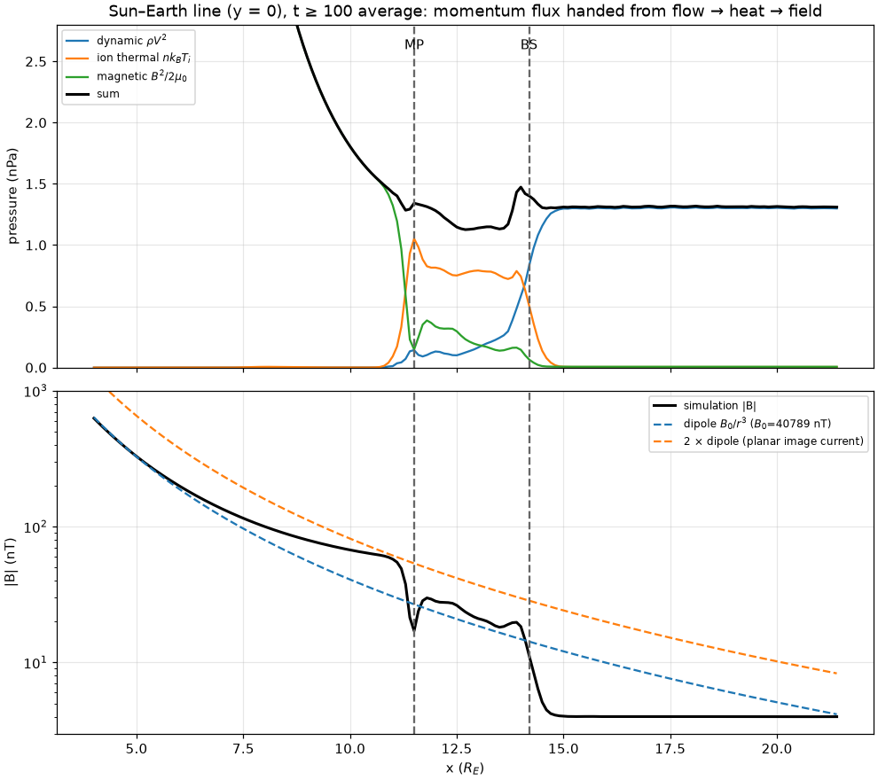

**🔰 新手读图**
1. **这张图在回答什么问题：** 沿日地连线从太阳风走到地球，太阳风的“冲劲”是怎样一步步转交给热压和磁压的？磁层顶处的磁场被压强了多少？
2. **先认坐标和颜色：** 横轴 x（Rₑ），右边是太阳风（x≈20），往左走依次经过弓激波 BS（约 14.2）和磁层顶 MP（约 11.5），两条竖虚线标出它们。上图纵轴是压力（nPa）：蓝=动压 ρV²（流动冲劲），橙=离子热压，绿=磁压，黑=三者之和。下图纵轴 |B|（对数）：黑=模拟磁场，蓝虚线=偶极场 B₀/r³，橙虚线=两倍偶极。
3. **按顺序看这几处：** ① 上图右侧：蓝线≈1.3 nPa 独占，太阳风全靠冲劲。② 穿过 BS：蓝线骤降、橙线升起——激波把冲劲变成热。③ 靠近 MP：绿线上升，到磁层内部几乎全是磁压。④ 下图 MP 左侧：黑线在蓝虚线之上、接近但低于橙虚线。
4. **看到了什么，说明什么：** 像接力赛：太阳风冲劲（动压）在激波处把“接力棒”交给热压，到磁层顶再交给地球磁压，三棒加起来大致不变，磁层顶就站在“谁也推不动谁”的位置。磁层顶内侧磁场比单纯偶极强约 2 倍，是因为磁层顶上的电流（像镜子里的“镜像磁铁”）把磁场叠加增强了（Chapman–Ferraro 图像）。
5. **新手容易误读：** ① 黑线在磁鞘里约 1.16 nPa、低于上游 1.31，不是“动量丢了”：改用各向异性压力后约 1.25 nPa，且电子压力没算进去，严格守恒尚未证明。② B₀=40789 nT 是从模拟反推的有效值，不是独立输入。

**问题与读法。** 上图黑线是逐帧求出的 ρ|U|²、离子标量热压和磁压的平均之和；下图比较 |B|、B₀/r³ 和两倍偶极近似。右侧是上游，向左依次穿过激波、磁鞘和磁层顶。不要把黑线标题中的“动量转交”当成已验证的守恒方程。

**图中证据与新复算。** 激波后动压下降、离子热压上升；靠磁层顶磁压贡献增大。原图三处标量值约为 1.31、1.16、1.42 nPa。本次逐帧构造陀螺对称离子 Pxx，并使用 ρUx²+B²/(2μ₀)−Bx²/μ₀ 后，三个区域的法向通量近似为 1.313、1.251、1.435 nPa。磁鞘偏离上游由约 12% 缩小到约 5%，说明压力各向异性对比较有实际影响。

**模型含义。** 内侧平均场约 56.4 nT、相对估计偶极压缩因子约 2.10，支持镜像电流的量级图像。不过 B₀,eff 是从模拟总 Bz 在 r=5–7 Rₑ 的值反推，含背景电流贡献；不能当作独立输入偶极矩。CF 半径还采用 k=0.881，必须连同 f、B₀ 和取样窗口报告。

**限制与结论。** 新通量仍未包含电子压力，采用固定 x 法向且未变换到移动边界系，也未闭合多维侧向通量。磁场堆积和热压分配得到支持，严格动量守恒尚未证实；PDL 是“耗减层”，需额外证明密度耗减，不能称为耗散层。

### F08 · 两个切面上的 Shue 形状拟合

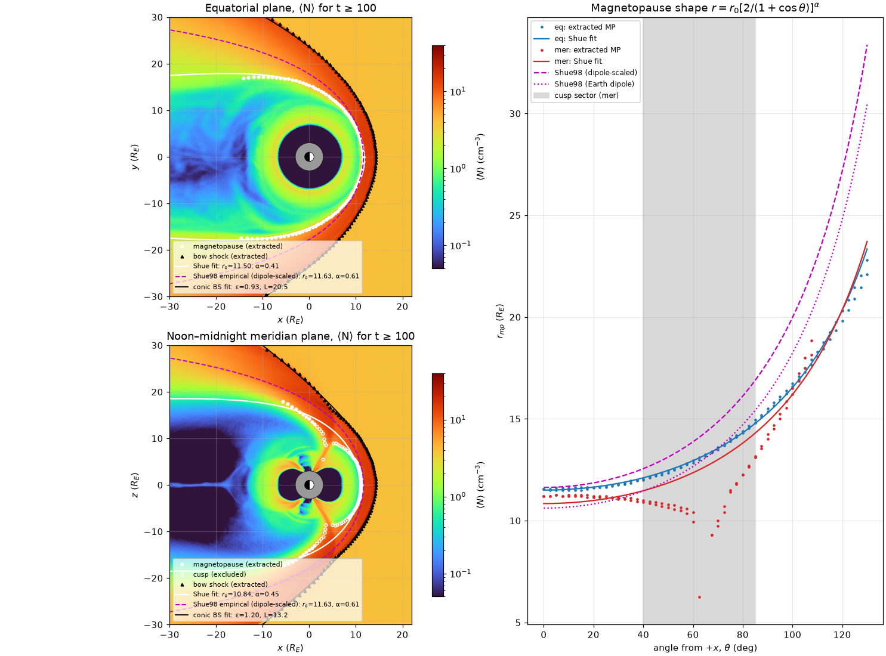

**🔰 新手读图**
1. **这张图在回答什么问题：** 模拟出来的磁层顶是什么形状？能不能用一个经典的经验公式（Shue 模型）描述？
2. **先认坐标和颜色：** 左上=赤道面（x–y）、左下=子午面（x–z），背景是 t≥100 的时间平均密度（对数色标），太阳在右。白点=提取出的磁层顶，空心白点=子午面被剔除的极尖点，黑三角=弓激波，白实线=Shue 拟合，紫虚线=经验 Shue98 曲线，黑实线=弓激波圆锥拟合。右图把边界写成“离地距离 r 对极角 θ（从太阳方向量起的角度）”：蓝=赤道面，红=子午面，灰色竖带=极尖剔除区。
3. **按顺序看这几处：** ① 右图 θ=0（正对太阳）：蓝点约 11.5、红点约 10.8 Rₑ——这就是鼻尖距离 r₀。② 往右看曲线上翘：越靠侧翼磁层顶离地越远，α 决定“张口”大小（赤道约 0.41、子午约 0.45）。③ 灰带里的红点乱跳：极尖处形状偏离简单公式。
4. **看到了什么，说明什么：** Shue 公式就像给磁层“鼻子”套一个标准模板：r₀ 是鼻尖离地多远，α 是两侧张开多快。模拟的鼻区能被模板很好地套住，侧翼稍窄、极尖处套不上——因为极尖是地磁场的“漏斗口”，本来就不圆滑。
5. **新手容易误读：** ① 赤道面与子午面 r₀ 差约 0.7 Rₑ，部分来自判据不同（赤道用 Bz 变号，子午用密度峰 30%），不能全当“磁层被压扁”。② 紫虚线的缩放 B₀ 来自同一模拟，拟合误差 ±0.02 Rₑ 只是拟合残差，不能说“模型被独立验证”。

**问题与读法。** 左上、左下是时间平均 N 场及提取边界；右侧将半径写为极角函数。白点是数据代理，曲线是拟合；灰色角区是子午面拟合时剔除的极尖区域。弓激波圆锥拟合另含焦点偏移 x₀，不能直接把其极角同原点射线角混用。

**定量证据。** 赤道面拟合 r₀≈11.501 Rₑ、α≈0.411，子午面约 10.839 Rₑ、0.454。关键方法差别是：赤道面 MP 用 Bz 变号；子午面则从密度峰向内找低于峰值 30% 的位置。因此两面 r₀ 的差别同时包含几何和判据效应，不能完全归因于真实压扁。

**物理推理。** 对 r=r₀[2/(1+cosθ)]^α，θ=90° 时 r=r₀2^α；α 偏小表示侧翼相对鼻区更窄。拟合鼻区曲率半径为 Rc=r₀/(1−α/2)，赤道面约 14.48 Rₑ，供厚度比较使用。拟合协方差给出的 ±0.02 Rₑ 只反映所选点的拟合残差。

**限制与结论。** 缩放后的 Shue 鼻区接近模拟是有条件的尺度一致性；缩放 B₀ 来自同一模拟，独立性有限。子午面灰区之外仍有约 0.51 Rₑ 的残差，说明轴对称函数难以描述极尖及判据变化。模型对照应分别报告鼻区、侧翼和极尖，不作单一“拟合成功”判断。

### F09 · 激波对齐剖面与 R–H 压缩比

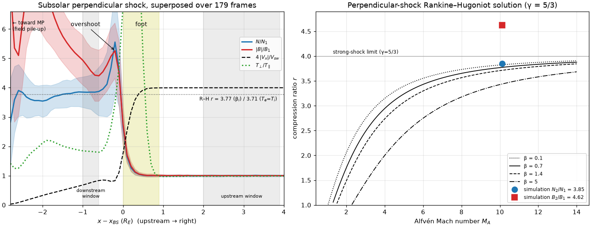

**🔰 新手读图**
1. **这张图在回答什么问题：** 模拟出的弓激波把太阳风压缩了几倍？和教科书的激波“跳跃条件”（Rankine–Hugoniot，简称 R–H）算出的理论值是否一致？
2. **先认坐标和颜色：** 左图横轴是“离激波的距离” x−x_BS（Rₑ），0 处是激波，右边是上游太阳风、左边是下游磁鞘；179 帧先把激波对齐再平均，阴影是均值±标准差。蓝=密度比 N/N₁，红=磁场比 |B|/B₁，黑虚线=流速（乘 4 后归一化），绿点线=温度比 T⊥/T∥（峰值超出纵轴）；黄带是激波“脚”，两块灰带是选来取上下游平均的窗口。右图横轴是阿尔文马赫数 MA（太阳风速度÷阿尔文波速，可理解为“磁化版音速倍数”），纵轴是压缩比 r，几条黑线是不同 β 的理论曲线；蓝圆点=模拟密度压缩比 3.85，红方块=磁场压缩比 4.62。
3. **按顺序看这几处：** ① 左图 x=0 附近蓝线从 1 陡升到约 4：激波一步把密度压缩近 4 倍。② 陡坡左边的小尖峰（overshoot，过冲）：先冲过头再回落。③ 右图蓝点贴近 MA≈10 的理论曲线，接近“强激波极限”4。
4. **看到了什么，说明什么：** 激波就像高速路上突然堵车：车流（太阳风）一下子从快变慢，车距（密度）挤密 3–4 倍，乘客焦躁发热（温度升高）。理想气体激波最多只能压缩 4 倍，MA≈10 已很接近这个上限，模拟的 3.85 与理论 3.77 相近。
5. **新手容易误读：** ① 红方块 4.62 超过 4 不等于“模型错了”，主要是下游窗口里磁场还在继续堆积，不是同一均匀状态。② 质量通量比约 0.77 且起伏大，所以只能说“密度压缩比接近 R–H”，不能说完整跃迁条件全部通过。

**问题与读法。** 左图将 179 帧按密度门槛定义的 BS 平移对齐，画的是均值±标准差；不是中位数±IQR。横坐标右侧为上游，向左穿过斜坡。绿线是两个温度均值的比，不等于逐点温度比的平均，峰值还超出纵轴上限。

**定量证据。** N₂/N₁≈3.85，而理想垂直激波解为 3.77（仅离子 β）或 3.71（假设 Te=Ti），密度跃变接近该模型。B₂/B₁≈4.62、过冲相对选定下游窗口约 1.14，则提示磁场和密度未按同一均匀理想下游状态取样。本次同窗口的实验室系质量通量比均值约 0.77、标准差约 0.25，不能声称全部 R–H 条件通过。

**机制对照。** 上游温度前驱、急剧斜坡与磁场过冲符合反射离子激波的形态预期；[Leroy et al. (1982)](https://agupubs.onlinelibrary.wiley.com/doi/abs/10.1029/JA087iA07p05081) 讨论了这类混合模拟结构及参数依赖。但本图没有离子速度分布，不能直接测反射率。

**结论。** “密度压缩比接近 R–H”可靠性高于“已复现完整激波跃迁”。后续应换到激波静止系、改变上下游窗口、检查质量与磁通及法向动量连续性。不能只因 rB>4 就判定模型错误，也不能直接宣布不违反 R–H；首先要解决状态选择和非稳态问题。

### F10 · 激波几何与归一化磁场扰动

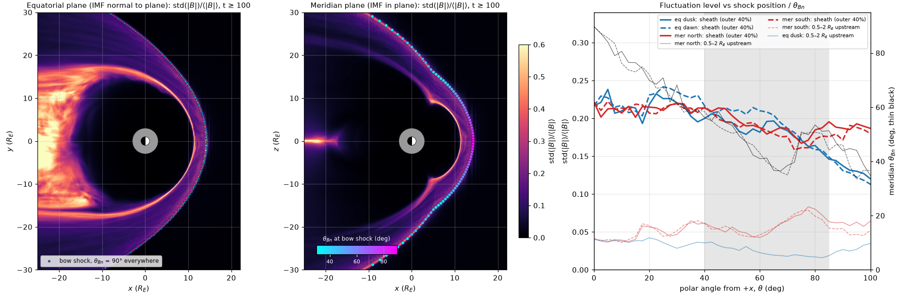

**🔰 新手读图**
1. **这张图在回答什么问题：** 激波不同部位后面的磁场“抖动”程度一样吗？磁场与激波面法向的夹角 θBn 有没有影响？
2. **先认坐标和颜色：** 左=赤道面、中=子午面，颜色是 std(|B|)/⟨|B|⟩，即磁场强度随时间起伏的相对大小（黑=很稳，亮黄=起伏达平均值的一半以上），太阳在右。激波上的彩点在中图表示 θBn（青≈40°，紫≈90°）；左图 θBn 处处为 90°。右图横轴是极角 θ（从太阳方向量起的位置角），左纵轴是扰动水平：粗线=磁鞘外侧，细浅线=激波前上游，蓝=赤道面、红=子午面；细黑线读右轴，是子午面 θBn。
3. **按顺序看这几处：** ① 左、中图都看弓激波后那条亮带：磁鞘里普遍在抖。② 右图 θ<40° 鼻区：蓝红粗线都在 0.21–0.22，几乎一样。③ θ>90° 的侧翼：红粗线明显高于蓝粗线；细线中浅红（子午上游）也高于浅蓝（赤道上游）。
4. **看到了什么，说明什么：** θBn 接近 90° 叫“准垂直激波”，像一堵硬墙，粒子不容易逆流跑回上游；θBn 小叫“准平行激波”，粒子能顺着磁力线跑到上游“探路”，激起波动，像在河口逆流形成的乱浪。子午面高纬激波更接近准平行，所以那里上下游都更“抖”。
5. **新手容易误读：** ① 极角 θ（位置）和 θBn（磁场夹角）是两个不同的角，灰带也不等于整个准平行区。② 时间起伏大也可能只是激波来回摆动扫过固定点，不能直接说成“湍流”或某种波。

**问题与读法。** 两张地图表示 std(|B|)/⟨|B|⟩，是场强的相对时间波动；不是矢量 δB 的完整能量。右图粗线采磁鞘外侧，细线采上游，黑线才是 θBn。极角 θ 与 θBn 是不同角，灰色极角区也不等同于整个准平行区。

**图中证据。** 近鼻区两面磁鞘扰动都约 0.21–0.22，差别较小；极角 90°–121° 子午面约 0.185、赤道面约 0.121，前者约为后者 1.53 倍。上游的 60°–90° 角段两面均值约 0.065 与 0.018，差别更明显。θBn 随极角并非单调下降，中间有局部回升。

**物理解释。** IMF 在赤道面外，光滑对称面近似下与其面内激波法向垂直；子午面的高纬法向可更接近 IMF，因而产生准平行候选区。上游活动增强与这一几何相容，但局地激波摆动也会让固定位置反复扫过陡梯度，抬高时间标准差。

**结论。** 该图支持“部分子午面侧翼有更强的场强扰动”，还不能直接命名湍流、反射离子波或其输运方向。最强检验是在随激波坐标里重新计算波动，再联合矢量磁场谱和粒子分布，分开边界位移与内禀波动。

### F11 · Brazil 图：越阈比例意味着什么

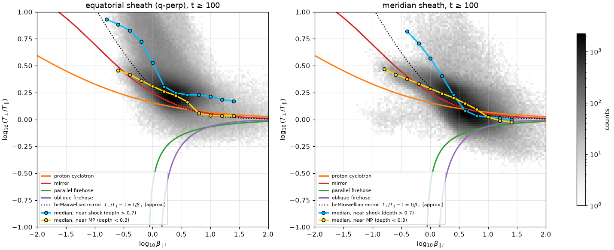

**🔰 新手读图**
1. **这张图在回答什么问题：** 磁鞘离子“左右热、前后冷”的程度（温度各向异性）有多大？是否超过了会引发等离子体不稳定性的理论阈值？
2. **先认坐标和颜色：** 这种图俗称“巴西图”（数据云形状像巴西地图）。横轴 log10 β∥i（平行方向热压÷磁压，取对数：0 代表 1，1 代表 10），纵轴 log10(T⊥/T∥)（0 代表各向同性，正值=垂直方向更热）。灰度是样本计数（越黑点越多，对数色标）。彩色曲线是理论阈值：橙=质子回旋，红=磁镜，绿/紫=火龙管（firehose）；青色折线=靠近激波样本的中位数，黄色=靠近磁层顶样本的中位数；黑点线是近似磁镜判据。左=赤道面，右=子午面。
3. **按顺序看这几处：** ① 左图黑色云团大多在橙、红线上方。② 右图云团更分散、更多落在线下。③ 青线（近激波）比黄线（近磁层顶）更偏上——激波刚压过的地方各向异性更强。
4. **看到了什么，说明什么：** 等离子体像一个被捏扁的气球：一个方向压得太狠（T⊥≫T∥）就“憋不住”，会激发波动把多余的能量放掉，曲线就是“快憋不住”的线。赤道面约 86% 样本高于磁镜线、约 94% 高于回旋线，说明磁鞘里储着大量可释放的“自由能”。
5. **新手容易误读：** ① 越过曲线≠已经看到这种波；两条线同时被越过，也不能由此说“磁镜模主导”。② 黑点线公式里变量用混了，不能当严格理论边界；样本是格点×时间，彼此相关，不是独立事件数。

**问题与取样。** 两轴分别为 log10β∥i 和 log10(T⊥/T∥)，灰度为计数。样本并非全部磁鞘格点：脚本在晚期每三帧取一帧，用密度、温度和空间门槛筛选，每帧最多随机抽 15000 点。最终赤道面 881241、子午面 447666 个样本是相关格点—时间样本，不是独立事件。

**定量证据。** 赤道面约 85.9% 高于磁镜阈值，同时约 94.4% 高于质子回旋阈值；因此“磁镜主导”不能由前一比例推出。子午面的相应比例约 48.9% 和 54.8%。青色近激波分组仅要求归一深度>0.7、未限制<1，可能混入几何边界外样本；黄色分组也放宽到深度>−0.1。

**理论核对。** 彩色曲线采用双 Maxwell 分布、最大增长率 γmax=10⁻³Ωcp 的线性阈值拟合，原文电子 βe=1：[Hellinger et al. (2006)](https://space.asu.cas.cz/~helinger/hellal06.pdf)。原图黑虚线把 1+1/β∥ 当作 1+1/β⊥，变量混用。若仅取简单流体磁镜条件 A−1=1/β⊥ 且 β⊥=Aβ∥，应得到 A=[1+√(1+4/β∥)]/2；不能把旧黑线当作严格理论界线。

**结论。** 图中存在充分的各向异性自由能和强烈的区域差别，但“越过经验增长率线”不等于已观测到相应波模，也不等于受边际稳定约束。需用时空波谱和 δN–δ|B| 关系识别波模，并用严格边界掩膜重新统计比例。

### F12 · t≈150 赤道面磁鞘各向异性

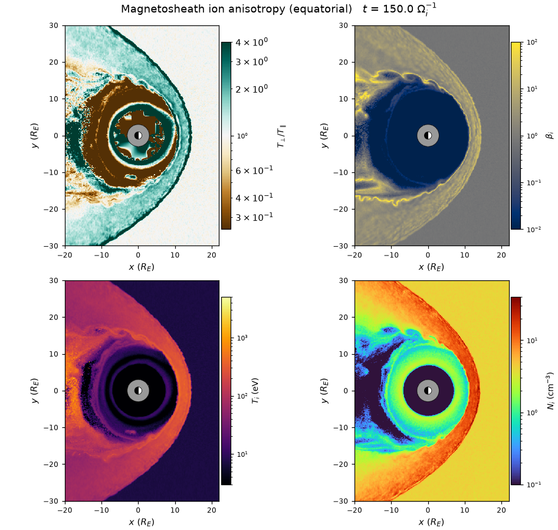

**🔰 新手读图**
1. **这张图在回答什么问题：** 上一张统计图里的“各向异性”在空间上分布在哪里？和密度、温度、β 是怎样对应的？
2. **先认坐标和颜色：** 四个赤道面小图（t=150，太阳在右，横轴 x、纵轴 y）。左上 T⊥/T∥：白=1（各向同性），青绿=垂直更热，棕=平行更热；右上离子 β：深蓝=磁压当家，黄=热压当家，灰≈1；左下温度 Ti（对数，越亮越热）；右下密度 N（对数，红稠蓝稀）。
3. **按顺序看这几处：** ① 左上图右侧紧贴激波内侧的一条深青色弧带：激波后垂直方向被加热。② 左下图同一位置变成橙色：磁鞘比上游热得多。③ 右下图左上方（昏侧侧翼）密度边界呈波浪/舌头状。④ 右上图中间大块深蓝：磁层内部 β 很低。
4. **看到了什么，说明什么：** 激波像一台“压面机”：垂直于磁场方向的运动被压得更剧烈，所以紧贴激波的磁鞘先出现 T⊥>T∥ 的条带，再往下游逐渐“揉匀”。β 高的地方热压占优，若同时各向异性大，就是可能激发波动的“储能区”。
5. **新手容易误读：** ① 内磁层和尾部的大片棕色多是到达色标下限，不是处处同一个温度比。② 这里的 β 用标量温度，F11 用 β∥，二者不能直接套同一阈值；侧翼密度起伏也不能直接认定为某种波（如磁镜模）。

**问题与读法。** 同时比较温度比、标量 βi、Ti 与 N 的空间对应。这里 βi 采用标量 Ti=(T∥+2T⊥)/3；F11 横轴却是 β∥i，二者不能不经换算直接代入同一阈值。

**图中证据。** 日侧激波后有一条 T⊥/T∥>1 的带，磁鞘温度明显高于上游；侧翼密度出现波状舌形结构，而内腔主要为低 β。尾侧和内磁层大片棕色比值达到或超出下限，不能据色块认为处处具有相同温度比。

**物理联系。** 准垂直压缩有利于产生垂直加热和各向异性，但混合模拟的非绝热离子动力学不必满足简单双绝热不变量。局地高 β 与各向异性可为不稳定性提供自由能；反之 β 高也可能只是 |B| 变小，需要联合两项判断。

**限制与结论。** 单张图没有波动的传播方向、等离子体系频率或极化，不能把密度起伏直接识别为磁镜模。可靠结论是激波后离子加热与各向异性具有空间组织；F11 用统计展示自由能，F12 用空间图定位它，二者相互补充但不能代替波模诊断。

## 4. 日侧局部结构与 FTE 候选

### F13 · t≈90 的日侧子午面

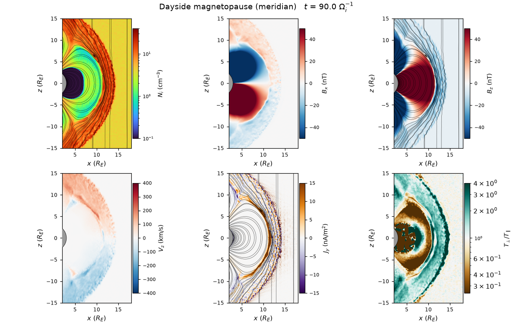

**🔰 新手读图**
1. **这张图在回答什么问题：** t≈90 时，日侧（面向太阳的一面）磁层顶附近有没有磁场重联的迹象？
2. **先认坐标和颜色：** 只截取日侧子午面：横轴 x 从 2 到 18 Rₑ（太阳在右，左边缘灰色半圆是地球内边界），纵轴 z（上北下南）。六个面板：上排 N（对数）、Bx、Bz（红正蓝负，±50 nT）；下排 Vz（红=向北流，蓝=向南流）、Jy（电流密度，橙=正、紫=负，±15 nA/m²）、T⊥/T∥（白=各向同性）。黑线是面内磁场曲线。
3. **按顺序看这几处：** ① Bz 面板：内侧深红（地球磁场朝北）、外侧浅蓝（太阳风磁场朝南），二者在约 11.6 Rₑ 处“对撞”。② Jy 面板同一位置的一条细橙色弧线：薄电流层，就是磁层顶。③ Vz 面板：上半红、下半蓝——等离子体从赤道附近分别向北、向南流走。④ N 面板：外侧红色磁鞘与内侧绿色磁层之间约 2.6 Rₑ 厚的过渡（MP≈11.6，BS≈14.2）。
4. **看到了什么，说明什么：** 南向的太阳风磁场与北向的地球磁场贴在一起，就像两股方向相反的绳子被按在一起，绳子在接触点“剪断再接上”（磁场重联），接好的新磁力线像弹弓一样把等离子体向南北两极弹出去。反向场＋薄电流层＋双向流同时出现，比单看黑线相连更能支持“这里可能在重联”。
5. **新手容易误读：** ① Bx 面板的上蓝下红主要是偶极磁场本身的几何，不是重联信号。② Vz 里也混有太阳风绕流，不能把整片红蓝都当成重联喷流；Jy 饱和色只说明超过 15 nA/m²，读不出峰值。

**面板与问题。** 从左到右、从上到下为 N、Bx、Bz、Vz、Jy、T⊥/T∥，视场只覆盖 x>2 Rₑ 的日侧。Bx 的南北反号很大部分来自偶极几何；真正需要研究的是磁层顶附近的 Bz 转向、薄电流层与沿 z 的双向流是否共址。

**图中证据。** 右侧高密度磁鞘与内侧低密度区相邻，Jy 在磁层顶附近集中；北侧 Vz>0、南侧 Vz<0，符合由低纬向两极的流动。中心条带复算得到 MP 变号代理约 11.6 Rₑ，BS 密度代理约 14.2 Rₑ，两者之间的厚度约 2.6 Rₑ。

**物理推理。** 反向磁场、切向电流和双向流组合比仅看场线相连更支持日侧重联候选。Vz 中同时存在绕流分量，不能把整片红蓝流都视为重联喷流；需要以局地上游为背景，检查出流速度与非对称阿尔文尺度。

**限制与结论。** t≈90 属于磁尾活动刚增强的阶段，早于多数晚期统计。Jy 色标上限为 15 nA/m²，饱和色只表示达到上限，不能精确读出峰值。该图可作为 F14、F15 的日侧形态基线，不单独给出重联率和 FTE 数量。

### F14 · t≈125 的日侧局部闭环

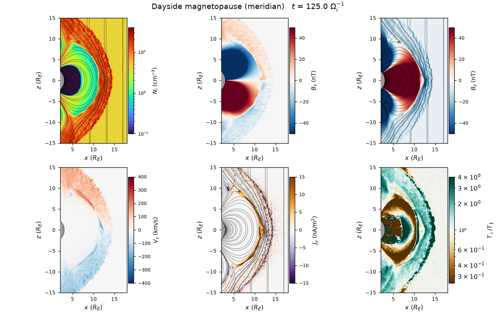

**🔰 新手读图**
1. **这张图在回答什么问题：** t≈125 时，北侧高纬磁层顶出现的一个小“闭环”，是不是通量传输事件（FTE，日侧重联产生的一段扭曲磁通管）的候选？
2. **先认坐标和颜色：** 面板与 F13 完全相同（N、Bx、Bz / Vz、Jy、T⊥/T∥），太阳在右，横轴 x=2–18 Rₑ，纵轴 z。重点关注细黑线（面内磁场曲线）。
3. **按顺序看这几处：** ① N 面板和 Bz 面板中约 x=6–7、z≈9–11 Rₑ 处：黑线绕成一个小圈（小闭环）。② Jy 面板同一位置：电流片在这里有弯折。③ 对比下半球（z<0）：没有同样清晰的闭环。④ 磁层顶这时约在 12.2 Rₑ、弓激波约 14.4 Rₑ，比平均略靠外。
4. **看到了什么，说明什么：** 如果日侧在两处同时“剪断再接上”，两个接点之间会夹出一个打着结的磁通“香肠”（磁通绳），在二维切面上看就是一个小圆圈。FTE 就是这种“香肠”沿磁层顶滑向两极、把太阳风磁通运到磁尾的过程。
5. **新手容易误读：** ① 二维切面上的小圈只是“候选形态”，可能是三维结构被斜切出来的，看不出管轴向磁场和真正连接，不能直接说“识别到 FTE”。② 它是否被 F16 的探针记录到，要先证明它经过了探针位置。

**图中问题。** 除了日下点电流层，应重点比较北侧高纬的局部场线回转是否在 N、Bz、Jy 中有对应。t≈125 北侧约 x=6–7、z≈9–11 Rₑ 的小结构，是旧报告命名 FTE 的主要依据。

**图中证据。** 局部平面内积分曲线出现小闭环，附近密度和电流片有弯折；下半球没有完全对称、同等清晰的闭环。中心线 MP 变号代理约 12.2 Rₑ、BS 约 14.4 Rₑ，说明这个时刻也处于日侧边界偏外的一段，而非任意平均日侧状态。

**物理解释。** 岛状切面可以来自局部多重重联，也可能对应三维结构的复杂切割；一般不能从这一平面恢复磁通绳轴向磁场和连接。若要关联 F16 的探针信号，须先证明结构经过了纬度 ±20°/±30° 的预设探针，而不是仅在同一张日侧图里出现。

**限制与结论。** 本图确立“局部岛状候选形态”，尚未确立“已识别 FTE”。更有力的下一步是追踪邻近输出帧、求局地 LMN、比较 Bn 双极、|B| 与总压，再检查第三维连接；不能以二维闭环代替这条证据链。

### F15 · t≈150 的日侧局部结构

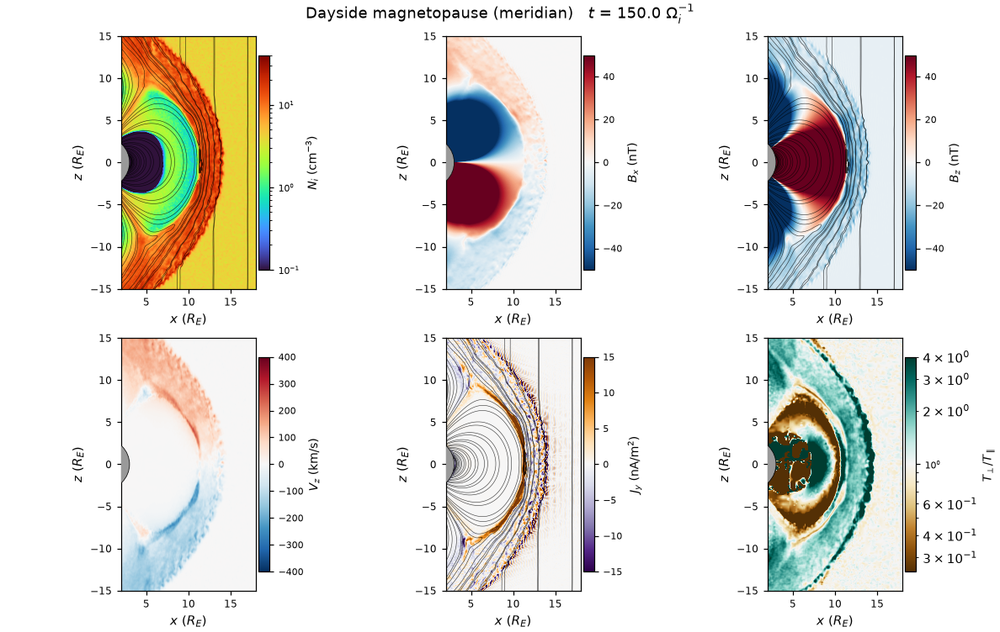

**🔰 新手读图**
1. **这张图在回答什么问题：** 到 t≈150，日侧的结构还在吗？F14 的小闭环是否仍然存在？
2. **先认坐标和颜色：** 与 F13、F14 同一视场同一组面板（N、Bx、Bz / Vz、Jy、T⊥/T∥），太阳在右；可以三张并排对照看。
3. **按顺序看这几处：** ① Jy 面板：磁层顶的细橙色电流层仍在。② Vz 面板：北红南蓝的双向流仍在，而且贴着磁层顶更清楚。③ 北侧高纬：F14 中那个小圈已经不见了。④ 磁层顶约 11.4 Rₑ、弓激波约 14.1 Rₑ，比 t≈125 向内收了一点。
4. **看到了什么，说明什么：** 日侧的“剪断再接上”像一台一直开着的机器：电流层和南北分流持续存在；而像小闭环这样的“产品”是一个个出炉又被运走的，所以单个结构会消失。边界位置也会轻微呼吸式进出，但整体形态稳定。
5. **新手容易误读：** ① 三张图间隔约 25 代码单位，中间可能已生成和消失过很多小结构，不能当连续录像，也不能据此判断 FTE“多”或“少”。② 不能凭三张快照说日侧 X 线（重联线）绝对稳定。

**比较目标。** 本图与 F13、F14 使用同一视场和面板，可比较结构是否持续；不要把三张稀疏快照视作连续追踪。t=125 到150 间隔约25代码单位，许多小尺度结构可能已产生和消失。

**图中证据。** 薄 Jy 层、南北反向 Vz 和激波后各向异性带仍存在，F14 中的小闭环却没有保持相同形态。中心条带 MP 约 11.4 Rₑ、BS 约 14.1 Rₑ，较 t≈125 向内；这是形态稳定而边界可移动的直接例子。

**物理推理。** 持续存在的反向场和极向流说明日侧相互作用没有因单个局部结构消失而停止。相反，是否存在一个可持续追踪的通量管，是另一独立问题。磁鞘 Vz 也包含太阳风绕流，不能把每一处双向流都作为 X 线出流测量。

**限制与结论。** 该图支持日侧电流层与极向流型的持续性，也显示单个闭环候选的时变性。它不能证明日侧 X 线绝对稳定或 FTE 内禀稀少，因为输出间隔、视场和切面位置都影响检出率。

### F16 · 四个虚拟探针的 Bn 时间序列

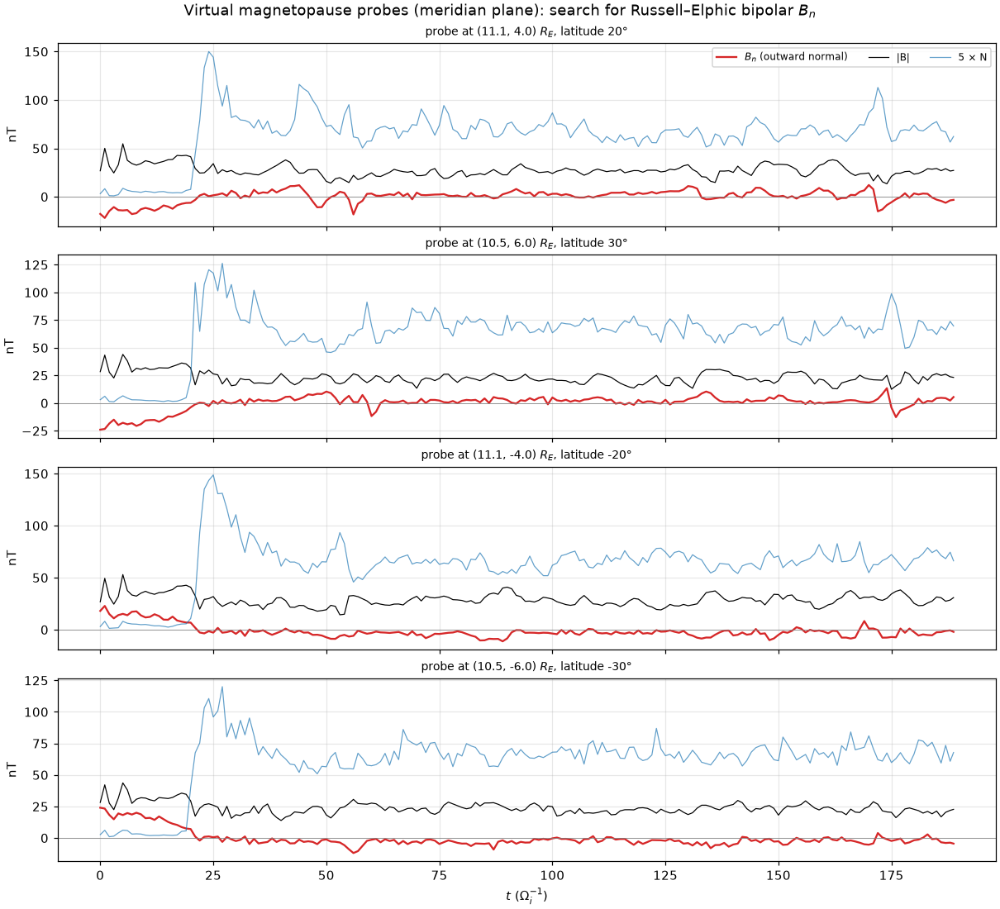

**🔰 新手读图**
1. **这张图在回答什么问题：** 在磁层顶附近放 4 个“虚拟卫星”，能不能记录到 FTE 经过时典型的“先正后负”磁场信号？
2. **先认坐标和颜色：** 四行是四个固定探针，从上到下：北 20°、北 30°、南 20°、南 30°（标题给出探针坐标）；横轴是时间 t。红线=Bn（垂直于磁层顶向外的磁场分量，nT），黑线=磁场强度 |B|，浅蓝线=密度乘 5 后画上来（不是 nT，只看起伏）。
3. **按顺序看这几处：** ① t≈20 前后：蓝线猛升，是磁鞘第一次扫到探针，属于启动。② 之后红线在 0 附近小幅摆动，找“先向上再向下（或反之）”的成对尖峰——这叫双极信号。③ 第一行 t≈170 附近：红线一次明显的正→负跳变，同时黑线和蓝线也有起伏。
4. **看到了什么，说明什么：** FTE 的“香肠”从卫星旁滑过时，会先把磁力线向外顶、再向内拉，于是 Bn 出现一正一负，就像小船经过时浮标先被推起再落下。按 ±5 nT 的标准，只在北 20° 找到一条候选；把门槛放松到 ±2 nT，次数就变成 8 次，说明结果非常依赖标准。
5. **新手容易误读：** ① “这几个固定点上强信号少”不等于“整个系统 FTE 少”；磁层顶自己来回摆动也会造成 Bn 变化。② 20°/30° 是从 +x 量起的位置角，不是磁力线足点纬度；南北差别不能直接说成半球不对称。

**取样与读法。** 四条序列来自预设曲面 r=11.6[2/(1+cosθ)]^0.6 上的 ±20°、±30°，不是逐帧测得的磁层顶。Bn 法向也是该曲面的解析法向。黑线为 |B|，蓝线是密度乘5后叠加，后者不是 nT，不能按同一纵轴解释其物理量纲。

**定量检验。** t≥60、九点移动平均去趋势后，原 ±5 nT 条件仅得到北20°的一条双极候选记录。把门槛改为 ±2、±3、±5、±7 nT，北20°的过零计数依次为8、5、1、0；南20°依次为5、3、0、0。计数未去重，强烈依赖门槛，不能直接作为事件发生率。

**物理联系。** [Russell & Elphic (1978)](https://ntrs.nasa.gov/citations/19790045569) 的核心是边界附近时间有限的磁通传递及磁场特征；在本图中，边界摆动和法向估计误差也会形成 Bn 变化。因此双极信号应与核心场增强和真实边界穿越联合判断。

**结论。** 可以说“这些固定探针上强双极候选少”，不能说“整个系统 FTE 少”。此外 ±20°/±30° 是从 +x 轴量取的子午面极角，不能直接叫磁力线足点纬度；南北信号差别也不能自动解释为全局半球不对称。

## 5. 侧翼剪切、扰动与动量输运

### F17 · t≈120 的侧翼涡旋候选

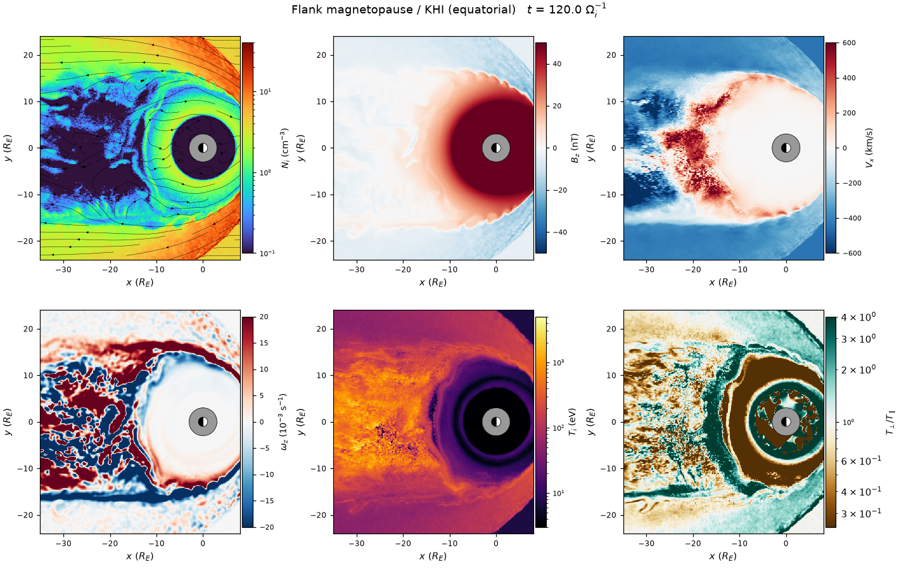

**🔰 新手读图**
1. **这张图在回答什么问题：** t≈120 时，磁层两侧（侧翼）的边界上有没有像风吹水面那样卷起的涡旋（开尔文–亥姆霍兹不稳定性，KHI）候选？
2. **先认坐标和颜色：** 赤道面，横轴 x（−35 到 8 Rₑ，太阳在右），纵轴 y（上方 y>0 为昏侧/傍晚一侧，下方为晨侧）。上排：N（对数，叠加带箭头的速度流线）、Bz（红北蓝南）、Vx（红=向太阳，蓝=背离太阳）。下排：ωz（涡度=流体局部旋转快慢，红=逆时针、蓝=顺时针，±20×10⁻³ s⁻¹ 封顶）、Ti（对数）、T⊥/T∥。
3. **按顺序看这几处：** ① ωz 面板上下两条长带：上方红、下方蓝——磁鞘向尾快流与内侧慢流之间的“剪切带”。② 同一面板左侧 x<−15 的红蓝碎块：更小的涡旋。③ N 面板侧翼：密度边界出现细丝和弯折，流线局部打弯。④ Vx 面板：外侧深蓝（快速向尾），内侧浅色或红（慢或回流）。
4. **看到了什么，说明什么：** 风吹过湖面，风快水慢，交界处会卷起波浪——这就是 KHI。磁鞘里太阳风沿侧翼快速向后流，磁层内侧几乎不动甚至回流，两者之间的“搓动”就可能把边界卷成涡旋，帮太阳风把动量和物质带进磁层。
5. **新手容易误读：** ① 边界上一条同号的涡度带本身只是“剪切”，即使没有任何不稳定增长也会存在，不等于 KHI 已发生。② 色标在 ±20 处饱和，一样红不代表转得一样快；内部小涡旋也可能来自尾部喷流，不一定都是边界 KHI。

**面板与问题。** N 面板叠加的是速度流线；下排左侧是经 σ=0.3 Rₑ 平滑后求导的 ωz。应区分边界上同号剪切涡度带与内部红蓝相间的小涡旋：前者即使没有不稳定增长也可以存在。

**图中证据。** 昏侧 y>0 边界有正涡度带，晨侧负涡度带，符合尾向磁鞘流与内侧回流之间的剪切符号。较远尾区密度细丝、闭合或弯折的速度流线以及交错涡度同时出现；它们并不都严格位于同一个磁层顶表面。

**物理联系。** 这种多量共址比单一密度波纹更有利于 KHI 解释，但尾部喷流剪切、通道侧移与其他受迫扰动也会产生涡度。上游磁场大体沿 z，仅削弱面内波矢对应的磁张力，不能消除有限边界厚度与可压缩效应。

**结论与检验。** 本图提供边界剪切与涡旋相容结构的证据，不能测出增长率。应在边界随动坐标中追踪波峰，而不是只统计固定网格上的涡度极值。色标达到 ±20×10⁻³ s⁻¹ 会饱和，不能据相同红色认为各处转动速度相同。

### F18 · t≈150 的侧翼密度舌和回流

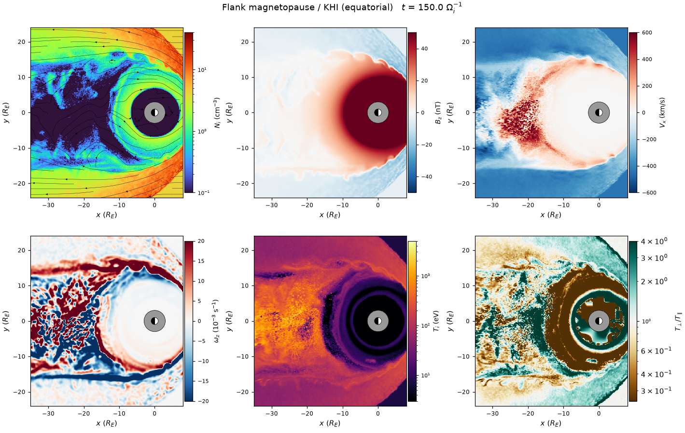

**🔰 新手读图**
1. **这张图在回答什么问题：** 到 t≈150，侧翼边界的起伏变成了什么样？
2. **先认坐标和颜色：** 与 F17 完全相同的六个面板和色标（N+流线、Bz、Vx / ωz、Ti、T⊥/T∥），赤道面，太阳在右，上方昏侧。
3. **按顺序看这几处：** ① N 面板上方（昏侧）约 x=−15 到 −5：密度边界呈连续的波浪和“舌头”。② ωz 面板同一位置：红色正涡度带沿波浪走。③ Vx 面板：边界外侧蓝（向尾），内侧浅红（向日回流）。④ Vx 面板约 x≈−20、y≈0 附近的深红团：磁尾高速流，与侧翼可能有关联。
4. **看到了什么，说明什么：** 边界被卷成波浪，就像两种颜色的颜料被搅棒搅出“舌头”，接触面变大，两边物质更容易交换。外侧往后、内侧往前的流动形成一对反向“传送带”，持续提供搓动的能量。
5. **新手容易误读：** ① 彩色“舌头”被卷进去≠两种等离子体已经真正混合，没有粒子来源标记无法区分“折叠”与“混合”。② 昏侧看起来更复杂，不能直接下结论说存在普遍的晨昏不对称。

**比较目标。** 本图与 F17 同标尺，可比较晚期边界起伏的组织方式。上排 N、Bz、Vx 联合定位边界，不能只用涡度图中鲜艳的红蓝结构决定磁层顶位置。

**图中证据。** 昏侧约 x=−15 至−5 Rₑ 附近有连续的波状密度边界；正涡度带沿该边界分布，磁鞘外侧为尾向流，边界内侧存在向日回流。更深夜侧的高速流则主要围绕 x≈−20 Rₑ、y≈0 附近展开，可能与尾部过程耦合。

**物理推理。** 边界卷起能增加两种等离子体的接触面积，但彩色密度舌被卷入并不等于不可逆混合。若无离子来源标记或跨边界粒子通量，无法区分界面折叠和真正的物质交换。

**结论。** F17–F19 支持侧翼持续存在剪切和非线性起伏。它们不能证明所有内部涡旋都来自磁层顶 KHI，也不能凭昏侧视觉更复杂认定普遍晨昏不对称；相同的相对边界位置和空间平均范围才是可比较样本。

### F19 · t≈180 的晚期侧翼

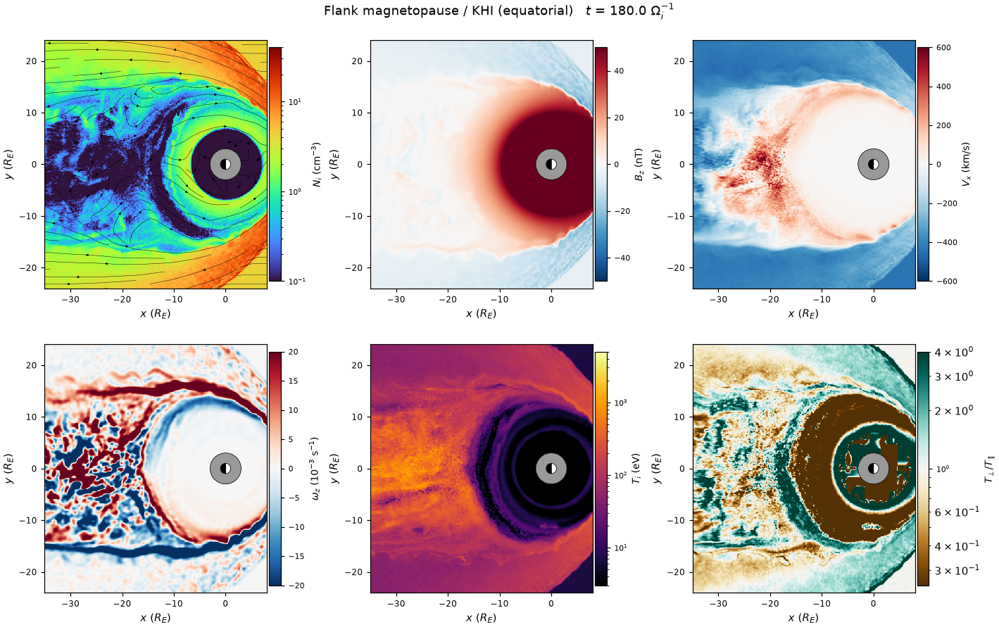

**🔰 新手读图**
1. **这张图在回答什么问题：** 接近模拟末期（t≈180），侧翼的扰动是否还在？是不是早期一次“甩尾”留下的残迹？
2. **先认坐标和颜色：** 同 F17、F18：六面板（N+流线、Bz、Vx / ωz、Ti、T⊥/T∥），赤道面，太阳在右，上方昏侧。三张图可以排成“连环画”对照。
3. **按顺序看这几处：** ① ωz 面板：上红下蓝两条剪切带仍然清晰，带边缘有起伏。② N 面板昏侧：密度波纹仍在。③ Ti 和 N 面板内部的细丝：位置与 t≈150 不同，说明图样在变。
4. **看到了什么，说明什么：** 只要太阳风一直沿侧翼吹，“风吹水面”的条件就一直在，所以边界在末期依然不平静。图样不断变化，说明这是一个持续“生成—移动—消散”的过程，而不是一张静止背景。
5. **新手容易误读：** ① “一直有起伏”≠“一直在线性增长”；三张图间隔 30 代码单位，波包早已生成、传播、饱和，无法从中拟合增长率或寿命。② ωz 的小结构受 0.3 Rₑ 平滑长度影响，部分可见尺度是平滑决定的。

**图中问题。** 在接近模拟末期时，侧翼扰动是否仍存在，还是只是 t≈80 启动后一次瞬变的残留？本图的价值在于时间上与 F17、F18 分开，提供持续活动的独立快照。

**图中证据。** 昏侧的密度波纹和同号涡度带仍在，内侧回流与外侧尾向流的剪切没有消失。内部低密度区和温度细丝与 t≈150 不完全重合，说明扰动图样不是静止背景。

**机制讨论。** “有持续起伏”与“持续线性增长”不同：后者要求某一模态在适当时间段内近似指数放大。相邻快照间隔30代码单位，波包已经可能经过生成、传播和饱和，不能从三张图直接拟合增长率或寿命。

**结论。** 侧翼非平静状态可持续到末期，但主波长、相速和增长机制仍需高时间分辨率追踪。对 ωz 的局部小结构，还应改变平滑长度检查稳定性；0.3 Rₑ 的平滑本身已经规定了部分可见尺度。

### F20 · KHI 判据、剪切马赫数和边界扰动

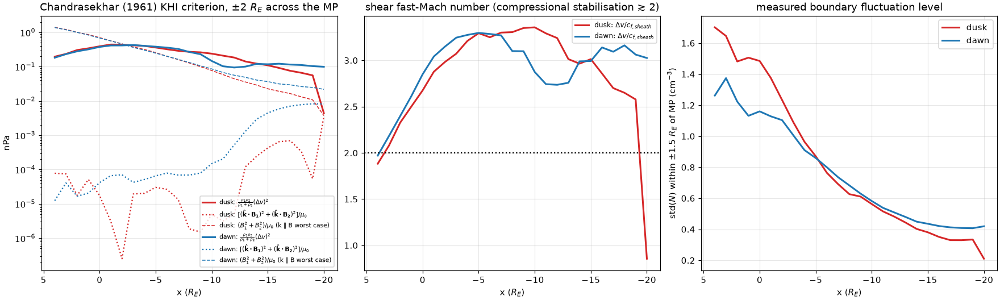

**🔰 新手读图**
1. **这张图在回答什么问题：** 用经典理论判据算一算：侧翼的剪切“驱动力”是否足以克服磁场的“拉住力”，从而允许 KHI 发生？
2. **先认坐标和颜色：** 三个小图横轴都是 x（注意从左 5 到右 −20，越往右越靠磁尾），红=昏侧，蓝=晨侧。左图纵轴对数（nPa）：实线=剪切驱动项（两侧速度差带来的“推力”），点线=沿波矢方向的磁张力项（磁力线被弯曲时的“回弹力”），虚线=用总磁场估的最大张力。中图=剪切速度差÷磁鞘快磁声速（剪切马赫数），黑点线是 2。右图=边界附近密度的时间标准差（扰动有多大）。
3. **按顺序看这几处：** ① 左图 x=0 到 −20：实线（约 0.2 nPa 量级）远高于点线（10⁻⁵–10⁻³）——驱动远大于实际张力。② 左图靠近 x≈4：虚线反而高于实线——最坏情形下并非处处不稳定。③ 中图：大部分区段在 2.5–3.3。④ 右图：越往尾部扰动越小。
4. **看到了什么，说明什么：** KHI 像拔河：速度差想把边界卷起来，磁张力像橡皮筋把边界拉平。这里磁场大体沿 z，与赤道面内的波几乎垂直，“橡皮筋”使不上劲，所以理想判据显示剪切自由能很充足。
5. **新手容易误读：** ① 中图“≥2 就会被压缩性稳定”不是普适门槛；右图扰动变小也不是“增长率变负”的直接测量。② 昏侧在 x≈−20 处的骤降先要排查边界算法误选，不能直接解释成物理稳定。

**读图与模型。** 左图实线为密度加权剪切驱动，点线为 k·B 张力项，虚线为总场给出的张力上界；中图为单侧磁鞘声速估计的剪切马赫数；右图为固定位置密度标准差。原文把点线写成实线，应以图例和脚本为准。

**图中证据。** x=0 到−20 的平均驱动约0.23 nPa，大于平均面内张力项；但“即使总 B 最坏情形也处处不稳定”不成立，近 x=4 时图中的总场张力虚线高于驱动实线。昏侧 x≈−20 处曲线突降，也应先检查 Bz 变号算法是否误选内部边界，不能直接解释为物理稳定化。

**理论对照。** [Miura & Pritchett (1982)](https://agupubs.onlinelibrary.wiley.com/doi/abs/10.1029/JA087iA09p07431) 研究的是有限厚度、可压缩、可变波矢方向的本征模。单侧 Δv/cf≈2 的横线不是适用于所有密度比和波矢的普适界限，右图扰动减小也不是增长率变负的直接测量。

**结论。** 该图显示理想化判据下剪切自由能充足；真实 KHI 增长、可压缩稳定化和波长选择仍需两侧参数及厚度。右图 std(N) 混合了界面扫过与内禀波动，不能直接当作 KHI 振幅包络。

### F21 · 侧翼虚拟探针与 FFT 周期谱

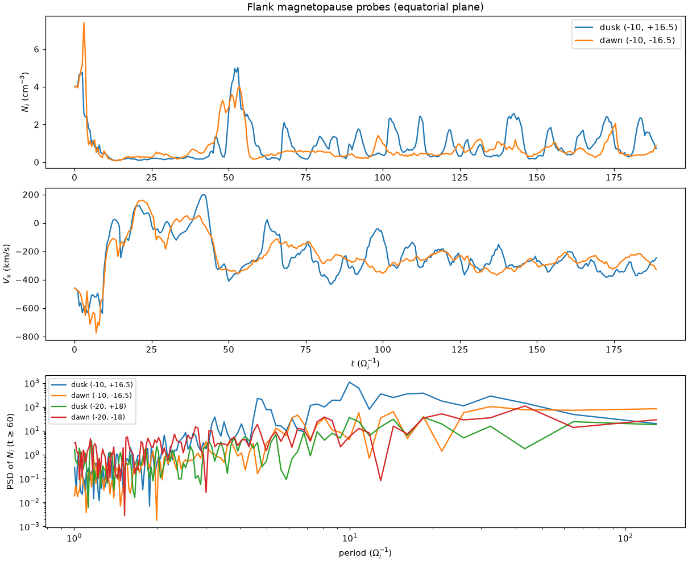

**🔰 新手读图**
1. **这张图在回答什么问题：** 在侧翼放“虚拟卫星”记录密度和速度，扰动有没有大致固定的周期？
2. **先认坐标和颜色：** 上两行是 x=−10 Rₑ 处两个探针（昏侧、晨侧）的时间序列：密度 N 和速度 Vx，横轴时间 t。第三行是“频谱”：横轴是周期（代码单位），纵轴是相对谱功率（某个周期的起伏有多强），包含 x=−10 和 −20 两处共四条曲线。谱峰=最“常见”的节拍。
3. **按顺序看这几处：** ① 上两行：昏侧密度有一串尖脉冲，并与 Vx 变化同时出现。② 第三行各曲线最高峰：x=−10 昏侧约 10、晨侧约 32；x=−20 两侧约 18.5 和 21.6 单位。③ 记住整段只有约 129 单位长，10 单位周期只重复了约 13 次。
4. **看到了什么，说明什么：** 频谱像把一段鼓声拆成不同节拍：有明显峰，说明边界扰动有某种“节奏”。若按周期约 10 单位（约 2.6 分钟）并假设波速 200 km/s，可估波长约 4.9 Rₑ——但 200 km/s 是假设，不是测出来的。
5. **新手容易误读：** ① 没做背景噪声检验和置信区间，峰值是“候选周期”不是确定结论。② 两个探针离各自磁层顶的距离不同，幅度差不能直接说成全球晨昏差异；纵轴不是严格归一化的功率谱密度。

**方法核对。** 上两行只显示 x=−10 的两个探针 N 与Vx；第三行同时含 x=−10 和−20 的四个 N 谱。脚本对 t≥60 序列减均值、乘 Hann 窗，再计算 |rFFT|²。它不是 Lomb–Scargle，纵轴也未经完整 PSD 归一化，宜称相对谱功率。

**定量证据。** x=−10 昏侧 N 峰值周期约9.96代码单位，晨侧约32.37；x=−20 两侧分别约18.50和21.58。昏侧强脉冲与局地尾向速度变化同时发生，具有边界反复扫过的可能。整段长度约129单位，对10单位周期仅有约13次循环，对32单位仅约4次。

**物理解释。** 由 P≈10、ut=15.685 s 和假定相速200 km/s 可得 λ≈4.9 Rₑ；这是条件估算，200 km/s 并非该谱测出的相速。要支持 KH 传播，应以两个沿边界探针的相位或时延测 cph，再检验 λ=cphP。

**结论。** 数据显示有限时段中的准周期成分，尚无红噪声背景检验或谱峰置信区间。固定 ±y 位置相对两侧磁层顶的距离不同，可显著影响脉冲幅度；因此不能把探针幅度比直接提升为全局晨昏物理差异。

### F22 · 雷诺应力与平面内波动能剖面

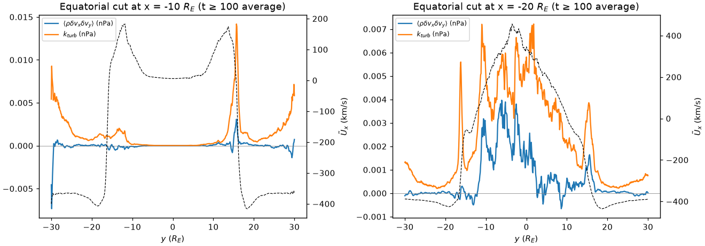

**🔰 新手读图**
1. **这张图在回答什么问题：** 侧翼和磁尾里的“乱流”有没有在横向传递沿日地方向的动量？传递在哪里最强？
2. **先认坐标和颜色：** 两个小图分别是 x=−10 和 x=−20 Rₑ 处横穿磁层的一条线（横轴 y，−30 到 30 Rₑ，正为昏侧），都是 t≥100 的时间平均。蓝线=雷诺应力 ⟨ρδvxδvy⟩（左纵轴，nPa），橙线=面内速度起伏的动能密度 k_turb（左纵轴），黑虚线=平均流速 Ux（读右纵轴，km/s，负=向尾）。
3. **按顺序看这几处：** ① 左图黑虚线：两侧约 −400 km/s（磁鞘快速向尾），中间接近 0 甚至为正（磁层内）；两侧陡变处就是边界。② 左图 y≈16 处：蓝线一个约 0.003 nPa 的小尖峰，正好在昏侧边界上，橙线也在这里冒尖。③ 右图（x=−20）：蓝线在中间 y≈−10 到 0 一大片都抬高（最高约 0.004 nPa），对应尾部高速流通道。
4. **看到了什么，说明什么：** 雷诺应力衡量的是“乱流带着动量横着走”：x 方向速度的起伏和 y 方向速度的起伏同步出现时，就像人群里推推搡搡，把前进方向的动量一点点传给旁边的人。x=−10 处主要在边界上传递；x=−20 处则在尾部通道里也很强，说明不都是磁层顶的“摩擦”。
5. **新手容易误读：** ① 真正加速平均流的是应力沿 y 的变化率，不是应力本身的正负。② 这里 nPa 只是量纲相同，不是热压；图边缘 y≈±30 处的尖峰可能是分析边界效应，不要当物理信号。

**面板与定义。** 本图包含 x=−10 与−20 两列，并非只有 x=−10。蓝线为 Favre 相关应力，橙线为两个面内速度分量的波动动能密度，黑虚线读右轴，为密度加权平均 Vx。能量密度以 nPa 表示是量纲等价，不能当作各向同性热压。

**图中证据。** x=−10 昏侧 y≈16 Rₑ 附近的相关应力峰约0.0031 nPa；x=−20 晨侧/中心片附近可达约0.0040 nPa，空间分布更宽。后者说明应力不仅在磁层顶，也可来自尾部通道和流动改变，不能一律称边界“粘性”。

**动量解释。** Rxy 是 x 动量沿 y 面的相关通量。给定 x 指向太阳，Rxy>0 的含义必须连同 y 法向和目标区域确定；平均流加速取决于 −∂yRxy，而非单看 Rxy 的符号。磁应力、平均对流与压力通量也可能同量级。

**结论。** 图中确有可测的相关动量输运，尚未证明它是全球驱动中的主项或等效常黏度。原图极端 y 边缘处尖峰接近分析域边界，需单独排除边界和截取效应。建议优先比较固定边界坐标内的应力及其散度。

### F23 · 赤道面 Favre 平均六面板

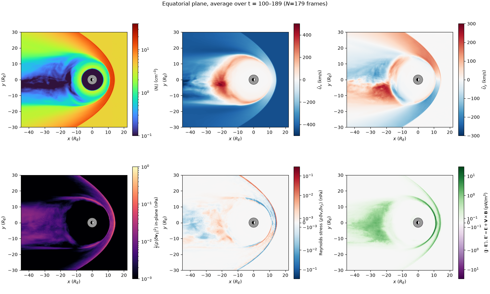

**🔰 新手读图**
1. **这张图在回答什么问题：** 把 t=100–189 共 179 帧平均起来，赤道面里“平均状态”的流动、乱流和能量转换各在什么位置？
2. **先认坐标和颜色：** 六个赤道面面板，太阳在右，上方昏侧。上排：平均密度 ⟨N⟩（对数）、密度加权平均速度 Ũx（红=向太阳）、Ũy（红=向昏侧/上，蓝=向晨侧/下）。下排：面内速度起伏能（对数，越亮越强）、雷诺应力（对称对数，红正蓝负）、⟨J·E′⟩（电流对等离子体做功的指标，绿=正、紫=负）。
3. **按顺序看这几处：** ① Ũx 面板：磁层内大片红色，x≈−20 附近最深——平均意义上存在向地球的流动通道。② Ũy 面板：尾部上蓝下红、并且偏向一侧——平均流向两侧分开。③ 起伏能和雷诺应力：沿弓激波和侧翼边界、以及尾部集中。④ J·E′ 面板：激波处一条深绿弧带，尾部也有一片绿色。
4. **看到了什么，说明什么：** 时间平均像长曝光照片：一闪而过的东西被抹掉，经常出现的通道和“热点”留了下来。所以能看出向地球的流在哪、乱流在哪、能量在哪转换——是一张“交通流量热力图”。
5. **新手容易误读：** ① 平均后某方向偏置不等于永久的对称性破缺；“起伏能”也不全是成熟湍流，还混有边界来回扫过。② J·E′ 的绿色面积不能直接当作“加热多少”或“太阳风能量输入效率”。

**统计与读法。** 179帧、t≥100；N 是普通时间平均，而速度和相关应力使用密度加权统计。左下是仅含 x、y 速度的波动能，右下是逐帧 J·(E+Ui×B) 后再平均。后者不是由平均场直接相乘得到。

**图中证据。** 平均图保留了日侧压缩磁鞘、内侧向日回流和尾部地向通道；平均 Vy 也显示明显偏向。相关应力和波动能在侧翼及尾部集中，右下非理想功在弓激波和部分内部结构增强。

**物理解释。** 时间平均抹平移动波包，却可保留持续偏置；偏置并不自动说明永久对称性破缺。Favre 平均能将密度与流速的耦合纳入动量通量，但有粒子噪声、边界扫过和间歇流时，“波动能”不全是成熟湍流。

**结论。** 该图适合描述平均输运通道和候选能量转换区域。不能由面内动能推断完整三维湍动能，也不能用 J·E′ 的绿色面积衡量不可逆加热或太阳风能量输入效率；有关参考系的严格关系见 F36。

## 6. 磁尾结构、喷流与事件统计

### F24 · 子午面中心线的 x–t 图

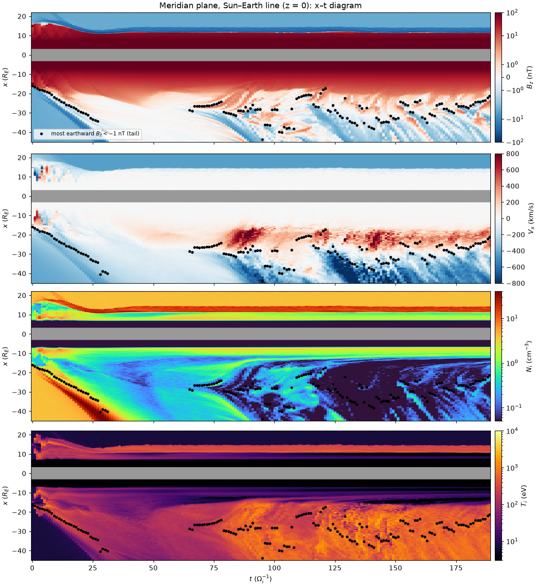

**🔰 新手读图**
1. **这张图在回答什么问题：** 沿子午面中心线（磁尾正中间的电流片），磁场和流动随时间怎么变？哪里可能有磁场重联的“X 点”？
2. **先认坐标和颜色：** 与 F05/F06 同类的 x–t 图：横轴时间 t，纵轴位置 x（下方是远尾）。四行依次为 Bz（红北蓝南）、Vx（红=向地球/太阳，蓝=向远尾）、密度 N、温度 Ti。黑点标出每个时刻最靠近地球、且 Bz<−1 nT 的位置，作为重联候选的粗略标记。
3. **按顺序看这几处：** ① t<30：黑点随初始结构一路向尾退——这是启动过程，不是 X 线后退。② t≈50 后：中心片重新出现蓝色（负 Bz）。③ t≈80 后：Vx 行出现上红下蓝的成对流，同时 N 变暗、Ti 变亮。④ 后期黑点从 −20 多 Rₑ 突然跳到约 −40 Rₑ。
4. **看到了什么，说明什么：** 磁尾中心正常应是 Bz>0（磁力线从南穿到北）；如果某处 Bz 变负，说明磁力线被“剪断再接上”后形成了 X 型或闭环结构。X 点两侧一边向地球喷、一边向远尾喷，就像捏住牙膏中间，两头都往外挤。
5. **新手容易误读：** ① 黑点只是“最近一个满足门槛的位置”，跳来跳去是换了一个结构，不是同一条 X 线在飞速移动，不能拟合加速度。② 负 Bz 也可能在磁岛内部，并不一定就是 X 点本身。

**问题与读法。** 四行依次为 Bz、Vx、N、Ti；黑点仅标出最靠地球的 Bz<−1 nT 位置。它们既不是磁场零点，也不是每一帧真实 X 线。尤其前30代码单位的黑点跟随初始结构向尾传播，不能解释为近地中性线逐步后退。

**图中证据。** t≈50 后重新出现负 Bz 候选区，t≈80 之后地向与尾向流变强，并伴随中心片密度降低和温度升高。后期黑点会从 −20 多 Rₑ 跳到 −40 Rₑ 附近，反映“最近满足门槛结构”的切换；它不必是同一个 X 线的连续轨迹。

**物理推理。** 流反转与 Bz 改号具有重联相容性，但负 Bz 也可位于磁岛或等离子团内部，过零位置不一定对应鞍点。Ti 在晚期稀薄区域的增强应同时检查粒子统计和密度下限。

**结论。** 该图可靠揭示启动与晚期活动的区别，支持尾部存在间歇喷流及磁场重构。黑点的离散跳跃更适合作为事件筛选线索，不能直接拟合 X 线加速度；应与 F25、F34 的另一种定义交叉比较。

### F25 · 宽条带平均的流反转代理

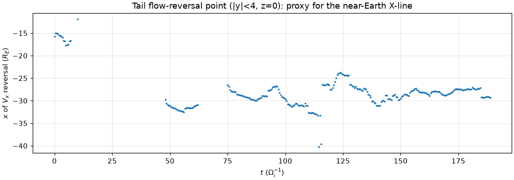

**🔰 新手读图**
1. **这张图在回答什么问题：** 用“流向反转点”（向地流和向尾流的分界处）来估计，磁尾的磁场重联点大约在哪、随时间如何变化？
2. **先认坐标和颜色：** 只有一个面板。横轴时间 t，纵轴是流向反转点的 x 位置（Rₑ，越往下离地球越远）。每个蓝点是一个时刻的估计；没有点的时段表示没找到满足条件的反转（比如 t≈10–48）。算法：先在赤道面 |y|<4 Rₑ 的宽条带里平均 Vx，再找“地向流 >150 km/s”与“尾向流 <−150 km/s”相邻处取中点。
3. **按顺序看这几处：** ① t<10 的几个点在约 −15 Rₑ：启动期。② t≈48 后点出现在 −30 Rₑ 附近。③ t≈75 以后大多在 −24 到 −33 Rₑ 之间缓慢游走，偶有跳变（如 t≈115 跳到约 −40）。
4. **看到了什么，说明什么：** 磁场重联点像一个“分水岭”：岭的地球一侧水往地球流，另一侧往远尾流。找到分水岭，就大致找到了重联点。t≥80 的统计中位数约 −28.6 Rₑ，说明这套模拟里重联候选区大约在离地球二三十个地球半径的磁尾中。
5. **新手容易误读：** ① 这是“流动代理”，不是磁场拓扑上严格的 X 点；速度停滞点与磁 X 点在移动或不对称重联中不必重合，和 F24 的 Bz 代理差几个 Rₑ 属于方法依赖。② 宽条带平均会把不同通道混在一起，点的跳跃不代表 X 线真的瞬移。

**实际算法。** 先对 |y|<4 Rₑ 的 Vx 平均，再作沿 x 的十点平滑。脚本寻找最尾侧的 Vx>150 km/s 样本，再找其尾向相邻的 Vx<−150 km/s 点并取中点；它不是简单地从 −8 Rₑ 起遇到的第一个零点。

**图中证据。** 启动期少数点位于 −15 Rₑ 左右；t≈48 之后又在更远尾部出现代理。已有 probes.json 中位数−28.6 Rₑ及10–90%区间−31.05至−26.55 Rₑ使用的是 t≥80，不是原报告表格写的 t≥100。

**物理解释。** 宽达8 Rₑ 的横向条带降低噪声，却也混合不同喷流通道。如果同一 x 上晨昏侧流向不同，平均反转位置可偏离局地磁场拓扑；速度停滞点与磁 X 点在非对称或移动重联中也不必重合。

**结论。** 该图证明尾部存在成对不同方向的强流区，但其坐标属于流动代理。应保留统计窗口差别，并将它与 Bz 过零代理之间约数 Rₑ 的差异列为方法依赖，不把两者差值完全归因于同一 X 线的运动。

### F26 · t≈90 的尾部子午面

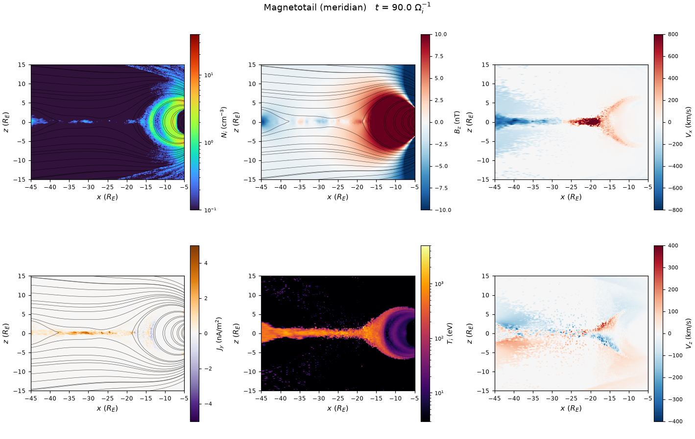

**🔰 新手读图**
1. **这张图在回答什么问题：** t≈90 时，磁尾中心的电流片附近长什么样？能看到磁场重联喷流吗？
2. **先认坐标和颜色：** 子午面磁尾局部：横轴 x 从 −45 到 −5 Rₑ（右边靠近地球），纵轴 z（±15 Rₑ）。上排：N（对数）、Bz（红=朝北，蓝=朝南，±10 nT 封顶）、Vx（红=向地球，蓝=向远尾，±800 km/s 封顶）；下排：Jy（电流密度，橙=正）、Ti（对数）、Vz（红=向北，蓝=向南）。黑线是面内磁场曲线。
3. **按顺序看这几处：** ① Jy 面板：z=0 处一条细橙线——尾部电流片。② Bz 面板：约 −23 Rₑ 附近颜色从红变白/蓝，即 Bz 过零（复算约 −23.4 Rₑ）。③ Vx 面板：约 −20 Rₑ 处一团深红（强烈向地流），它左边是蓝色（向尾流）。④ Vz 面板：x≈−15 到 −12 处上红下蓝的“八”字形。
4. **看到了什么，说明什么：** 上下尾瓣磁场方向相反，被中间电流片隔开；在 X 点处反向磁力线“剪断再接上”，新接成的弯曲磁力线像拉满的弓弦向两边弹射等离子体：一股冲向地球（红），一股冲向远尾（蓝）。这就是磁尾磁场重联的“双向喷流”。
5. **新手容易误读：** ① 色标封顶 800 km/s，但实际最高向地速度可近 1000 km/s，不能从颜色读最大值。② 这是挑出来的强喷流时刻，早于 t≥100 的晚期统计，不代表“典型”流速；电流片看起来的宽度也受网格和色标影响。

**面板与重点。** N、Bz、Vx、Jy、Ti、Vz 展示电流片附近的空间结构。Bz 色标为±10 nT，Vx 为±800 km/s；相同饱和色不能读出真实峰值。尾瓣的大面积低密度与中央薄片必须联合看。

**复算证据。** t=90.011 的中心条带平滑 Bz 过零代理约−23.4 Rₑ，地向喷流强、尾侧为负 Vx。对 −44<x<−12 Rₑ 条带剖面，Vx 的空间1–99%分位约为−687到+996 km/s；上端超过图中颜色上限，故不能从图读成最高800。

**物理联系。** 中央 Jy 集中、反向尾瓣场与两向流组合支持局地重联相容过程。电流片的可见窄度受网格、插值和色标阈值影响；仅从橙色带宽不能精确得到离子尺度厚度。

**结论。** 本图是强喷流阶段的例子，但它早于 t≥100 的晚期统计，不能用它代表晚期典型流速。需要区分“所选强事件”和“时间中位状态”；两者差异正是磁尾间歇性的表现。

### F27 · t≈125 的尾向团状结构

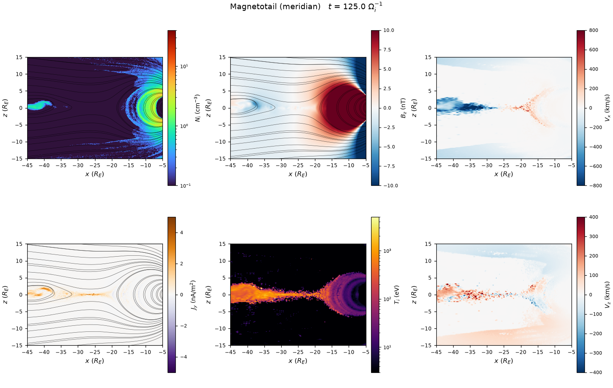

**🔰 新手读图**
1. **这张图在回答什么问题：** t≈125 时，远尾出现的一团高密度结构，是不是被磁场重联“切下来”向远处抛的等离子团（磁岛）？
2. **先认坐标和颜色：** 同 F26 的六面板（N、Bz、Vx / Jy、Ti、Vz），横轴 x=−45 到 −5 Rₑ，纵轴 z，右侧靠地球。
3. **按顺序看这几处：** ① N 面板左端 x≈−40：一个亮绿色的团块，周围黑线绕成闭环。② Bz 面板同一位置：闭环左右 Bz 一正一负。③ Vx 面板 x≈−40 到 −30：深蓝强尾向流；而 −20 附近只有弱的红色向地流。④ Jy、Ti 面板：团块处电流增强、温度较高。
4. **看到了什么，说明什么：** 如果磁尾里有两个 X 点同时“剪断再接上”，它们之间会被裹出一个闭合的磁场“气泡”，里面装着热的等离子体；这个气泡被尾向喷流推着往远尾漂走，好比从牙膏管中间挤出的一段被甩出管口。密度团＋闭环场线＋尾向流＋电流增强同时出现，是比单看负 Bz 更强的候选证据。
5. **新手容易误读：** ① 二维切面上的闭环不能证明三维的磁通真的封闭（三维磁通绳可以穿出切面）。② 本时刻尾向流明显强于地向流，不能套用 F26 的近千 km/s 向地数字；Bz 过零代理约 −24.7 Rₑ。

**图中证据。** 远尾约 x=−40 Rₑ 有密度增强，平面内场线围成闭环；对应 Vx 为强尾向、Jy 局部增强，Ti 较高。向地一侧则存在较弱地向流，中央两种流向之间的区域不能只靠一条场线判断。

**定量核对。** t=125.018 的中心条带 Bz 过零代理约−24.7 Rₑ；同一尾区 Vx 空间1–99%分位约−893到+322 km/s。该时刻尾向流明显强于地向流，不能沿用 F26 的近千 km/s 地向强事件作为本图数值。

**物理解释。** 密度团、环状场线、尾向流和电流结构共址，提供了比单看负 Bz 更强的磁岛/等离子团候选证据。但三维磁通绳可穿出切面，无法仅凭平面闭环证明整体磁通闭合或完成抛射。

**结论。** 本图支持远尾存在随尾向流输运的团状磁结构；“形成于哪个 X 线、沿何路径离开”仍需邻帧追踪。与 F24 斜纹关联时，应按时间与 x 同时配对，不能只比较相似形状。

### F28 · t≈150 的磁尾与尾瓣入流

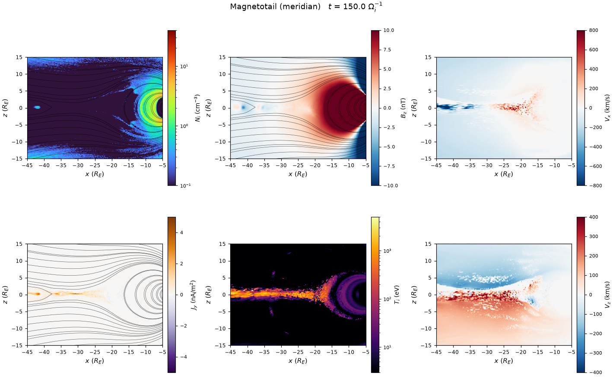

**🔰 新手读图**
1. **这张图在回答什么问题：** t≈150 时磁尾的结构如何？尾瓣里的等离子体是否在向中心电流片“汇流”（为磁场重联输送原料）？
2. **先认坐标和颜色：** 与 F26、F27 相同的六面板（N、Bz、Vx / Jy、Ti、Vz），子午面，横轴 x=−45 到 −5 Rₑ（右侧靠地球），纵轴 z。注意 Vz 面板：红=向北，蓝=向南。
3. **按顺序看这几处：** ① N 面板左端 x≈−42：一个小密度团，周围黑线弯成尖角——和 t≈125 不在同一位置。② Vx 面板：约 −25 到 −15 是红色向地流，x<−30 是蓝色向尾流；Bz 过零代理约 −30.6 Rₑ。③ Vz 面板：上半（北尾瓣）大片蓝=向南流，下半（南尾瓣）大片红=向北流——上下都朝中心面汇集。
4. **看到了什么，说明什么：** 尾瓣像两条从上下两侧往中间挤的“传送带”，把磁力线和等离子体送进电流片；在电流片里磁力线“剪断再接上”，再从左右两头喷出去。在 −24<x<−20、5<|z|<9 Rₑ 区域，离子朝片层的平均速度约 125 km/s，与 E×B 漂移（电场和磁场共同造成的整体漂移）约 117 km/s 很接近，说明这一刻的汇流就是磁场带着等离子体一起“对流”。
5. **新手容易误读：** ① 这种吻合只在本帧成立：t≈90、125 同一区域二者差得很远，不能说所有时刻 Vz 都等于 E×B 入流。② F03 中固定的“Tail X-line”箭头不能当作本帧 X 线的精确位置。

**图中证据。** 尾部中心片仍有局部密度团和两向流，但其空间位置不同于 t≈125。中心条带过零代理约−30.6 Rₑ，较 t≈125 更尾向；这也说明 F03 固定箭头不能充当本帧精确定位。

**入流复算。** 在 −24<x<−20、5<|z|<9 Rₑ 的双尾瓣区域，以 −sign(z)Vz 定义向片层的有向速度，离子平均约125 km/s，逐点 E×B 漂移的对应分量约117 km/s。这一时刻二者接近，支持局地垂直对流解释。

**必要对照。** 同一区域 t≈90 和125 的离子有向速度约3.2、0.4 km/s，而 E×B 对应约47.6、83.2 km/s。Ui 可以含平行流并与漂移叠加，所以不能把所有时刻的 Vz 都直接叫 E×B 入流。

**结论。** 本帧提供较好的尾瓣向片层对流例子，但不支持全时段 Ui=E×B/B²。要讨论磁通输运，应分解平行和垂直速度、检查非理想电场，并在 X 线邻近而非固定远处定义上游。

### F29 · t≈85 的赤道面强喷流

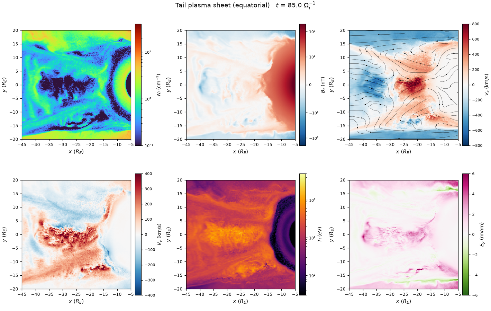

**🔰 新手读图**
1. **这张图在回答什么问题：** t≈85 时，从“俯视”（赤道面）看磁尾等离子体片，强喷流的通道是什么形状、往哪边偏？
2. **先认坐标和颜色：** 赤道面磁尾局部：横轴 x=−45 到 −5 Rₑ（右侧靠地球），纵轴 y=±20 Rₑ（上方昏侧）。上排：N（对数）、Bz（对称对数，红北蓝南）、Vx（红=向地球，蓝=向远尾，带速度流线）；下排：Vy（红=向昏侧/上，蓝=向晨侧/下）、Ti（对数）、Ey（晨昏方向电场，粉=正、绿=负，±6 mV/m）。
3. **按顺序看这几处：** ① Vx 面板中心约 x=−25 到 −18：一块深红高速向地流；它左侧 x<−30 为蓝色向尾流（Bz 过零代理约 −25.8 Rₑ）。② 流线：红区里的流到地球附近向上下两边分开绕行。③ Vy 面板：红区里大片偏红，说明喷流还有横向偏转。④ Ey 面板：中心通道里粉色增强。
4. **看到了什么，说明什么：** 从上往下看，向地喷流像一股冲向墙壁的水柱：跑到地球附近“撞墙”后向晨昏两侧分流。赤道面能看到这种横向组织，说明喷流不是沿一条直线的一维现象。电场 Ey 增强是因为快速流动穿过磁场会产生电场（就像导线切割磁力线产生电动势）。
5. **新手容易误读：** ① 赤道面看不到上下尾瓣反向的 Bx，单凭这张图不能确认 X 型结构。② Ey 粉色区域大部分是对流电场，不能直接当作“重联电场”，更不能说重联效率超过 100%；这是挑出来的强事件，不代表晚期常态。

**读图重点。** 上排 N、Bz、Vx，下排 Vy、Ti、Ey；只有 Vx 面板叠加速度流线。赤道面能展示横向喷流通道和晨昏偏折，却看不到上下尾瓣反向 Bx，不能单凭这张图确认子午面 X 型结构。

**定量证据。** 中心条带过零代理约−25.8 Rₑ，尾区 Vx 的空间1–99%分位约−574到+804 km/s。Ey 在窄通道里增强，但有正有负，不能把整个红区看成同一个重联电场。

**物理联系。** 地向流、横向偏折和温度升高说明喷流不仅沿一维日地线发展。实验室系 Ey 包含对流电场；一般有 Ey=−(Ui×B)y+E′y，故 Ey>Esw 既可能来自快流与局地强场，也可能包含非理想项，并不自动意味着局地重联效率超过100%。

**结论。** 这是一帧用于展示强流通道的事件图。其时刻接近 DF 记录最密集的早段，不能把图中强度推广到晚期分布；稳健的率值必须在候选 X 线、正确参考系和相同上游归一化下测量。

### F30 · t≈125 的赤道面横向结构

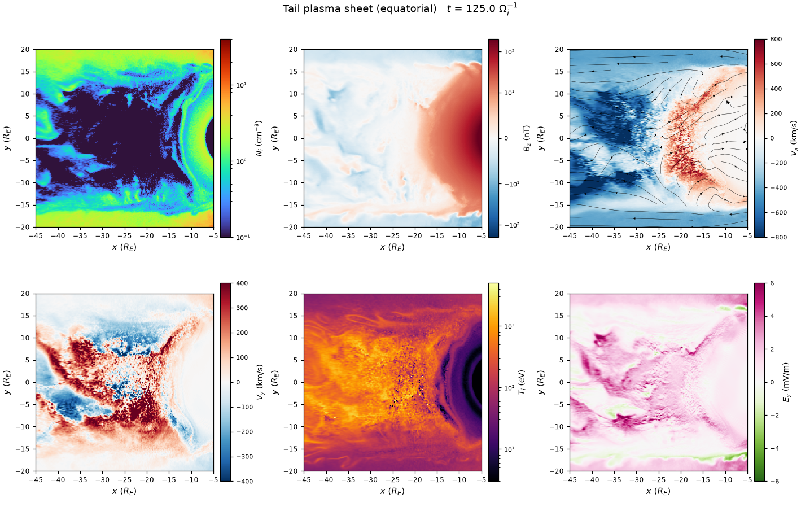

**🔰 新手读图**
1. **这张图在回答什么问题：** t≈125 时，磁尾等离子体片在晨昏方向上有什么横向结构？
2. **先认坐标和颜色：** 与 F29 相同的六面板（N、Bz、Vx+流线 / Vy、Ti、Ey），赤道面磁尾，横轴 x=−45 到 −5（右侧靠地球），纵轴 y（上方昏侧）。
3. **按顺序看这几处：** ① Vx 面板：左侧 x<−25 大片深蓝（宽阔的尾向流），右侧约 −22 到 −12 是一条斜着的红色带（向地流集中在更靠地球处）。② Vy 面板：红蓝交错的条块——流在左右来回偏转。③ N 面板：中心一大片深紫稀薄区，四周有密度细丝。④ Ey 面板：粉色细结构与 Vy、Bz 的细节部分重合。
4. **看到了什么，说明什么：** 把它和同一时刻的子午面 F27 一起看，就像同一个物体的“俯视图”和“侧视图”。横向偏流很重要：固定在中心线上的探针看到 Vx 变小，可能只是流“拐弯走了”，并不一定是被刹车减速——就像站在路中间看车流变少，也可能是车辆改走了旁边车道。
5. **新手容易误读：** ① 赤道面与子午面的中心线是相交的，所以两张图 Bz 过零代理相近（约 −24.7 Rₑ）不算两次独立验证。② 两张二维切面拼不出完整三维体积，离面结构和物质来源仍未知。

**图中证据。** 尾部密度细丝与 Vy 的红蓝区域表明通道具有明显横向组织；尾向喷流范围宽，而向地喷流在较靠地球的位置集中。Ey 与 Vy、Bz 的细结构部分共址，提示对流项可能重要。

**定量对照。** 中心条带过零代理约−24.7 Rₑ，与同一时刻子午面结果相近；Vx 的空间1–99%分位约−898到+427 km/s。两切面中心线相交，因此相近的中心线数值并非两套完全独立的三维验证。

**物理解释。** 横向分流可以使固定中心探针看到 Vx 下降，即使沿喷流自身轨迹速度未下降。它也能把一个三维结构分割成多个二维密度块，这正是需要将流制动与通道偏转分开的原因。

**结论。** 本图帮助解释为什么一维速度剖面不足以确定制动力。与 F27 联合可描述同一时间的垂直/水平截面，却不能把两张图拼成完整三维体积；离面结构和物质来源仍未知。

### F31 · t≈160 的晚期赤道面磁尾

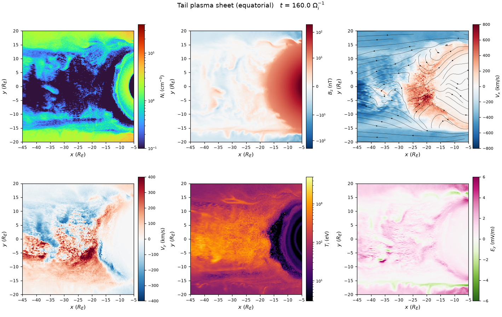

**🔰 新手读图**
1. **这张图在回答什么问题：** 到模拟晚期（t≈160），磁尾里的地向/尾向喷流还在吗？
2. **先认坐标和颜色：** 与 F29、F30 相同的六面板（N、Bz、Vx+流线 / Vy、Ti、Ey），赤道面磁尾，右侧靠地球，上方昏侧。
3. **按顺序看这几处：** ① Vx 面板中央约 x=−25 到 −15、y≈−5：红色向地流仍在，但比 F29 弱。② 外侧上下边缘（磁鞘/边界层）：一致的蓝色尾向流，这是太阳风绕流，不是重联喷流。③ Vy 面板：中心红、右侧蓝的分区——喷流靠近地球时向两侧偏转。④ Bz 过零代理约 −22.3 Rₑ。
4. **看到了什么，说明什么：** 只要太阳风持续带着南向磁场吹来，磁尾就会不断“充磁—释放”，像不停被压紧又松开的弹簧，所以晚期活动并没有停止，只是位置和强度在变。
5. **新手容易误读：** ① 不能把本帧和 t≈125 的 X 位置差除以时间当作 X 线移动速度，因为算法可能换了一个过零结构。② “多个时刻都有喷流”不能证明存在固定周期的重联循环；还要注意先用 N 和 Ti 区分中央等离子体片和边界层，不要把边界层的绕流误当喷流。

**比较目标。** 相比 F29 的早期强事件，晚期流通道是否仍有地向、尾向分支？先看 Vx 的主通道，再用 N 和Ti 确认其所处区域，避免把边界层尾向绕流认成中央重联喷流。

**图中证据。** 中央地向流仍然存在，外侧磁鞘/边界区域主要尾向，Vy 体现横向偏转。中心条带过零代理约−22.3 Rₑ，Vx 的空间1–99%分位约−677到+401 km/s，整体与 F29 的强地向事件不同。

**物理含义。** 持续南向驱动可以维持间歇活动，而候选 X 区、流通道位置及强度随时间变化。不能用本帧与 t≈125 的位置差直接计算某条 X 线速度，因为算法可能在不同过零结构之间切换。

**结论。** 晚期活动并未停止，但“多时刻存在喷流”不足以证明一个固定周期的重联循环。要得到周期，应先构造事件目录，再估计等待时间与不确定性；不能从三张挑选快照推断全局周期。

### F32 · 地向流出现率与近地减弱

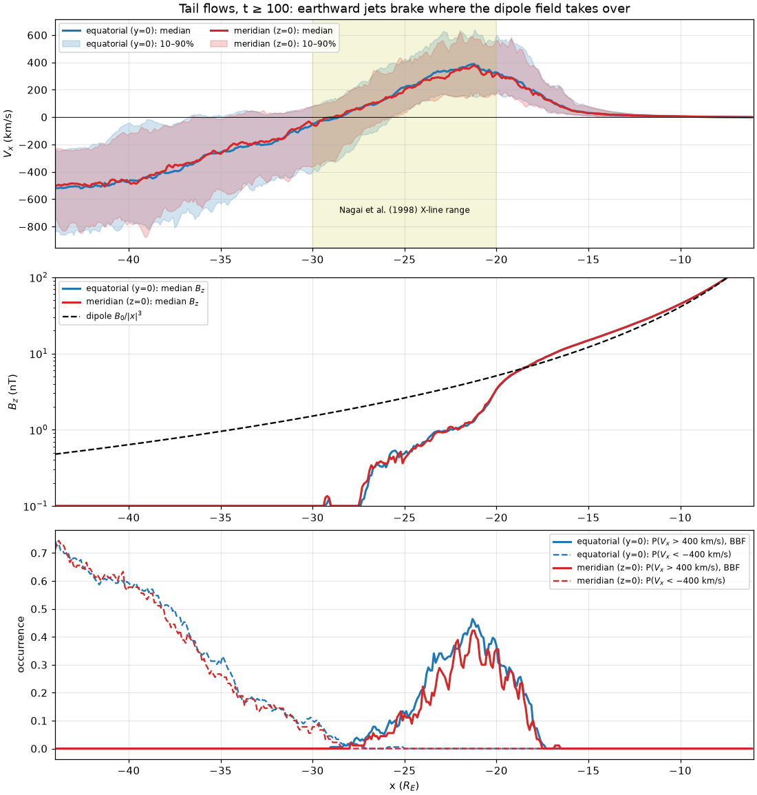

**🔰 新手读图**
1. **这张图在回答什么问题：** 磁尾里冲向地球的高速流，越靠近地球是不是越少、越慢？在哪里被“刹住”？
2. **先认坐标和颜色：** 三个面板共用横轴 x（−44 到 −6 Rₑ，右侧靠地球），都是 t≥100 的统计；蓝=赤道面中心线，红=子午面中心线。上图：Vx 中位数（粗线）与 10–90% 范围（阴影），正值=向地；黄色带是 Nagai 等人观测到的 X 线常见范围（−20 到 −30 Rₑ）。中图：Bz 中位数（对数轴），黑虚线=偶极场。下图：速度超过 +400 km/s（实线，向地高速流，即 BBF“爆发式整体流”）和低于 −400 km/s（虚线，向尾高速流）的出现比例。
3. **按顺序看这几处：** ① 上图约 −21 Rₑ：向地速度中位数达到峰值约 388 km/s；往右到约 −17 Rₑ 就降到 100 km/s 以下。② 中图同一段：Bz 从很小迅速增大到接近偶极场。③ 下图实线：在 −22 到 −20 附近约 35–45%，到 −17 Rₑ 附近降到 0。
4. **看到了什么，说明什么：** 向地高速流像冲向停车场的车：越靠近地球，偶极磁场越强越“硬”，像一块越来越厚的缓冲垫，高速流在约 −17 Rₑ 附近基本被挡住或拐开。按探针统计，P(Vx>400)：−22 Rₑ 约 37%、−18 Rₑ 约 9%、−16 Rₑ 为 0；换门槛趋势不变，说明“近地高速流减少”结论稳健。
5. **新手容易误读：** ① 中图左侧水平平台是把很小或负的 Bz 截到 0.1 nT 画出来的，不是真实恒定值。② “减少”不等于已证明“被磁压刹车”：固定位置看到的减少也可能来自流向两侧偏转；这里的百分比也不能直接与卫星观测的 BBF 发生率比较。

**统计读法。** 上图是中心条带速度中位数及10–90%区间，中图是 Bz 中位数，下图为超过 ±400 km/s 的样本比例。中图将非正或很小的 Bz 截到0.1 nT 后画对数轴，因此远尾水平平台不是实测恒定正 Bz。

**定量证据。** 赤道面速度中位数在约−21.2 Rₑ 达388 km/s，向地到约−16.9 Rₑ 低于100 km/s。另用5×5探针缓存核对得到 P(Vx>400)：−22、−20、−18、−16 Rₑ 处约37.4%、35.8%、8.9%、0；改变门槛到200、300、500 km/s 后仍有向地减弱，趋势稳健。

**物理解释。** 速度减弱与背景 Bz 变强在空间上接近，符合流制动候选图像，但不等于已经量出磁压力。只有沿同一流团的 DU/Dt 才能识别真正减速，固定位置占比还混有偏转、通道宽度和事件占空比。

**结论。** “近地高速流减少”比“磁压已证明使所有喷流制动”更有证据。模拟与观测的 BBF 百分比必须匹配选择条件；这里只使用单一速度门槛，没有完整事件时长和等离子体片筛选，不能直接比较总体发生率。

### F33 · DF 检出与叠加时序：窗口改变后的检验

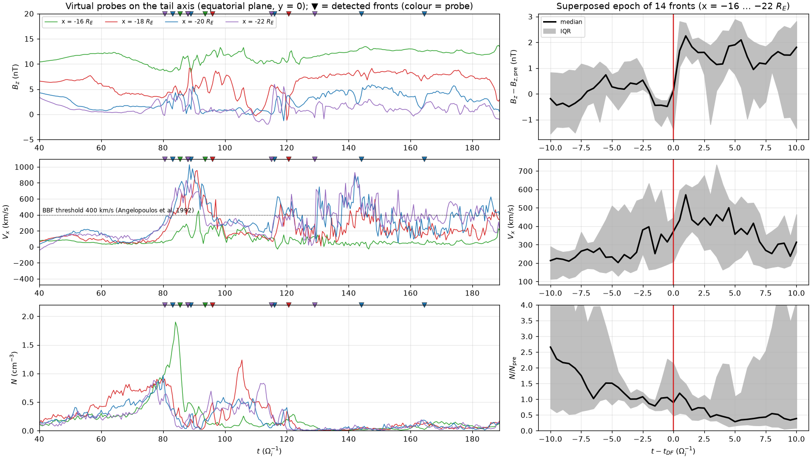

**🔰 新手读图**
1. **这张图在回答什么问题：** 磁尾快流前沿有没有“偶极化锋面”（DF，磁场 Bz 突然跳高的锋面）？把多次事件叠在一起，平均长什么样？
2. **先认坐标和颜色：** 左侧三行是 4 个虚拟探针（绿 −16、红 −18、蓝 −20、紫 −22 Rₑ，赤道面 y=0）的时间序列：Bz、Vx、N，横轴 t（从 40 开始）；顶部倒三角=检出的锋面（颜色对应探针）；Vx 图里虚线是 400 km/s 的 BBF 门槛。右侧是“叠加时序”：把 14 次锋面的时刻对齐到 0（红竖线），黑线=中位数，灰带=四分位范围；三行分别是 Bz 变化量、Vx、N/N_pre（锋面前后密度比）。
3. **按顺序看这几处：** ① 左图倒三角大多集中在 t≈80–100，t≥100 只有 6 个。② 右上：0 时刻 Bz 由负到正跳升约 2 nT。③ 右中：同时 Vx 冲到约 500–570 km/s。④ 右下：全样本密度似乎下降，但灰带极宽。
4. **看到了什么，说明什么：** DF 像高速流前面的“推土板”：磁场被压缩堆积，所以 Bz 突然跳高，后面紧跟高速流。早期样本里锋面后常常密度较低（像一个“空心气泡”），但只看 t≥100 的 6 条，密度后/前比约 1.03——几乎不变，所以“低密度气泡”这一点不稳健。
5. **新手容易误读：** ① 用“Bz 跳升+高速流”挑出事件，再看平均有 Bz 跳升和高速流，部分是挑选规则本身造成的，不是独立验证。② 相邻探针可能记录同一个锋面，14 条记录≠14 个独立锋面。

**实际方法。** 四个探针对 t>40 做 ΔBz 的两单位差分筛选；同探针记录间隔要求>6单位。叠加前基线实际为 tDF−3 至−1 的五帧，不是旧文写的−6至−2；跃升数值取+1至+2.5单位。右图曲线为逐时刻中位数±IQR，而表中跃升和峰值有些采用跨记录均值，不能统一称中位数。

**关键复算。** 全部14条记录的平均跃升约1.86 nT、密度后/前比中位数0.82、平均记录峰速559 km/s；只保留 t≥100 的6条，分别约2.25 nT、1.03、570 km/s，温度后/前比约1.53。晚期子集仍有场跃升和高速流，但“跃升后密度降低”不再稳健。

**选择效应。** 以 Bz 跃升和Vx 筛选后，再画平均 Bz 跃升与高速流，部分特征是选择规则本身带来的；它们不是完全独立验证。相邻探针还可能检出同一结构，14条记录不能视作14个独立锋面。

**结论。** DF 候选存在，但低密度“气泡”的一般结论应撤回。Runov 的观测工作采用多探针传播识别：[Runov et al. (2009)](https://agupubs.onlinelibrary.wiley.com/doi/full/10.1029/2009GL038980)。本模拟下一步应跨探针配对并去重，分别报告早段和晚段，而不是用全时段 SEA 掩盖样本差异。

### F34 · 磁尾 X 线位置、局地电场与条件样本

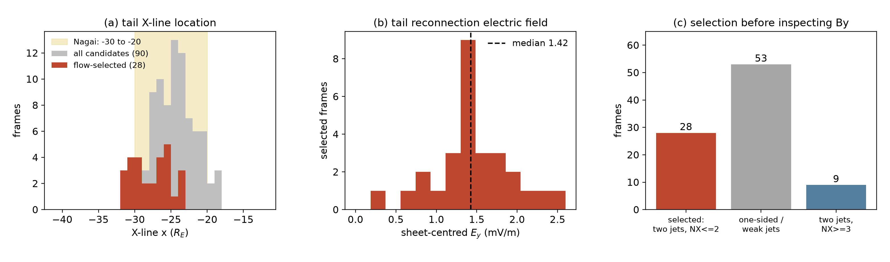

**🔰 新手读图**
1. **这张图在回答什么问题：** 磁尾候选在哪里？局地电场多大？后续霍尔检验究竟用了哪些时刻？
2. **先认坐标和颜色：** 左图灰色是全部 90 帧候选位置，红色是 28 帧条件样本，黄带是 Nagai 的观测参考位置。中图是条件样本的 Ey，单位 mV/m。右图是筛选分类，不是日侧电场。
3. **按顺序看这几处：** 全部候选位置中位数 −24.76 Rₑ；条件样本为 −27.71 Rₑ。中图 Ey 中位数 1.42 mV/m。右图共 28+53+9=90 帧，未选中的样本没有被隐藏。
4. **看到了什么，说明什么：** 在片层中心附近能测到局地电场，且存在双向喷流时刻；这些是后续检验的样本背景。电场不是无量纲率，更不是局地耗散率。
5. **新手容易误读：** 28 帧是输出时刻，不是 28 个独立事件。条件比例不能当成整个磁尾、全部时间的发生率；1.42 mV/m 也不能直接和经典的无量纲 0.1 比。

**方法与定位。** 在 t≥100 的 90 帧子午面中，先沿 z 找离 z=0 最近的 Bx 过零，得到电流片中心 z_c(x)。沿该中心的 Bz 作 11 点平滑，在 −40<x<−12 Rₑ 内寻找由尾向负值到地向正值的过零点，取最靠地球的候选。两侧各 6 Rₑ 内的沿片层 Vx 峰值分别超过 +300 与低于 −300 km/s、且候选数≤2 的归入条件样本。筛选不使用 By 符号。

**定量证据。** 全部候选位置中位数 −24.76 Rₑ，10–90% 为 −29.55 至 −20.50 Rₑ。条件样本 28 帧，位置中位数 −27.71 Rₑ；在候选附近 |Δx|<0.5、|Δz|<0.3 Rₑ 取 Ey 平均，条件中位数为 1.424 mV/m。其余 53 帧为单侧或弱喷流，9 帧为双向喷流但候选数≥3；这些类别不等于判定“没有重联”。

**模型与不确定性。** 标准率为 R=Ey/(BL VA,L)，归一化依赖实际入流上游的场与密度。旧版在固定 z=0 与特定尾瓣采样下得到约 0.032，本版不将其与片层对齐、双向喷流筛选后的量混用，也不据此宣称模拟“整体偏慢”。recon_redo.json 中的 R 字段实际为 Ey/(BL Vout)，是出流归一化代理，不能直接和阿尔芬速度归一化的 0.1 比较，故不作为新版 PPT 的率结论。参考量级见 [Cassak et al. (2017)](https://arxiv.org/pdf/1708.03449)。

**日侧与全球效率。** 旧日侧 Ey≈0.478 mV/m 的生成采样位置未能独立重建，新版 PPT 已移除其柱图。局地 Ey/Esw 更不是能量通量比，不能解释成“27% 能量进入、73% 未进入”；全球重联电压需沿重联线积分，能量耦合还需相应通量预算。

## 7. 全局流型与能量指标

### F35 · 两个平面的平均速度流线

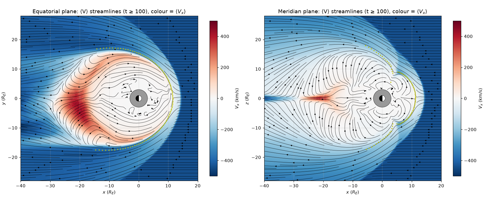

**🔰 新手读图**
1. **这张图在回答什么问题：** 长时间平均来看，磁层内的等离子体是怎样“循环流动”的？
2. **先认坐标和颜色：** 左=赤道面（x–y），右=子午面（x–z），太阳在右；都是 t≥100 的平均。颜色是平均 Vx（红=向太阳，蓝=背离太阳）；黑色带箭头的线是平均速度的流线（水流方向）；黄点=由平均场提取的磁层顶点。
3. **按顺序看这几处：** ① 左图 x≈−20 中央深红：向地流；流线到地球附近向上下（晨昏两侧）分开。② 左图贴着黄点内侧的流线：沿边界内侧向太阳方向回流（昏侧低纬边界层平均向日速度约 124 km/s）。③ 右图：上下尾瓣的流线都指向中间 z=0 的片层，再在约 −20 处汇成红色向地流。
4. **看到了什么，说明什么：** 这和 Dungey 循环（地球磁层的“传送带”模型）相符：日侧磁场重联把磁力线“打开”，太阳风把它们拖到尾瓣；尾瓣磁力线向中心片汇聚，在尾部重联后“闭合”，再沿两侧流回日侧——像旋转寿司的传送带一圈圈转。
5. **新手容易误读：** ① 平均场的流线不是某个粒子的真实轨迹，也不是磁力线；流线“闭合”不能推出磁通真的闭合。② 只能说“与 Dungey 循环相容”，完整循环要追踪开放磁通和日夜两侧重联电压，两个平面做不到。

**统计与读法。** 黑线为普通时间平均速度 ⟨Vx,Vy⟩ 或 ⟨Vx,Vz⟩ 的流线，不是密度加权速度流线。黄点是时间平均场提取的边界点，不能简单叫逐帧真实磁层顶。颜色只表示 ⟨Vx⟩，速度大小还取决于另两个分量。

**图中证据。** 赤道面内有地向流向两侧分开、沿边界内侧向日回流的图样；子午面尾瓣流指向中央片层。原缓存的昏侧 LLBL 平均向日速度约124 km/s，说明回流通道可在时间平均后保留。

**物理推理。** 这一图样与 Dungey 型磁通循环相容；但平均场的流线不等于流体元在时变场中的轨迹，也不是磁力线。速度分解还显示 Ui 与 E×B 不必逐时逐区相同，不能由流线闭合直接推出磁通闭合。

**结论。** 当前可以报告“循环相容的平均流型”。真正完整循环需要开放磁通随时间变化、日夜侧重联电压，以及磁通从打开到重新闭合的追踪；仅两个平面无法完成这一验证。

### F36 · 子午面平均应力与 J·E′

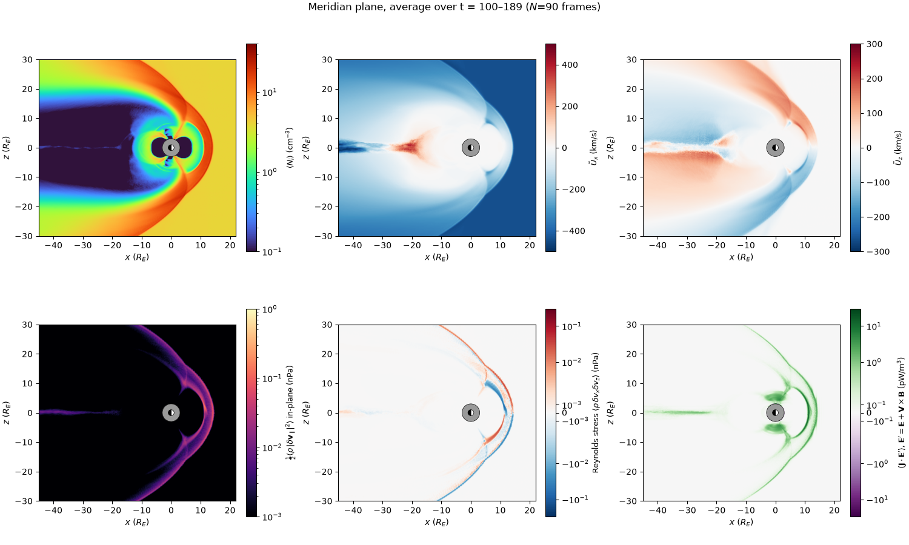

**🔰 新手读图**
1. **这张图在回答什么问题：** 子午面的平均状态中，动量传递（应力）和电磁能量转换（J·E′）主要发生在哪里？
2. **先认坐标和颜色：** 与 F23 同样的六面板，但切面是子午面（x–z），90 帧平均，太阳在右。上排：平均密度 ⟨N⟩、Ũx（红=向太阳）、Ũz（红=向北，蓝=向南）；下排：面内速度起伏能（对数）、雷诺应力 ⟨ρδvxδvz⟩（红正蓝负）、⟨J·E′⟩（绿=正，紫=负）。
3. **按顺序看这几处：** ① Ũz 面板：上半淡蓝、下半淡红——尾瓣向中心片汇流。② Ũx 面板：约 −20 处中心红色向地流，远尾蓝色向尾流。③ 雷诺应力面板：磁鞘/磁层顶附近红蓝成对反号。④ J·E′ 面板：激波弧、日侧磁层顶、极尖两个绿色“耳朵”以及尾部中心片都有绿色。
4. **看到了什么，说明什么：** J·E′ 正值表示电流在“给等离子体干活”（电磁能变成粒子能量），像电动机把电能变成动能；负值则像发电机。绿色集中的激波、极尖、尾片，正是能量转换最活跃的“车间”。
5. **新手容易误读：** ① J·E′（离子系）和 J·E（实验室系）不是一回事，正负区域可以不同，不能随意叫“负载”或“发电机”；正值也不等于不可逆加热。② 图上是 pW/m³ 的局地密度，二维切面不能积出整个磁层的总功率，不能据此说“全球以负载为主”。

**面板与证据。** 与 F23 同样是六面板，但有90帧、面内分量为 x、z。密度显示低密度尾瓣和薄片，速度显示地向流与尾瓣入流；相关应力在磁鞘/磁层顶附近反号，J·E′ 正值集中在激波、日侧和极尖附近，尾片亦有增强。

**必须区分的两个功率。** 定义 E′i=E+Ui×B 后，J·E′i=J·E−Ui·(J×B)。实验室系电磁能方程中的场—粒子功是 J·E；离子系指标扣除了洛伦兹力对整体流的功。二者的正负区域和面积可以不同，不能交换“负载/发电机”的称呼。

**机制边界。** 非理想功还不等于不可逆加热，进一步需要压力—应变、热通量和分布函数变化。参考系指标的定义可见 [Zenitani et al. (2011)](https://arxiv.org/pdf/1104.3846)，多种代理为何不同可见 [Pezzi et al. (2021)](https://arxiv.org/abs/2101.00722)。

**结论。** 此图适合定位值得研究的电流与能量转换区域，不支持“全球以负载为主”或“负值必在切面外”。对整个磁层的功率比较必须积分三维体积、含边界 Poynting 通量；面内图上的 pW/m³ 不能直接当作总功率。

## 8. 教材对照图：哪些层面可比

### F37 · 磁层顶形状：几何图像与经验拟合

> **教材对照图未入库：F37 教材磁层顶形状对照。** 本节保留分析与文献出处，不重新分发第三方教材截图。

**🔰 新手读图**
1. **这张图在回答什么问题：** 教材里画的磁层顶形状，和模拟里提取出来的磁层顶边界像不像？
2. **先认坐标和颜色：** 上半是教材图6.2：左边是三维立体示意（实线=磁力线，虚线=边界层电流方向）；右边是若干剖面轮廓，横轴 x（左边是 10，即太阳在左！），纵轴 ρ=√(y²+z²) 是离日地连线的距离；最上一条是赤道面，最下一条是子午面。下半是模拟（太阳在右）：左列两张是 t≥100 平均密度（对数色标，每深一档约乘十），白点=提取的磁层顶，黑三角=弓激波，白线=Shue 拟合，紫虚线=经验 Shue98 模型；右图横轴是离 +x 轴的角度 θ，纵轴是边界距离，蓝=赤道面，红=子午面，灰带=被剔除的极尖扇区。
3. **按顺序看这几处：** ① 先把教材图左右翻转再比较。② 模拟子午面在 z≈±7–10 处白点向内凹——对应教材下方曲线的极尖凹口。③ 右图 θ=0 处蓝点约 11.5 Rₑ，并随角度增大而外扩；紫虚线外扩得更快（α 0.61 对比拟合 0.41）。
4. **看到了什么，说明什么：** 磁层顶像一颗被风吹扁的“子弹头”：向阳面钝圆，向尾张开，两极极尖处有“酒窝”。模拟在这些几何特征上和教材一致。
5. **新手容易误读：** ① 两张图画法相似≠定量精确复现；教材是三维的历史示意，模拟只有两个平面，且两切面判定边界的方法不同。② 张开程度的差异（α）要用 F08 的残差去定量评估，不能靠眼睛比轮廓。

**上图是什么。** 教材图6.2包含磁层顶表面示意与不同行星经度剖面，并不是 Shue1998 的原始观测数据库。上图日侧在左，下方模拟日侧在右，必须先统一 x 方向再比较。图题“外赤道面、内子午面”说的是截面几何，不能作为任意时刻的普适形状定律。

**可比之处。** 鼻区钝头、向尾延伸、极尖附近凹陷这些几何特征可定性对应。模拟 α≈0.41 与经验 α≈0.61 则是另一个定量比较，需要相同参数、边界定义和归一化；不能因为上下轮廓相似就宣称精确复现教材。

**关键限制。** 模拟两切面采用不同 MP 判据，教材上方还包含三维经度信息；它们没有共同误差模型。有效偶极场由模拟总场反推，再用于缩放模型，会降低对照的独立性。

**结论。** 本图适合说明“经典磁层几何在模拟中有相容表现”。定量检验应回到 F08 的角度残差，分别评估鼻区、侧翼和剔除的极尖，不从教材画法推断三维边界已被恢复。

### F38 · 激波：卫星穿越时间序列与模拟空间剖面

> **教材对照图未入库：F38 教材激波结构对照。** 本节保留分析与文献出处，不重新分发第三方教材截图。

**🔰 新手读图**
1. **这张图在回答什么问题：** 卫星真正穿过弓激波时记录到的结构，和模拟里激波附近的空间剖面能不能对上？
2. **先认坐标和颜色：** 上半是教材图5.4：ISEE-1 卫星的时间序列，横轴是世界时（几分钟），从上到下是电子密度、质子速度、磁场；标有“脚”“斜坡”“过冲”，左边上游、右边下游。下半左图：模拟的激波对齐剖面，横轴是到激波的距离（右边=上游太阳风，左边=下游磁鞘），蓝=密度比、红=磁场比、黑虚线=速度、绿点线=T⊥/T∥，阴影=标准差，黄带=“脚”区。右图：理论 R–H 压缩比随阿尔文马赫数 MA 的曲线，蓝圆点=模拟密度比 3.85，红方块=磁场比 4.62。
3. **按顺序看这几处：** ① 教材磁场：先小幅抬升（脚），再陡升（斜坡），冲过头（过冲）后回落波动。② 模拟左图从右往左读：黄带里缓慢抬升→0 附近陡升→约 −0.2 处红蓝尖峰（过冲）。③ 右图：蓝点落在理论曲线附近，红方块明显高。
4. **看到了什么，说明什么：** 激波像高速公路上的“堵车前沿”：车先在前方略减速（脚），然后突然挤在一起（斜坡），甚至挤过头（过冲）。观测和模拟出现了同样顺序，支持这是“准垂直激波”（磁场与激波面法向接近垂直）。
5. **新手容易误读：** ① 上图横轴是时间、下图是空间，不知道激波运动速度就不能把“几分钟”换成“几 Rₑ”去比厚度；模拟的离子尺度还被放大约 6 倍。② 形态相似还不能证明“反射离子”机制，那需要粒子分布函数。

**上图是什么。** ISEE-1 的电子密度、质子速度和磁场是卫星穿越记录，包含激波自身运动；下方模拟是按 BS 对齐的空间剖面，并叠加了多帧。两者的横轴既不相同，也不应直接拉伸后比较脚区持续时间。

**物理对应。** 可比较压缩前驱、斜坡、磁场过冲及下游波动的相对顺序；在准中性近似下，电子和离子密度可作量级对照。模拟还有 T⊥/T∥，但上方图并没有同样的温度矩，不能把该项当成观测已匹配的证据。

**不能直接比较的量。** 若未知激波相对卫星速度，观测的分钟不能转换成脚宽；模拟的数 Rₑ 厚度又受约6倍离子尺度放大影响。多帧平均还会削弱瞬时过冲，相对上游归一化后的峰值才更具可比性。

**结论。** 形态对应支持准垂直激波解释，尚不是反射离子机制的独立证明。需要分布函数及激波静止系通量。下方阴影为标准差，不能作为观测与模拟差异的95%置信区间。

### F39 · 气体动力学密度等值线与磁化激波 R–H 解

> **教材对照图未入库：F39 教材气体动力学磁鞘与R-H对照。** 本节保留分析与文献出处，不重新分发第三方教材截图。

**🔰 新手读图**
1. **这张图在回答什么问题：** 激波把太阳风压缩了多少？与教科书理论值相比如何？
2. **先认坐标和颜色：** 上半是教材图6.7：气体动力学（不含磁场）计算的磁鞘密度等值线，太阳在左，横轴是沿日地连线的距离（以障碍物尺度归一），曲线上的数字是密度相对太阳风的倍数（如 3.82、4.23）。下半两张与 F38 下半相同：左=模拟激波对齐剖面，右=磁化垂直激波的 R–H 理论曲线（不同线型=不同 β，β 是热压/磁压之比），蓝点=模拟密度比 3.85，红方块=磁场比 4.62，水平细线=强激波极限 4。
3. **按顺序看这几处：** ① 教材图激波刚过处标 3.82，紧贴障碍物鼻尖处标 4.23。② 右下蓝点贴近理论曲线（理论约 3.77）。③ 红方块高于极限 4。
4. **看到了什么，说明什么：** 激波是一次“急刹”，单次跃迁最多压缩约 4 倍；但气流过了激波还要继续减速堆积到障碍物前，就像车流在收费站前越堵越密，所以鼻尖附近可以超过 4。模拟密度压缩和理论接近；磁场压缩偏高，可能与激波后的磁场堆积有关。
5. **新手容易误读：** ① 教材是马赫数 8 的无磁场流体，模拟是 MA≈10 的磁化等离子体，两者不是同一个条件、同一种马赫数。② 不能用 4.23 去“验证” 4.62 的磁场压缩比，也不能说所有 R–H 条件都通过。

**两个不同模型。** 教材上方是 M=8、γ=5/3 的气体动力学绕流密度等值线，含激波到停滞区的继续压缩；下方是磁化垂直激波的压缩比随 MA 的解。Ms=8 与MA≈10不是同一个马赫数，不能称为同条件的同一理论曲线。

**可比较的数字。** 上图约3.82是激波后密度比，约4.23是停滞附近的值。后者大于4不违反强激波的单次跃迁极限，因为激波后还继续减速压缩。模拟 rN≈3.85接近压缩量级，但下方磁场方块4.62显著高于密度圆点。

**图件修复。** 旧拼图的下方纵轴标签被裁切、红标题又笼统说“实测落在曲线上”；本版重排时保留完整模拟面板，并把结论改为“密度接近、磁场存在差异”。没有改变底层测量数据。

**结论。** 这是一张跨模型的物理对照，能帮助解释“跃迁”和“下游堆积”两个过程；不能作为所有 R–H 条件通过的证据，更不能用4.23去验证磁场压缩比。

### F40 · 教材边界波与模拟侧翼起伏

> **教材对照图未入库：F40 教材KHI与侧翼扰动对照。** 本节保留分析与文献出处，不重新分发第三方教材截图。

**🔰 新手读图**
1. **这张图在回答什么问题：** 磁层侧翼边界的波浪状起伏，是不是教科书说的 Kelvin–Helmholtz（KH）波？
2. **先认坐标和颜色：** 上半是教材图11.7（太阳在左）：(a) 侧翼边界上的 KH 波（像风吹水面起波浪），并激发内部“共振 L 壳层”的波；(b) 日下点附近的压缩扰动与腔体共振，含“阻尼区”。下半是模拟 t≈150 赤道面六幅（太阳在右）：上排密度（对数）、Bz（红正蓝负）、Vx（红=向太阳，蓝=背离）；下排涡度 ωz（红蓝=两种旋转方向）、离子温度 Ti、温度各向异性 T⊥/T∥。
3. **按顺序看这几处：** ① 密度图 y≈±15 的边界：呈锯齿/波浪状。② Vx 图：边界外磁鞘蓝色快速向尾，内侧颜色浅或偏红——这就是“剪切”（两侧流速不同）。③ ωz 图：沿上下边界各有一条红、一条蓝的涡度带，方向相反。
4. **看到了什么，说明什么：** 两股流体擦肩而过，速度差会把界面“搓”出波浪和涡旋，就像风吹过湖面。模拟中波状边界、两侧反向剪切、边界涡度集中，都与教材 (a) 的 KH 图像相容。
5. **新手容易误读：** ① 教材整幅图不全是 KH，(b) 是另一种压缩机制；模拟也没有诊断共振 L 壳层或阻尼区。② 看到波浪不等于证明了 KH 不稳定性在增长，增长率和输运效应都还没测。

**上图的两种机制。** 教材图11.7不仅有(a)侧翼 Kelvin–Helmholtz 边界波，还有(b)压缩扰动及其与内部波动耦合的示意。整幅教材图不能简单概括成“所有起伏都是 KHI”。

**可比证据。** 模拟的密度界面呈波状、剪切方向两侧相反、涡度在边界集中，支持与(a)相容的解释。可是上图的内部共振 L 壳和阻尼区，在下方模拟图里没有相应的频率、极化或场线共振诊断。

**必须补的链条。** 边界形态→剪切自由能→传播模态→增长率→物质/能量输运，是不同层次。F20只检验一个理想化自由能条件，F17–F19展示形态，尚没有把其余环节闭合。

**结论。** 教材提供候选机制框架，而非本模拟的模式标签。跨图对应应停留在已观察到的剪切与波状边界；不能额外宣称已观察到场线共振、边界层黏性或其全球驱动贡献。

### F41 · 教材全磁尾与模拟近尾局部

> **教材对照图未入库：F41 教材磁尾结构对照。** 本节保留分析与文献出处，不重新分发第三方教材截图。

**🔰 新手读图**
1. **这张图在回答什么问题：** 教材里完整磁尾的分区结构，能否在模拟的近尾部分看到？
2. **先认坐标和颜色：** 上半是教材图9.3：按实际比例画的子午面（太阳在左），x 一直延伸到约 −150 Rₑ，标有北/南尾瓣、等离子体片、等离子体幔，以及约 115 Rₑ 处的 X 线。下半是模拟 t≈125 子午面（太阳在右，只到 x=−45）：上排密度、Bz（红正蓝负）、Vx；下排电流 Jy（橙=正）、离子温度、Vz；细黑线是磁力线。
3. **按顺序看这几处：** ① 密度图：上下大片深紫=稀薄的尾瓣，中间薄片=等离子体片。② Jy 和 Ti 图：中心沿 z=0 一条细亮带=电流片/热等离子体片。③ Vx 图：约 −25 Rₑ 以外蓝色向尾、以内红色向地；④ 左端 x≈−40 有闭合磁力线圈住的一团等离子体（团状结构）。
4. **看到了什么，说明什么：** 磁尾像被太阳风拉长的“风向袋”：上下两半是磁场方向相反的尾瓣，中间夹着一层热而密的等离子体片，片中流着横越磁尾的电流。模拟正好显示这种“三明治”分层，并在近尾出现流向反转。
5. **新手容易误读：** ① 两图太阳方向相反，比较前先翻转。② 教材的 X 线在约 115 Rₑ 远尾，模拟候选区在 20–30 Rₑ，是不同的对象（近地中性线 vs 远尾中性线），不能说“X 线位置与教材一致”。

**坐标和尺度。** 教材图9.3延伸到百余 Rₑ，标有约115 Rₑ 的远尾 X 区；模拟下方只到约45 Rₑ，候选区约20–30 Rₑ。上图日侧在左、下图日侧在右，直接看箭头位置会混淆方向。

**可比结构。** 尾瓣、中央片层和电流片的分区可以对应；模拟 t≈125 也有尾向团状结构。但教材图中的远尾中性线与本模拟近地候选区不是同一个统计对象。NENL、远尾 X 区和流反转点必须分别定义。

**物理意义。** 上方示意强调磁尾是开放系统以及粒子可沿片层输运；下方则展示特定时刻在有限视场中的 N、Bz、流和电流。形态相似可以检验区域识别，无法验证百 Rₑ 尾部的连接或收支。

**结论。** 该对照支持尾瓣—片层的基本图像，不能据此声称 X 线位置与教材一致。对本模拟位置的有效外部比较，应使用相同近地事件选择的观测统计，而非此幅全磁尾示意。

### F42 · NENL 模型与 DF 记录的关系

> **教材对照图未入库：F42 教材近地中性线与DF候选对照。** 本节保留分析与文献出处，不重新分发第三方教材截图。

**🔰 新手读图**
1. **这张图在回答什么问题：** 教科书的“近地中性线”亚暴模型，和模拟里探针看到的偶极化锋面有什么关系？
2. **先认坐标和颜色：** 上半是教材图13.22–13.23（太阳在左，磁力线示意）：左图是亚暴膨胀相开始，标有向阳面、近地、远地三条中性线（磁场为零、可发生磁场重联的地方）；右图是稍后，近地中性线切断磁力线，一团“等离子体团”被抛向远离地球方向。下半与 F33 相同：左=4 个探针的 Bz、Vx、N 时间序列（倒三角=检出的锋面），右=14 次锋面对齐后的中位数（黑线）与四分位范围（灰带），红线=锋面时刻。
3. **按顺序看这几处：** ① 教材左图：近地中性线在地球后不远处，磁力线在那里被“剪断”。② 教材右图：等离子体团向右（向尾）飘走。③ 模拟右上：0 时刻 Bz 跳升；右中：Vx 同时冲高。④ 左图倒三角大多在 t<100，红字标注 t≥100 只有 6 条。
4. **看到了什么，说明什么：** 近地中性线发生磁场重联后像“弹弓”：向尾一侧把等离子体团射走，向地一侧把高速流和被压缩的磁场送向地球——后者在探针上就表现为 Bz 突跳和快流。模拟锋面与这种向地出流图像相容。
5. **新手容易误读：** ① 教材比 DF 观测研究更早，不是同一现象的原图或逐项预言；局地探针的 Bz 跳升不能反过来证明整个亚暴模型（膨胀相、电流楔、极光响应都没诊断）。② 晚期 6 条的密度后/前比约 1.03，所以“锋面后是低密度气泡”不能当成稳定规律。

**两个层次。** 教材图13.22–13.23描述亚暴膨胀相的近地中性线、磁通重构和等离子团释放；下方图是局地虚拟探针检测的 Bz 跃升、速度、密度及 SEA。教材成书早于 Runov2009，因此它不是该 DF 观测的原始图或逐项预言。

**相容之处。** NENL 模型容许向地出流与尾向团状结构，这与本模拟喷流图像相容。局地 Bz 变强可以是向地输运及偶极化的结果，但不能仅凭它确定亚暴膨胀相、近地电流楔或电离层响应。

**新增约束。** 14条记录中8条位于 t<100；晚期6条的密度后/前比约1.03，不再呈系统性下降。故下图的低密度气泡特征主要依赖取样时段，不能把它列为整段模拟的稳定共性。

**结论。** 此图能连接局地锋面与全局重构的可能关系，不能用局地 SEA 反向证明整套亚暴模型。今后需要事件配对、磁通变化和电流系统的同步诊断。

### F43 · FTE 通量管示意与日侧岛状候选

> **教材对照图未入库：F43 教材FTE模型和观测对照。** 本节保留分析与文献出处，不重新分发第三方教材截图。

**🔰 新手读图**
1. **这张图在回答什么问题：** 日侧磁层顶上会不会出现“通量传输事件”（FTE，一小段重联产生的磁通管）？
2. **先认坐标和颜色：** 上半左是教材图9.28：一根扭曲的磁通管（像一根弯管子）穿过磁层顶平板，B₁=磁鞘场，B₂=地磁场；上半右是图9.26：ISEE-2 卫星的磁场时间序列，用边界坐标 L（沿边界）、M、N（垂直边界）表示，斜线阴影标出 FTE。下半是模拟 t≈125 日侧子午面（太阳在右，地球在左边灰色半圆）：上排密度、Bx、Bz；下排 Vz、电流 Jy、T⊥/T∥；细黑线是磁力线。
3. **按顺序看这几处：** ① 教材右图 B_N 那一行：阴影处出现“先正后负”的双极小抖动，这是 FTE 掠过卫星的标志。② 模拟密度图和 Jy 图里 x≈7、z≈11 附近：磁力线绕出一个小闭合圈。③ Jy 图沿磁层顶的橙色电流带在那里出现弯折。
4. **看到了什么，说明什么：** FTE 像在磁层顶这张“布”上打了个小结：局部磁场重联把磁鞘磁力线和地磁力线接成一根绳子，被流拖着沿边界滑走；卫星穿过它时就看到法向磁场一正一负。模拟里的小闭环是这种“磁岛”的二维候选。
5. **新手容易误读：** ① 二维切面的小圈不一定是三维的磁通绳，模拟的 x、z 分量也不等于教材的 L、N 坐标。② 上方左图是概念模型而非观测；F16 里双极信号少，也不能直接说明模拟中 FTE 稀少。

**上图的证据链。** 左侧是有限范围重联形成通量管的概念图，右侧是局地边界 LMN 坐标的卫星磁场序列。它同时包含模型与观测，不能把模型图当作独立观测证据，也不能把全球 x、z 分量直接等同于 L、N。

**与模拟可比的内容。** 下方日侧 t≈125 有小闭环与边界电流弯折，提供磁岛/FTE候选；真正与右上 Bn 对应的量是 F16 的法向分量，而那里的法向来自预设曲面，并非逐事件求得的 LMN。

**关键缺口。** 本次尚无轴向核心场、磁通管连接以及结构穿越探针的连续追踪。单个候选岛不保证产生可检出的双极 Bn，反之边界摆动也可能给出双极候选。

**结论。** 上下图只在形态与候选机制层面相容。不能把 F16 的稀少强信号当作模拟中 FTE 稀少的充分证据。本版同时修正了旧拼图标题中下标显示成方框的问题，采用清楚可读的 B_n 标法。

### F44 · 磁鞘绕流、Dungey 模型与平均速度

> **教材对照图未入库：F44 教材绕流和Dungey对流对照。** 本节保留分析与文献出处，不重新分发第三方教材截图。

**🔰 新手读图**
1. **这张图在回答什么问题：** 太阳风绕过磁层的方式，以及磁场重联驱动的“对流循环”，在模拟平均流场中能看到吗？
2. **先认坐标和颜色：** 上半左是教材图6.10：磁鞘中流线（虚线）与磁力线（实线）的绕流，两种上游磁场方向（太阳在左）。上半右是图9.11：Dungey 对流示意，编号 1′→9 表示一根磁力线被日侧重联打开、拖到尾部、在尾部 X 线再连接、回到日侧的顺序；小插图是北极电离层里对应的流动。下半与 F35 相同：模拟 t≥100 平均速度流线（黑线），颜色=⟨Vx⟩（红=向太阳，蓝=背离），黄点=磁层顶，太阳在右。
3. **按顺序看这几处：** ① 教材右图按编号 1′、2′、3′……跟着磁力线走一圈。② 模拟左图：磁鞘蓝色流线绕过黄点边界；内部约 −20 处红色向地流向晨昏两侧分开，再贴着边界内侧流回日侧。③ 模拟右图：上下尾瓣的流线流向中心片。
4. **看到了什么，说明什么：** Dungey 循环像一条“传送带”：日侧接上太阳风磁场→被拖到尾瓣→尾部剪断重接→沿两侧回到日侧，循环往复。模拟平均流场中绕流、尾瓣汇聚、向地流和侧翼回流都在，和这一框架相容。
5. **新手容易误读：** ① 流线、磁力线、电离层流型是三种不同的东西，不能互相替代；平均流线闭合也不代表单根磁通管真的完成了一圈。② 只有两个平面、没有开放磁通的守恒检验，不能说“已完整复现 Dungey 循环”。

**上方两幅图不同。** 左侧比较磁鞘流线与磁力线在不同 IMF 方向下的绕流，右侧是重联驱动的磁连接演化及电离层对流概念。流线、磁力线和电离层流型不是可以相互替换的三种画法。

**下方支持什么。** 模拟平均速度流线展示绕流、尾瓣向片层流动、地向流与侧翼回流，可与上述机制形成一致图像。可见的平均闭合流线仍不是单个磁通管从日侧打开到夜侧闭合的历史。

**缺少的守恒量。** 若能得到开放磁通，应检验 dΦopen/dt=Vday−Vnight，右侧是重联电压。当前只有局地点电场和两个平面，无法给出全局积分，也没有直接的电离层对流图。

**结论。** 这张教材对照可用作物理组织框架，但不能写成“已完整复现 Dungey 循环”。将磁鞘绕流、磁连接与内磁层回流三个层次分开，反而能更清楚地指出下一步需测量什么。

### F45 · Sweet–Parker、Petschek 与局地率分布

> **教材对照图未入库：F45 教材重联几何与局地率对照。** 本节保留分析与文献出处，不重新分发第三方教材截图。

**🔰 新手读图**
1. **这张图在回答什么问题：** 经典重联理论（Sweet–Parker 与 Petschek）的几何图像，和模拟测得的重联位置与重联率是什么关系？
2. **先认坐标和颜色：** 上半左是教材图9.12 Sweet–Parker：两股反向磁力线挤进一个细长的阴影“扩散区”（长 2L、宽 2l），入流 uᵢ 小、出流 uₒ 大；上半右是图9.13 Petschek：扩散区缩成中央一点，四条斜线是让等离子体加速的慢模激波。下半保留旧版诊断作方法对照：左为固定 z=0 的候选位置，中为旧归一化率，右为旧日侧缓存电场。它与已重做的 F34 不是同一张图，也不采用同一采样方法。
3. **按顺序看这几处：** ① Sweet–Parker 图：扩散区又长又窄，所以“入口”很窄、重联很慢。② Petschek 图：扩散区很小，靠四条激波快速加速出流。③ 中下图：大多数率挤在 0 到 0.1，中位数约 0.03，少数更高。
4. **看到了什么，说明什么：** 可以把扩散区想成剪断再接上磁力线的“剪接车间”：车间又长又窄（SP）时出货慢；车间缩成一点、靠旁边的“滑道”（慢激波）快速出货（Petschek）时就快。模拟测得的率量级与“快速重联”相容，但有较宽的变化范围。
5. **新手容易误读：** ① 模拟没有测扩散区长宽、慢激波或有效电阻率，单凭率值不能判定是 Petschek 型几何，“远快于 SP 所以是 Petschek”是因果跳跃。② 右图日侧测量来源还需重建，55% 的对照只是待核实数字，不能当成几何模型的判决。

**上方比较的条件。** Sweet–Parker 和 Petschek 图的差别涉及扩散区长宽比、外部流场与慢模激波；不是简单的“小率/大率”二分。下方图没有直接测扩散区尺度、慢激波或有效电阻率。

**可推导的关系。** 在二维稳态近似下，归一化电场可联系上游入流与阿尔文速度；但若上游选择、参考系和定位不一致，两个率的差异也可能只是取样造成。要与 SP 比较，还需要有效 Lundquist 数及系统长度。

**本模拟约束。** 拼图下半的约0.03为旧固定中面和尾瓣归一化结果，保留用于解释方法局限，不再据此认定模拟整体偏慢；新版片层对齐、双向喷流筛选结果见 F34。无论旧率还是局地电场，都不足以识别 Petschek 型几何。右侧日侧缓存的生成位置未能独立重建，所以55%的对照也不能作为几何模型判决。

**结论。** 本图说明传统理论提出了哪些应测的量，而没有在它们之间作出实验判决。应保留“快速重联相容量级”的有限表述，删除“远快于 SP、因此属于 Petschek”的因果跳跃。

## 专题 · 磁场重联：中科大课题组采用的标准图像与本模拟检验

> **术语约定。** 本报告统一使用“磁场重联”（magnetic reconnection），与中国科大陆全明等老师的论文和课程用法一致；文中简称“重联”。下面的“标准图像”依据 Lu, Fu, Wang & Lu (2022) 在 *Chinese Physics B* 上的综述《Collisionless magnetic reconnection in the magnetosphere》，以及 GEM 重联挑战（Birn et al. 2001）等公认工作整理。

### R1. 先用一句话说清磁场重联

在理想等离子体里，磁力线像“粘”在流体上一样随流体移动（**冻结**），两根磁力线无论怎么挤也不会改变彼此的连接关系。但当方向相反的磁场被挤到一层很薄的电流片里时，冻结条件在一个很小的区域内被破坏：磁力线在那里**断开并以新的方式重新连接**，形如字母 X。被重新连接、弯得很厉害的磁力线像拉满的弹弓，把等离子体以接近**阿尔芬速度**的速度向两侧弹射出去，同时加热粒子。于是磁能被转化为动能和热能，磁力线的“连接拓扑”也改变了。

在磁层中，这件事发生在两个地方：日侧磁层顶（南向 IMF 与北向地磁场相遇）和磁尾等离子体片（北瓣、南瓣反向磁场相遇）。它们共同驱动 Dungey 循环。

### R2. 为什么一定要“无碰撞”的图像

最早的 Sweet–Parker 模型把冻结的破坏归于碰撞电阻，重联率约为 S^(−1/2)，S 是 Lundquist 数。磁层里粒子几乎从不碰撞，S 可以大到 10¹⁰ 以上，于是 Sweet–Parker 预言的重联慢到可以忽略；但卫星观测到的重联率约为 0.1，快了几个数量级。解决这个矛盾的关键是：在离子和电子各自的特征尺度上，**两种粒子先后与磁场“脱钩”**，而不需要碰撞。

### R3. 标准图像：嵌套的两层扩散区

$$
d_i=\frac{c}{\omega_{pi}}\approx\frac{228\ {\rm km}}{\sqrt{n/{\rm cm^{-3}}}},\qquad
d_e=\frac{c}{\omega_{pe}}=d_i\sqrt{\frac{m_e}{m_p}}\approx\frac{d_i}{43}.
$$

- **离子扩散区（IDR，宽约 dᵢ）**：离子质量大、回旋半径大，先跟不上磁力线的弯折，不再冻结；电子仍然冻结在磁场上。
- **电子扩散区（EDR，宽约 dₑ）**：嵌在离子扩散区中心的更小一层，电子也脱钩，冻结在这里才真正被破坏，磁力线在这里真正“断开重接”。

用广义欧姆定律可以把这件事写得很清楚：

$$
\mathbf E+\mathbf V_i\times\mathbf B=
\underbrace{\frac{\mathbf J\times\mathbf B}{ne}}_{\text{霍尔项}}
-\underbrace{\frac{\nabla\cdot\mathbf P_e}{ne}}_{\text{电子压力}}
+\underbrace{\frac{m_e}{ne^2}\frac{d\mathbf J}{dt}}_{\text{电子惯性}} .
$$

左边为零就是理想冻结。离开 X 线很远时右边可以忽略；进入 dᵢ 尺度，霍尔项变得重要；进入 dₑ 尺度，电子压力张量和电子惯性项才打破电子冻结。

### R4. 霍尔效应：四极场和快重联

在离子扩散区里，离子“掉队”而电子仍随磁力线运动，于是电流主要由电子携带。电子沿分界线（separatrix）流向 X 线，再沿中心面高速流出，形成平面内的**霍尔电流环**。由安培定律，这些电流环在出平面方向产生一个**四极型磁场 By**：X 线四周四个象限的 By 正负交替，像一片四叶草（见 F46 的 ⊙⊗ 符号）。同时，在离子扩散区边缘还出现指向电流片中心的**霍尔电场**。

对磁尾（北瓣 Bx>0），按电子携带电流的方向可推得：

$$
\operatorname{sign}B_y=\operatorname{sign}\left(B_x\,V_{x,\rm out}\right),
$$

即地向侧北半球 By>0、南半球 By<0；尾向侧正好相反。Øieroset et al. (2001) 用 Wind 卫星首次在磁尾就地观测到这一四极场，Eastwood et al. (2010) 用 Cluster 做了统计。

GEM 重联挑战（Birn et al. 2001）在其比较条件下发现，包含离子与电子脱耦物理的模型可给出相近的快速重联，提示离子尺度动力学的重要性。这不是“只要有霍尔项，任何环境都必等于 0.1”的定理，也不将霍尔四极场作为快重联的普适充要条件。这里采用经典近二维、近反平行、离子耦合图像作为可检验的参考。

### R5. 观测进展与仍在研究的问题

MMS 卫星在 2015 年之后首次直接穿越了电子扩散区（Burch et al. 2016），证实了电子尺度上冻结的破坏。陆全明、王荣松等的系列工作（见 Lu et al. 2022 综述）进一步发现：真实的扩散区往往是**湍动的**，伴随磁通绳（二级磁岛）的形成与合并，以及高效的电子加速。因此“层状、稳定的两层扩散区”是理解重联的**起点模型**，不是全部。

### R6. 混合模拟能检验什么、不能检验什么

本模拟是混合模型：离子是粒子，电子是无质量流体。它的欧姆定律**保留霍尔项和（标量）电子压力**，但没有电子惯性和电子压力张量，冻结在电子尺度上的破坏只能由数值或给定电阻代替。因此：

| 层次 | 本模拟能否检验 | 理由 |
|---|---|---|
| 离子尺度霍尔特征、离子出流 | **可检验，须检查分辨率** | 霍尔项在方程中；新例 x≈−26 Rₑ 附近原生 Δx≈0.16 Rₑ、片层附近 Δz≈0.10 Rₑ。0.1 Rₑ 插值网格不是新增分辨率；尺度估算仍依赖局地密度与本算例约 6 倍离子尺度放大 |
| 电子扩散区、电子加速、电子分布函数 | **不能** | 电子无质量、无动理学 |
| 三维磁通绳、湍动重联 | **不能直接** | 只有两个二维切面 |
| 重联率 | 可以测量，但要谨慎 | 归一化、X 线定位和时间间歇性都会改变数值，见 F34、第9.5节 |

下面三张新增图就是按这一标准图像，在本模拟中寻找离子尺度的霍尔特征。

### F46 · 无碰撞磁场重联的双尺度示意图

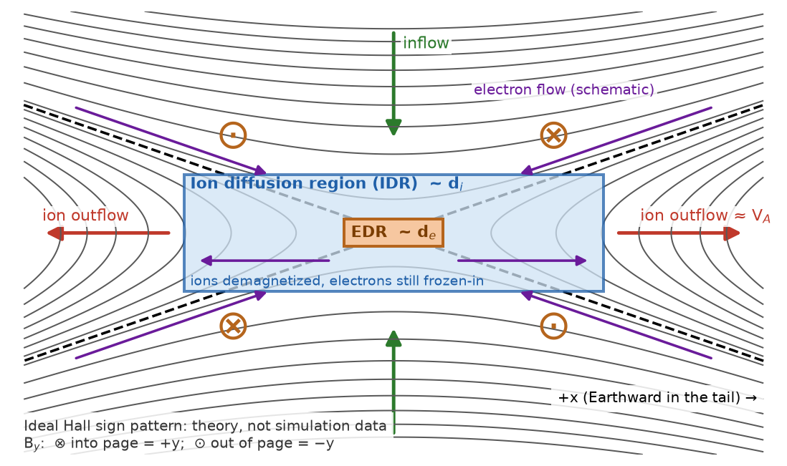

**🔰 新手读图**
1. **这张图在回答什么问题：** 中科大课题组教科书式的“磁场重联标准图像”长什么样？
2. **先认坐标和颜色：** 这是示意图，不是数据。灰线是磁力线，横向为出流方向（在磁尾就是 x，右侧朝地球），竖向为入流方向。黑虚线是分界线（separatrix），把“已重联”和“未重联”的磁力线分开。
3. **按顺序看这几处：** ① 绿色箭头：上下两侧等离子体被吸入；② 红色箭头：左右两侧被弹射而出；③ 蓝框（离子扩散区）里套着橙框（电子扩散区）；④ 紫色箭头是电子流，⊙⊗ 是由它产生的出平面霍尔磁场。
4. **看到了什么，说明什么：** 标准理论有两层嵌套：外层离子脱耦，内层电子也脱耦。这是理论预期，不是本模拟已测到两层；典型快速重联率约 0.1 也不是由这张图直接测得。
5. **新手容易误读：** ⊙/⊗ 的四个象限是“出平面磁场的正负”，不是粒子在转圈；示意图的比例（框的大小）也不按真实尺度。

**问题与读法。** 本图综合 Lu et al. (2022) 与 GEM 挑战的标准图像：嵌套的 IDR/EDR、沿分界线入流和沿中心面外流的电子、由此形成的平面内霍尔电流环和四极 By。y 轴指向纸内，⊗ 表示 By>0。

**图中证据。** 示意图本身不是证据。它规定了下面检验所用的符号约定：在磁尾，地向北、尾向南两个象限 By>0，另两个象限 By<0。

**物理联系。** 霍尔项把离子与电子的运动分开，使得外区可以用离子尺度控制重联速率；这是快速重联几乎与电子尺度耗散无关的原因。

**限制与结论。** 真实扩散区可能是湍动、多 X 线的（MMS 观测）；示意图是起点模型。混合模拟只可能检验其中离子尺度的部分。

### F47 · 霍尔磁场：单帧、条件平均与实际象限均值

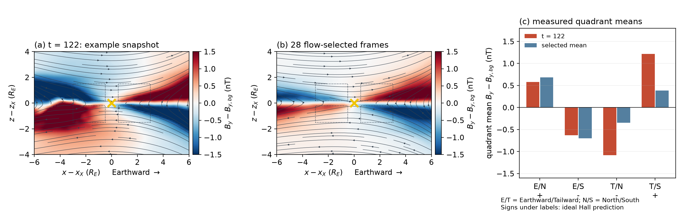

**🔰 新手读图**
1. **这张图在回答什么问题：** 不把预言符号贴在数据上，真实颜色能否显示四极结构？
2. **先认坐标和颜色：** 横轴为 x−xₓ、右为地向；纵轴为 z−zₓ、上为北。(a) 是 t≈122 单帧，(b) 是 28 帧条件平均。两图均为 By 减去局地背景，共用 ±1.5 nT 色标，红正蓝负、白为零。黑线是投影磁场线，黄叉为候选 X 线。
3. **按顺序看这几处：** 围绕叉号，先读右上红、右下蓝、左上蓝、左下红，再看 (c) 的实测柱子是否依次为 +、−、−、+。虚框是实际计算象限均值的窗口。
4. **看到了什么，说明什么：** 单帧与条件平均都具有预期符号，条件平均尾向一对较弱。支持双向喷流条件下的局地霍尔图样，不等于每时每处都有完整四极。
5. **新手容易误读：** (b) 的平均不是单帧，且只用了条件样本。不能把 21/28 的比例冒充全部 90 帧的比例；也不能把图例下方的理论符号当作测量。

**方法与定位。** 候选和独立喷流筛选同 F34；28 帧入选条件不使用 By。对每帧减去 |Δx|<5、|Δz|<3 Rₑ 窗口的统一 By 中位数，并在 x、z 两方向把候选平移到原点，重采样到 Δx=±6、Δz=±4 Rₑ 窗口。四个象限取 0.5<|Δx|<3、0.2<|Δz|<1.5 Rₑ。图(a) t=122.018，候选 x=−26.27、z=0.05 Rₑ；双向峰值 +559/−523 km/s，由与 By 无关的片层流场确认。

**图中证据。** 按地向北、地向南、尾向北、尾向南排序，单帧均值为 +0.58、−0.63、−1.09、+1.22 nT；条件样本平均为 +0.68、−0.70、−0.35、+0.39 nT。平均四极投影 (EN−ES−TN+TS)/4≈0.53 nT；它不是单帧峰值或误差估计。两个面板用同一色标，不靠改变颜色范围制造“更明显”的对比。

**简单幅度检查。** 四象限不仅符号正确、还各自超过 0.1 nT 时，条件样本为 19/28，全部为 25/90；门槛改为 0.2 nT 时分别为 15/28 与 19/90。因此只按符号计数会包括较弱的样本，75% 不能解释成“强四极事件”的比例。t≈122 窗口统一背景约 +0.01 nT，不扣背景仍保留四符号；这只是单帧检查，不代替全样本背景敏感性试验。

**物理联系。** 符号与经典近反平行、离子耦合霍尔图像一致。旧版把不同喷流状态都平均且只对齐 x，难以读出完整四极；新方法还改变了候选定位、窗口和背景定义，不能把新旧百分比理解为同口径的“显著提升”。

**限制与结论。** 全部 90 帧有 27 帧四符号同时符合；28 帧条件样本中为 21 帧。支持局地条件性的霍尔特征，不证明电子扩散区、三维连通拓扑或完整能量转换。未完成网格收敛、窗口、背景和阈值的全面敏感性试验；减一个统一常量不等于任意背景选择下都稳健。

### F48 · 全时段象限曲线与独立流场筛选

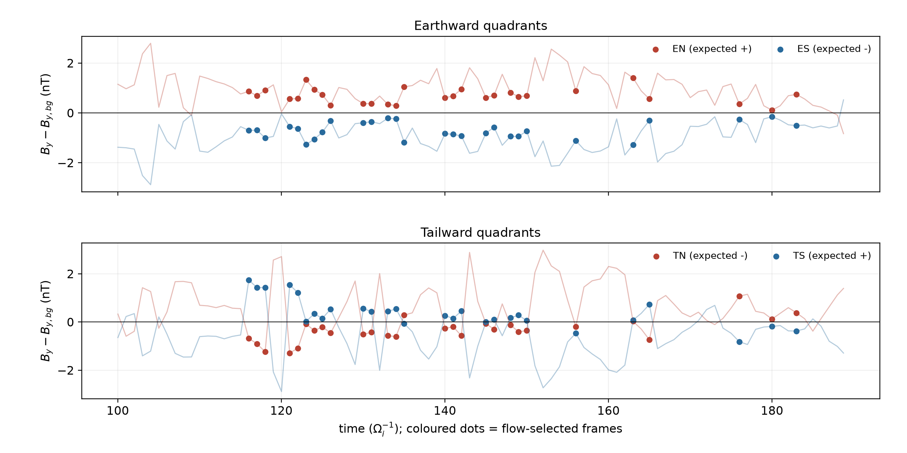

**🔰 新手读图**
1. **这张图在回答什么问题：** 清晰单帧是否代表全部时刻？条件样本在时间上如何分布？
2. **先认坐标和颜色：** 横轴是时间；纵轴是统一背景扣除后的象限 By。上图是地向南北两象限，下图是尾向南北两象限。淡线包含全部候选，实心点只标记按流场独立选中的 28 帧。
3. **按顺序看这几处：** 先看淡线不能始终维持四符号，再看实心点。地向北与尾向南应为正，另外两条应为负；时间相近的连续点不是独立事件。
4. **看到了什么，说明什么：** 四符号同时相符：全部 27/90=30%；条件样本 21/28=75%；未入选样本 6/62≈9.7%。图样依赖局地喷流状态，不能用一张平均图代替全时段。
5. **新手容易误读：** 这不是“75% 的整个磁尾发生霍尔效应”，更不是显著性检验。单侧流、多 X 线、三维变化和背景定义均可影响诊断；未入选不等于没有重联。

**方法。** 逐帧对 F47 的同一窗口计算四象限均值，保存结果于 output/cache/recon_redo.pkl；汇总于 output/recon_redo.json。图由 recon_slide_figures.py hall_timeseries 生成，未按 By 好看与否重新选取条件样本。

**证据与局限。** 条件样本符号一致性更高是本批数据的描述性关联，不能直接归因于唯一机制。300 km/s 与候选数≤2 是操作定义，缺少阈值扫描；相邻帧相关，未报告独立事件显著性。后续需要三维分量、真正上游取样和逐事件追踪，才能增强物理解释。

## 9. 跨图综合、公式与稳健性

### 9.1 日侧的时间窗口与相关性

以下±均为帧间标准差，不是位置精度或均值误差；所有窗口共用终点τ=188.736，互相重叠。

| 起点τ | 帧数 | MP均值±σ (Rₑ) | BS均值±σ (Rₑ) | 平均厚度 (Rₑ) |
|---|---|---|---|---|
| 80 | 219 | 11.647 ± 0.207 | 14.199 ± 0.136 | 2.552 |
| 100 | 179 | 11.633 ± 0.220 | 14.196 ± 0.146 | 2.563 |
| 120 | 139 | 11.650 ± 0.244 | 14.166 ± 0.145 | 2.517 |
| 140 | 99 | 11.508 ± 0.061 | 14.095 ± 0.074 | 2.587 |

以τ≥100为主窗，对相邻帧做循环移动分块bootstrap、4000次、固定种子20261105，均值的条件性95%区间为：

| 块长（帧） | 块时长τ | MP均值区间 (Rₑ) | BS均值区间 (Rₑ) |
|---|---|---|---|
| 5 | 2.5 | [11.565, 11.705] | [14.154, 14.240] |
| 10 | 5 | [11.544, 11.740] | [14.140, 14.257] |
| 20 | 10 | [11.518, 11.774] | [14.120, 14.279] |

块长越长区间越宽，说明时间相关不可忽略。这里未按相关时间优化块长，且存在慢漂移；区间只描述固定算法下的有限样本变化，不包含边界定义、原始网格和模型系统误差。

### 9.2 腔体尺度与磁鞘厚度：公式不能混用

Chapman–Ferraro量级模型采用

$$
\frac{(fB_0)^2}{2\mu_0}\left(\frac{R_E}{r}\right)^6
=k\rho_{\rm sw}V_{\rm sw}^2,\qquad
r_{\rm CF}=R_E\left(\frac{f^2B_0^2}{2\mu_0 k\rho_{\rm sw}V_{\rm sw}^2}\right)^{1/6}.
$$

原数值取k=0.881。rCF≈11.50 Rₑ（f=2）和12.29 Rₑ（f=2.44）是该假设下的结果。B₀,eff并非独立设定值：它来自模拟总Bz在晨昏线r=5、6、7 Rₑ的反推，六个样本约3.83–4.30万nT；“有效偶极”和原始偶极参数应分开。

对Shue形状函数与鼻区曲率，

$$
r(\theta)=r_0\left(\frac{2}{1+\cos\theta}\right)^\alpha,\qquad
R_c=\frac{r_0}{1-\alpha/2}.
$$

磁鞘厚度Δ=RBS−RMP。Spreiter形式以RMP归一化，曲率形式以Rc归一化：

$$
\begin{aligned}
\frac{\Delta}{R_{\rm MP}}&=1.1\frac{(\gamma-1)M^2+2}{(\gamma+1)M^2},\\
\frac{\Delta}{R_c}&\simeq0.81\frac{(\gamma-1)M^2+2}{(\gamma+1)(M^2-1)}.
\end{aligned}
$$

| 比较对象 | 模拟 | 代入Mms≈8.03的模型 |
|---|---|---|
| Δ/RMP | 0.220（时序均值）或0.235（平均场拟合） | 0.288 |
| Δ/Rc | 0.177 | 0.215（系数0.81）；0.213（系数0.80） |

两种模型下均偏薄约两成，但不是唯一原因的诊断。原repro.json中farris_russell使用系数1.1，不能拿约0.29直接与Δ/Rc比较。曲率归一化的重要性见[Farris & Russell (1994)](https://ntrs.nasa.gov/citations/19950057095)，0.81形式见[Gopalswamy & Yashiro (2011), 式(4)](https://doi.org/10.1088/2041-8205/736/1/l5)。

压缩比3.85相对3.77仅高约2%，不足以独自解释约20%的厚度偏差；如果只令MP向内侵蚀而BS固定，厚度反会增加。重联、曲率与边界方法的作用必须分别检验。

### 9.3 应检验的法向动量通量

$$
\Pi_{nn}=\rho U_n^2+P_{i,nn}+P_{e,nn}
+\frac{B^2}{2\mu_0}-\frac{B_n^2}{\mu_0},
$$

$$
P_{i,nn}=p_{i\perp}+(p_{i\parallel}-p_{i\perp})(\hat{\mathbf b}\cdot\hat{\mathbf n})^2.
$$

本次对179帧的|y|<0.3 Rₑ条带逐帧计算，最后平均，使用n=x、陀螺对称离子压力：

| 区域 | 标量代理 (nPa) | 离子+磁场法向通量 (nPa) |
|---|---|---|
| 上游17<x<21 Rₑ | 1.313 | 1.313 |
| 磁鞘所选窗口 | 1.160 | 1.251 |
| MP内侧所选窗口 | 1.423 | 1.435 |

这里不能把缺失的电子压力设成已知零；也未扣边界速度、检查局地法向或多维散度。所以“更接近”是本次实算结果，“守恒闭合”尚未完成。R–H质量通量比也必须在激波静止系重新检验。

### 9.4 KHI与各向异性判据

在不可压缩切向间断近似下、取波矢方向平行速度差，剪切驱动与张力比较为

$$
\frac{\rho_1\rho_2}{\rho_1+\rho_2}|\Delta\mathbf U|^2>
\frac{(\hat{\mathbf k}\cdot\mathbf B_1)^2+
(\hat{\mathbf k}\cdot\mathbf B_2)^2}{\mu_0}.
$$

该式检验自由能，不给有限厚边界的真实增长率。标量std(N)又含边界扫过，不能直接当成模态振幅。F20显示平均驱动充足，但部分位置总场张力上界超过驱动，末端代理突变也需排查。

各向异性阈值采用

$$
A\equiv\frac{T_\perp}{T_\parallel}
=1+\frac{a}{(\beta_\parallel-\beta_0)^b}.
$$

| 线性模态 | a | b | β₀ |
|---|---|---|---|
| 质子回旋 | 0.43 | 0.42 | −0.0004 |
| 磁镜 | 0.77 | 0.76 | −0.016 |
| 平行火管 | −0.47 | 0.53 | 0.59 |
| 斜火管 | −1.4 | 1.0 | −0.11 |

它们对应指定分布函数和增长率。大量样本同时越过磁镜与质子回旋线时，无法由越线比例决定哪个模态主导。原图黑线另混用了β⊥与β∥；若取简单流体条件(A−1)β⊥=1，正确换元为A=[1+√(1+4/β∥)]/2，并非1+1/β∥。

### 9.5 重联归一化与全球磁通

非对称重联估算采用反向场幅值B1、B2：

$$
\begin{aligned}
V_{\rm out}^2&=\frac{B_1B_2}{\mu_0}
\frac{B_1+B_2}{\rho_1B_2+\rho_2B_1},\\
E_{\rm CS}&\simeq0.1\,\frac{2B_1B_2}{B_1+B_2}V_{\rm out}.
\end{aligned}
$$

代入原磁鞘/磁层参数，Vout≈253 km/s、ECS≈0.87 mV/m。因子2是必要的，原脚本已包含；0.1是采用的归一化率尺度，不是仅由上游守恒推出的精确系数。日侧原测量缓存的生成方法仍未重建，不能将0.478/0.87当作已验证效率。

全球循环需检验

$$
\frac{d\Phi_{\rm open}}{dt}
=\mathcal V_{\rm day}-\mathcal V_{\rm night},
$$

其中V为重联电压（V），不是单点Ey（V/m）。旧尾部约0.03与旧日侧电场比约0.27使用不同归一化，且本版已撤回其作为整体快慢和全球效率的判决；新版 F34 只展示明确取样的局地电场与条件样本。

### 9.6 将候选机制推进为识别的优先顺序

| 问题 | 已有证据 | 最有区分力的下一步 |
|---|---|---|
| KHI | 剪切、波状边界、涡度 | 边界随动坐标追踪波峰，估相速、波长与增长；改变平滑长度 |
| 磁镜/离子回旋 | 各向异性及越阈 | 随流频率、传播角、极化、密度与场强波动关系和严格掩膜 |
| FTE | 局部小闭环、少数Bn候选 | 逐帧局地LMN、核心场/总压、结构经过探针的追踪与三维连接 |
| DF | 跃升与高速流 | 跨探针事件配对去重，分早晚窗口，报告密度变化的失稳健性 |
| 流制动 | 近地速度占比下降 | 同一流团追踪及动量项，分开偏转、几何和真实加减速 |
| 能量转换 | 局地J·E′ | 同时比较J·E与Ui·(J×B)，再补压力—应变及边界通量 |

以上是仍待完成的工作，不计入本版已验证结果。现有数据的主要科学价值是：展示太阳风驱动下不同磁层区域如何分工，以及哪些局地结构值得进一步追踪。

## 10. 来源、复算与交付边界

### 10.1 图件和数字的本地来源

| 文件 | 用途与范围 |
|---|---|
| analysis.py、snapshots.py、probes.py | 原时空图、快照、平均量和探针谱 |
| repro_cache.py、reproduce.py | 平均场、探针缓存及模型对照图；保留原始算法便于追溯 |
| diagnostics.json、repro.json、probes.json | 原图相关数值；其中存在本文已指出的方法口径差异 |
| recon.json | 原日侧电场等缓存；生成脚本在本目录未找到，来源复现仍不完整 |
| figure_diagnostics.py与figure_diagnostics.json | 本次25个切面时刻、179帧BS门槛/法向动量、DF窗口及FTE门槛复算 |
| audit_report.py与report_audit.json | 第三版窗口、分块区间与高速流阈值检验，本版继续使用 |
| figure_diagnostics_profiles.npz | 法向动量与标量代理的平均剖面 |
| figure_studies.md | 全部45图的独立可编辑研究文本 |

本版未重新运行模拟、未补造粒子分布或三维磁连接。除九张教材对照拼图的排版修复外，原定量图未重算重画；已知图内方法简写、范围截断和历史标题均在邻近正文说明。教材拼图上方的原图注已逐张目视核对；未对全书所有节号或全部旧参考文献逐条校勘。

### 10.2 本次实际核对的外部文献

- [Shue et al. (1998), Magnetopause Location Under Extreme Solar Wind Conditions](https://faculty.epss.ucla.edu/~ctrussell/russell_bib.html/papers/mpause_extreme/)：作者机构全文页；核对轴对称经验模型和参数依赖。
- [Hellinger et al. (2006), Solar wind proton temperature anisotropy](https://space.asu.cas.cz/~helinger/hellal06.pdf)：作者机构原文；核对β定义、分布假设、增长率和阈值系数。
- [Miura & Pritchett (1982), Nonlocal stability analysis of the MHD Kelvin–Helmholtz instability](https://agupubs.onlinelibrary.wiley.com/doi/abs/10.1029/JA087iA09p07431)：期刊摘要；核对有限厚度、可压缩性和波矢条件，未取得正文全部数值解。
- [Leroy et al. (1982), The structure of perpendicular bow shocks](https://agupubs.onlinelibrary.wiley.com/doi/abs/10.1029/JA087iA07p05081)：期刊摘要及原文检索片段；核对反射离子和过冲的参数依赖，未作逐图重算。
- [Runov et al. (2009), THEMIS observations of an earthward-propagating dipolarization front](https://agupubs.onlinelibrary.wiley.com/doi/full/10.1029/2009GL038980)：期刊全文；核对多探针传播和局地锋面证据。
- [Russell & Elphic (1978), Initial ISEE magnetometer results—Magnetopause observations](https://ntrs.nasa.gov/citations/19790045569)：NASA原研究摘要记录；正文未完整取得。
- [Cassak, Liu & Shay (2017), A Review of the 0.1 Reconnection Rate Problem](https://arxiv.org/pdf/1708.03449)：作者公开全文；核对率的归一化及其适用边界。
- [Zenitani et al. (2011), New Measure of the Dissipation Region in Collisionless Magnetic Reconnection](https://arxiv.org/pdf/1104.3846)：作者公开全文；核对参考系能量指标。
- [Pezzi et al. (2021), Dissipation measures in weakly-collisional plasmas](https://arxiv.org/abs/2101.00722)：作者摘要；用于区分能量与分布函数代理，全文PDF体积超过本次网页读取上限。
- [Farris & Russell (1994), Determining the standoff distance of the bow shock](https://ntrs.nasa.gov/citations/19950057095)：NASA摘要及书目信息；核对曲率归一化的重要性。
- [Cassak & Shay (2007), Scaling of asymmetric magnetic reconnection](https://doi.org/10.1063/1.2795630)：原报告理论来源；本轮作者PDF访问失败，公式按本地实现与对称极限复算，未声称重新完整阅读全文。
- [Lu, Fu, Wang & Lu (2022), Collisionless magnetic reconnection in the magnetosphere, Chin. Phys. B 31, 089401](https://doi.org/10.1088/1674-1056/ac76ab)：中国科大课题组综述；本报告“磁场重联”术语与双尺度扩散区图像的依据。
- [Birn et al. (2001), Geospace Environmental Modeling (GEM) Magnetic Reconnection Challenge, JGR 106, 3715](https://doi.org/10.1029/1999JA900449)：含霍尔项的模型重联率约0.1、与耗散机制几乎无关。
- [Øieroset et al. (2001), In situ detection of collisionless reconnection in the Earth's magnetotail, Nature 412, 414](https://doi.org/10.1038/35086520)：磁尾四极霍尔场的首次就地观测；F47符号约定的观测依据。
- [Eastwood et al. (2010), Average properties of the magnetic reconnection ion diffusion region in the Earth's magnetotail, JGR 115, A08215](https://doi.org/10.1029/2009JA014962)：Cluster统计的离子扩散区霍尔场幅度。
- Kivelson & Russell主编《太空物理学导论》：本地九张拼图中的原图及图注，支持F37–F45逐图比较。

### 10.3 阅读与验证

本版以report.html及web/index.html作为同源离线阅读版，report.md为编辑源。HTML公式在生成时预渲染，图像保持原像素并可放大；无需联网加载数学脚本、字体或静态图片。动画以本地视频入口提供，需同目录视频文件；PPT和旧讲稿保留但未同步。显示检查、文件覆盖清单及复核结果记录在report_v4_validation.json和report_v4_review.md。
